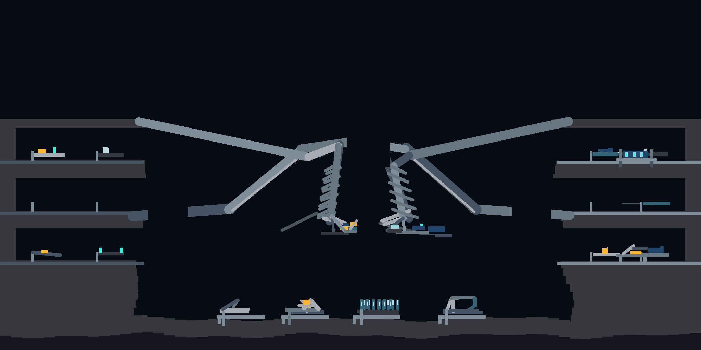
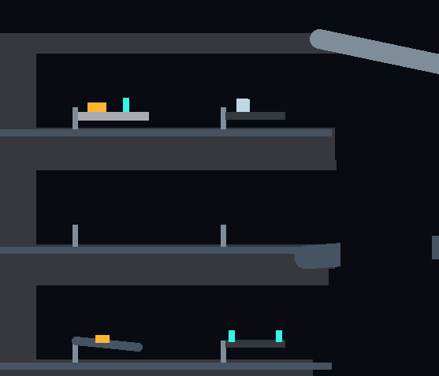
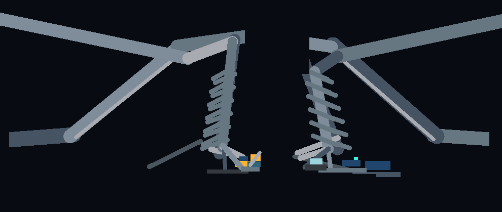
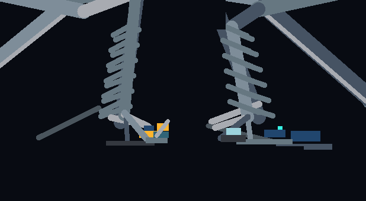
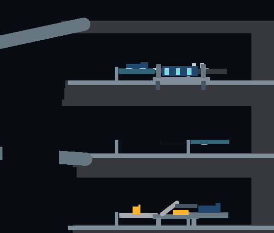
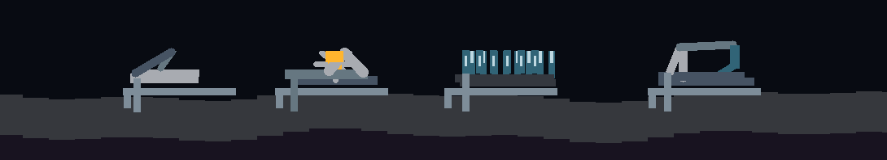

# Rime Accord — Xenolith Jaw Excavator (R3)

**Entirely original 2048×1024 true perpendicular 2D material-cell world.**
**OPEN DRAFT/HOLD · R3 CREATOR SOURCE-STATIC PASS · independent exact-R3 Art/Tech/Shepherd review required · NATIVE-UNTESTED.**

This branch owns the original world alone. R3 repairs the independently reported residual Art P1
on the R2 committed final material plane: the two massive boundary-anchored jaw spars now have
a visibly gripped xenolith carried by a compact, physically supported **jaw-tip pickup → sample
cradle → separate outfeed/receiver**. West and east retained machine apertures remain open,
including a deliberately greater-than-Midge-width central natural air gap. On the eastern side,
an entered quarantine room has its own three-capillary shielded assay enclosure, and the
neighbouring freight floor has an independently legible loading fork and cargo receiver.
All additions are **material cells**, not captions or illustrations. Previous sections, scale,
named site positions and overflight/underpass routes remain unchanged.

## Reproducible exact-HEAD facts

| Physical or route invariant | R3 |
|---|---|
| Final material-ID plane | `2097152` cells (2048×1024) |
| Deterministic fixed seed | `0xC1A26E` |
| Occupied inert grounded material | `569547/569547`; no detached final solids |
| Final rectangular edits | `3401` canonical, ordered, disjoint rectangles |
| Accepted source limits | 32,768 rectangles, 1 MiB Setup, 32M work cells |
| Setup-v2 JSON | `64193` bytes, 14 top-level fields |
| Grid SHA-256 | `de43614395c07ac2207c89fb5e12d88aaba7d199815e4123c255d71fbce1520c` |
| Setup SHA-256 | `f9ca1bb4b8368d6108971a492e3a13ddca1758e45c99dcabc5df5adb4fce73da` |
| Midge actual actor spawn | `[164,414]` |
| Exact named sites (19×15, 23×19, 31×27) | 32/32; 32/32; 32/32 |
| Temporary obstacle | `[1021,539,1079,589]` blocks only custody; 31/31 others reachable |
| Material state | accepted native inert Solid / RuleKernel::None IDs; no fluids/reactants |
| 1:1 authentic art | 2048×1024 full indexed PNG + five exact-cell crops |
| Source engine read-only | `7b03aa437561ec63e31fd09531171360ab60eeb4` |
| Main map repo base | `99a166e7fcae45eb22be1740e9f33f62faccbcc7` |

Named site graph: west arrivals → occupied pilot's exchange → fabrication → left jaw monitor →
jaw custody/outfeed → east quarantine / freight. Alternative: west shaft → open dry deep
mechanical bays → eastern shaft → cargo, with overflight through roof/void.

The entire JSON rectangle list is lossless and non-overlapping against exactly 2,097,152 original
material cells; the builder's dynamic flood consumes complete hull footprints on every 4-neighbour
step without moving any target. Its real solid obstruction demonstrates continuity of alternate
routes instead of using radius exemptions or nearest-site substitutions.

| Western inhabited workshops | Rooted two-jaw extractor | Custody transfer |
|---|---|---|
|  |  |  |

| Quarantine/export machinery | Lower geological service |
|---|---|
|  |  |

Run `node build.cjs --verify` from this folder to regenerate and compare source JSON, receipt
and PNGs byte-for-byte with the committed originals. Five unscaled crop rectangles, histograms,
exact sites and post-prune functional survival checks are recorded in `receipt.json`.

**Installed bridge:** this requires 3401 rectangles (now below a hypothetical legacy
4096 limit), but source capacity is not evidence of actual installed bridge compatibility.
**NATIVE-UNTESTED**: Godot/Workbench/CyberDemoBridge/Rapier load, actual Midge steering and collisions,
simulation advancement, and fresh-process persistence remain outside this source-only run.
Independent exact-R3 Art/Tech/Shepherd reviews are required. No Ready/merge/owner acceptance.
