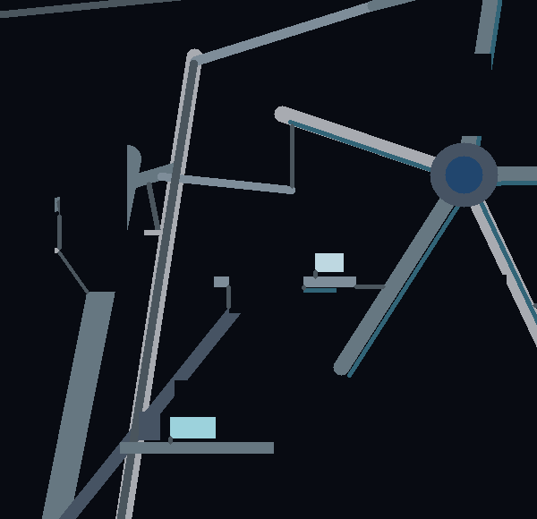

# Sable Quoin — Gravitic Core Survey and Fracture Bridge

**ORIGINAL / NO REFERENCE ART · 2048×1024 actual material cells · CREATOR STATIC PASS · OPEN Draft/HOLD · NATIVE-UNTESTED**

## Site and authorship

An inhabited offworld geodesy station occupies two fractured basalt escarpments enclosing a huge clear flight basin. The five-arm asymmetric gravimetric collimator is suspended by a visible upper tension path rooted in the western bedrock and by uneven structural struts; its core is physically entered and inspected rather than a decorative circle. The western rover/assay settlement, core comparison works, eastern sterile/quarantine service port and deep four-bay dry understrata form differentiated functional districts.

The following material-cell assemblies are original to this map, not stamps copied from any other canvas: five unequal collimator ribs, offset counterweight wing, two uneven embedded rover tiers, two nonidentical side-entry gantries, east sterilization/scrubbing chain and four distinct understrata apparatus bays (crane-fed mineral comparator, ram seismic press, four-cassette isotope sorter, finned thermal exchanger).

**Player goal:** arrive at western rover port; survey the collimator via both comparator stations; secure eastern sterilization and freight operations; return through the accessible dry understrata or overhead route.

**Route graph:** West rover arrivals → West isotope dock → West assay lab / machine bay → West gantry overlook → West comparator → Core diagnostic viewport / lower cathode → East comparator → East decon → Sterile isotope lab → East rover evacuation. Parallel loops: Western ridge → upper sky bypass → Eastern ridge; western rescue throat → four physically entered understrata stations → eastern rescue throat. Local basin recovery sites provide staging after collision or missed approach.

## Exactly reproducible material source

Run `node build.cjs` within this folder to reproduce the committed `setup.json`, `receipt.json` and every PNG. `node build.cjs --verify` checks byte-for-byte identity, SHA-256 using independent Node crypto, independent Node zlib PNG decompression, CRC-32, image dimensions and every material-index pixel against regenerated cells. Deterministic seed **2535951**. No external images, learned textures, screenshots or native execution are involved.

- Accepted CyberSand read-only main: `de109d0131641d6adc8d25bb9ced7ca3d4991105`.
- Map repository default main at branch creation: `99a166e7fcae45eb22be1740e9f33f62faccbcc7`.
- Source final material-grid SHA-256: `593b93d0215e911f0dee4d5596d417eba54c8524ce3ea3b021417eff61a0d9e2`.
- Source Setup-v2 SHA-256: `a81aeccbc74649caed2d625c140d190898a1f7d77d0810096f52d527e789045c`.
- Dimensions: **2048×1024 = 2,097,152 indexed material cells**.
- Canonical lossless ordered disjoint edits: **5101**, Setup JSON **94864 bytes**, rectangle work **425394**.
- Solids: **425394/425394 rooted**, **0 detached**, **1** final solid connected component(s).
- All nonzero material IDs from accepted static inert solid/None catalogue; no unstable powder, mobile fluid, reactive support or free liquid.
- Exact named checkpoints: **28/28** connected at all **19×15, 23×19, 31×27** collision envelopes with unshifted literal coordinates and complete in-bounds 4-neighbour free-centre BFS.
- Literal physical obstruction **[1016,329,1074,416]** blocks **Core diagnostic viewport** and still permits 27/27 other destinations at conservative 31×27.
- Source claims rectangle budget 32,768 / JSON cap 1,048,576 bytes / work 32,000,000; installed legacy CyberDemoBridge may permit only ~4,096 rectangles. **These 5101 rectangles require installed-capability revalidation.** Do not weaken design to meet unverified legacy capacity.
- **NATIVE-UNTESTED:** no actual installed Godot/Workbench/CyberDemoBridge/Rapier actor play, collision, advancement, save/reopen or persistence was performed.

## Authentic images (indexed material IDs, no AI artwork)

| Genuine 1:1 physical district crop | Image |
|---|---|
| Western isotope rover port, inhabited workshops |  |
| West upper structural tension and comparator support |  |
| Five-arm survey collimator and active comparative workfaces |  |
| Eastern quarantine, sterile assay and freight handling |  |
| All four individual understrata laboratories/service bays |  |

All images are palette-indexed PNGs in which the pixel index equals the actual material ID from the committed setup; 1:1 district crops have no scaling. Image audit metadata and hashes are in `receipt.json`.

## Reviewer checkpoints and HOLD

Independently replay committed Setup edits across all cells, check material state/kernels and support, canonical rectangles/histograms, exact centres and obstruction, each PNG's pixel parity, life-scale interior widths and distinct functional machinery, and provenance. Request separate source-pinned Art/Technical/Shepherd decisions. Source-static success is **not** native-engine acceptance. Remain **Draft/HOLD**, no Ready, merge or owner acceptance.
