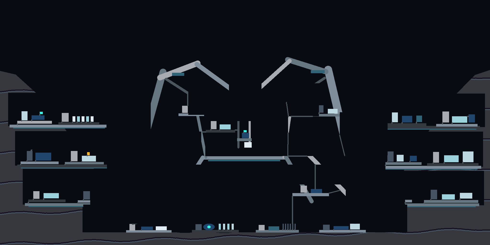
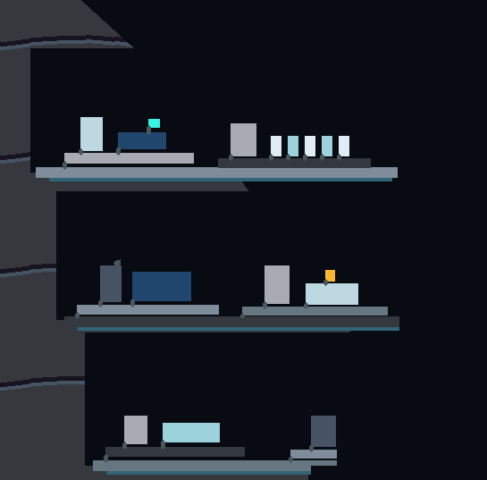
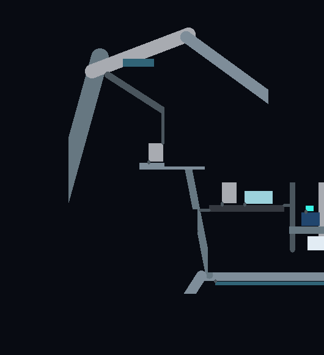
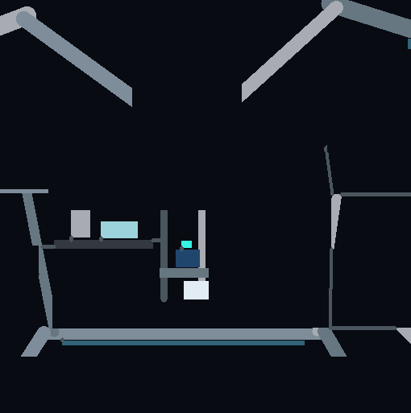
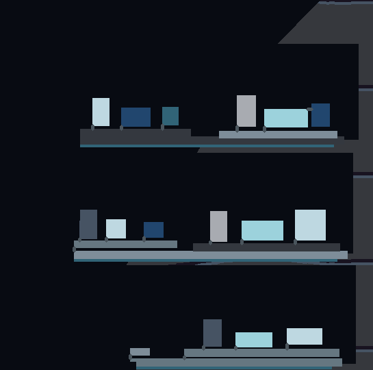
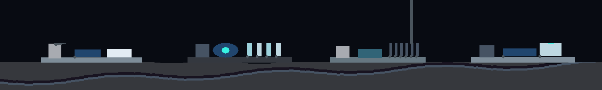

# Threnody Scar — Foldwing Xenoseed Lift

**Entirely new original / no source art · 2048×1024 physical material cells · author static PASS · Draft/HOLD · NATIVE-UNTESTED**

## Setting and Midge gameplay

An inhabited xenobotany settlement is cut in half by a frontier rift. A colossal unequal **foldwing stabilisation canopy**, rooted into opposite basalt flanks, shelters an entered xenoseed lift. Functional districts include the West Rover Nursery (capsule receiving, seed sorting), West Assay & Refuge (cold centrifuges, microscopy and emergency dispatch), Central Foldwing Xenoseed Lift (two distinct specimen workfaces, vertical guide rails and diagnostic cages), East Quarantine and Freight Quay (sterilisation, biocargo inspection and outward transport), and a complete four-bay dry Understrata Return (mineral assay, membrane rotor, thermal fins and rover mechanical service).

The intentional silhouette is a broad central V-shaped break with unequal folded wing profiles, very large playable overflight, external flight past machinery, a sheltered lower basin and a truly entered subterranean alternative. Doors/rooms/equipment remain human-scale at 1:1, not isometric or scenic platforms.

**Player objective:** spawn at West rover intake `[171,443]`, inspect the west and east foldwing observation stations, descend into the xenoseed lift, secure east isolation/freight, then loop through the dry geological gallery or overhead recovery. Named route graph has 29 literal centres. Primary: western nursery → west foldwing observation → lift upper arrival → lift junction → lift lower transfer → east quarantine → rover garage. Alternative: west escarpment → overflight bypass → east wing observation → east sterile intake. Rescue: west rescue shaft → deep assay → deep membrane → deep exchanger → deep rover repair → east rescue shaft. Every named destination is checked with full exact unshifted Midge 19×15, 23×19 and 31×27 clearances; physical obstruction `[1002,431,1059,484]` blocks only the literal Lift junction and 28/28 other destinations remain reachable.

## Reproducible source and physical laws

- `node build.cjs` regenerates `setup.json`, `receipt.json` and **all six authentic material-index PNGs** from seed `0x3E717A`. `node build.cjs --verify` independently checks regeneration against stored files, SHA-256 against Node crypto, each PNG chunk CRC, zlib inflation and exact material-index every-pixel parity using Node's zlib.
- Accepted CyberSand read-only `main@de109d0131641d6adc8d25bb9ced7ca3d4991105`; original reference-map default `main@99a166e7fcae45eb22be1740e9f33f62faccbcc7`.
- Final **2,097,152** material cells; plane SHA-256 `d0f52f9fb46fad8ec71ceaca44f0ca5c8c08c815aa1829a288a69cf758c8f20c`. **3252** disjoint lossless ordered rectangle edits. Work 409565 cells, Setup-v2 JSON 61640 bytes. Rectangle replay exactly equals final grid without overlaps, exceeding neither 32,768-edit source cap, 32-million cell-visit source cap nor 1 MiB Setup limit.
- Accepted immobile inert nonzero IDs only. **409565/409565 occupied cells rooted**, zero detached/uncontained fluid/falling/chemical foundations. The builder removes 8279 disconnected ornamental cells *before* final encoding, verifying that they are absent from both Setup and source-derived PNGs. All final remaining real material cells are boundary-grounded.
- Accepted 14-root-key Setup-v2 and exactly five-key `id,model,hash,spawn,options` Midge actor; actor at actual exact literal West rover intake `[171,443]`. Full exact-target four-way BFS **29/29 / 29/29 / 29/29** at three collision envelopes. Genuine physical obstruction **28/29** with only intentional Lift junction lost.
- **Installed bridge hazard:** source supports 32,768, but older locally installed CyberDemoBridge can report only 4,096 rectangles; 3252 rectangles fit the fallback, without proving installed compatibility. Godot/Workbench/Rapier Midge gameplay, dynamic collisions, time-advance and fresh-process save/reopen are **NATIVE-UNTESTED** (no compatible binary available).

## Authentic 1:1 indexed material PNG gallery

These are not generated illustrations or simulated screenshots: PNG palette index equals true final stored material ID for each genuine cell, with no crop upscaling. Hash, crop bounds, palette and material histogram are recorded in the machine receipt.

## Independent qualification / safety gate

Separate independent Art/Technical/Shepherd exact-HEAD audits, installed bridge-admission capacity, physical Midge handling and cold persistence remain required. Recheck actual committed files, genuine apparatus functionality, hull routes, materials kernels and art scale before any promotion. **Draft/HOLD only. No Ready, merge, auto-merge or owner acceptance claimed.**
