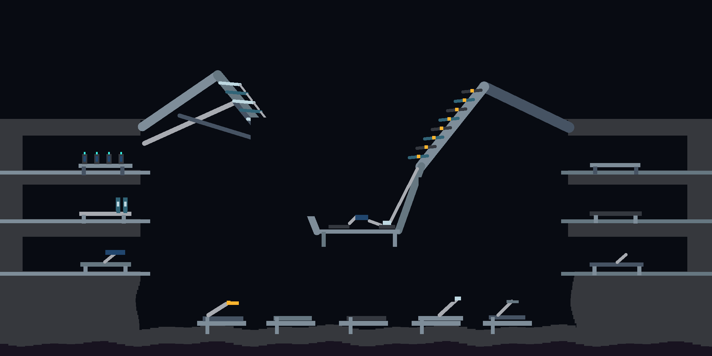
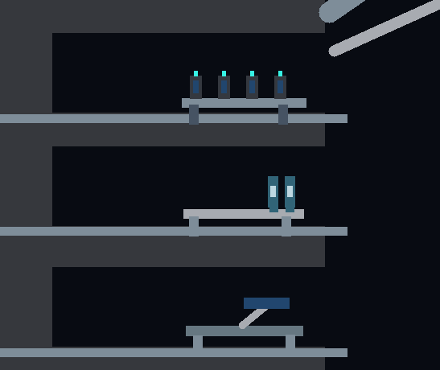
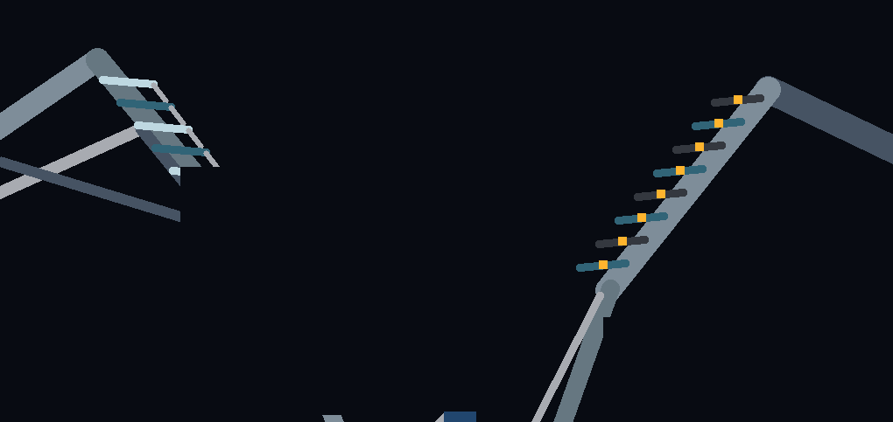
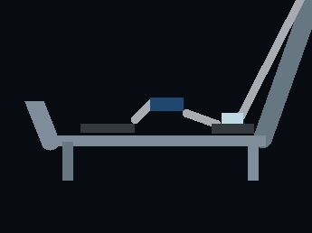
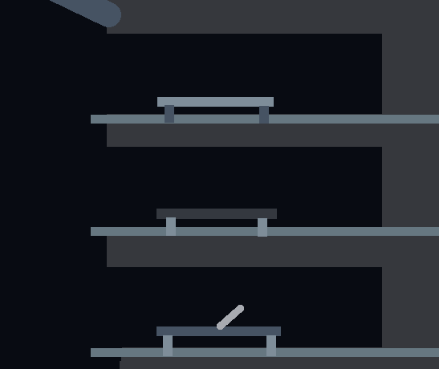
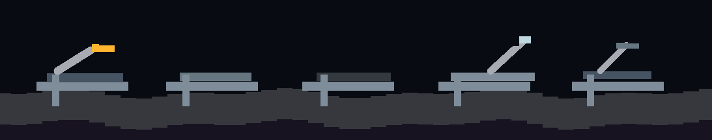

# Vela Rift — Crosswind Biosieve Research Yard

**ORIGINAL SCI-FI FRONTIER — 2048×1024 ACTUAL MATERIAL CELLS**
**DRAFT / HOLD · Creator static qualified · Independent Art/Tech/Shepherd PENDING · NATIVE-UNTESTED**

Original orthographic 2D exoplanet research outpost. Two differently engineered wind-sieve vanes are
attached to basalt shoulders above a large, deliberately flyable central canyon. An entered sample
custody basket rests below the sieves; west seed-cultivation and sample-assay decks, east containment,
scanning and cargo stations, plus five different underground recovery machines give the canyon
working reasons to exist. No photographs, borrowed composition, isometric geometry or scenic fake floors.

## Authored functional areas and route graph

1. **West nursery/rover dock**: spawn [151,435], cultivation [390,435], wet-lab analogue [153,576],
   sample classifier [390,580], rover repair [152,729] and crew shelter [388,732].
2. **Left crosswind biosieve**: service throat [496,707], low vane viewport [830,527],
   upper survey [625,157], lower rescue [784,731].
3. **Suspended shared custody**: entered physical specimen inlet/outlet with fixed filter custody [1035,570].
4. **Right decontamination vane**: upper service [1438,162], separator viewport [1223,527],
   recovery throat [1542,700].
5. **East quarantine, scanning, freight**: isolation [1647,433], sterile lock [1910,433],
   classifier and spectrometry [1908,579], [1643,579], cargo [1913,729], dispatch [1645,729].
6. **Below-grade dry recovery**: [562,843] → core sampling [682,849] → membrane drive
   [869,849] → rotary processing [1092,849] → crane [1288,850] →
   recovery hoist [1494,846] → eastern mouth [1554,846].

Primary Midge line: west rover → nursery → west throat → left sieve viewport → centre custody →
right vane → east isolation → east cargo. Alternative: west service throat → underground dry
recovery → east service throat → east cargo. The *open upper sky* offers a third route.
The intentionally inserted half-open obstacle [1010,548,1059,597] blocks only Filter custody
at 31×27 while all other 28 literal destinations remain reachable.

## Exact physical contract

- Map repository main at inception: `99a166e7fcae45eb22be1740e9f33f62faccbcc7`.
- CyberSand source read-only main: `7b03aa437561ec63e31fd09531171360ab60eeb4`.
- Grid: **2,097,152 complete material-ID cells**, fixed seed `0xB1051E`.
- Actual lossless ordered rectangles: **2200**, Setup-v2 JSON **42300 bytes**,
  solid writes **544306**, source limits 32,768 rectangles / 1 MiB / 32M work.
- Hash of final flat grid: `8ccc3b588140d39ef1d13784aa972dbf7d5edeefc54ae032da11c4e0ea69f59d`. Setup JSON hash:
  `550b9e36576c377e7618a9d9a73c509815ba73f64b7008b31d3c76de0b0fd274`.
- Structural: **544306/544306 boundary-grounded final occupied cells, zero detached**, zero
  fluid/granular/reactive foundation cells. **23592** unrooted prototypes were pruned
  before proof, not treated as final map. Materials drawn only from the accepted immobile
  `Solid / RuleKernel::None` native-ID set; see receipt histogram.
- Full in-bounds unshifted Midge envelopes and exact free-centre 4-neighbour BFS:
  19×15: 29/29; 23×19: 29/29; 31×27: 29/29.
- Real solid rectangular obstruction [1010,548,1059,597]: **one intended blocked centre, 28/28
  unaffected centres survive**; no nearest-site substitutes.
- Final material-plane replay: all 2200 disjoint ordered rectangles reconstructed
  without overlap or out-of-bounds writes and compared against every final cell.
- Six true indexed PNGs: overview `2048×1024`, plus five literal 1:1 crops (no resampling),
  each RGB palette index directly represents the material ID. All PNGs generated from
  this committed builder; see hashes/dimensions in receipt.
- Reproduce with `node build.cjs --verify` inside this output folder, or execute
  `node build.cjs` to generate artifacts in place.
- Source is admissible by a hypothetical 4,096-rectangle legacy bridge **by rectangle count only**;
  installed capacity/binary compatibility has **not** been measured.
- **NATIVE-UNTESTED:** actual Workbench/Setup-v2 import, Midge steering/collisions, Rapier
  simulation advancement and cold persistence/load have not been performed. This cannot
  be promoted to playable/native PASS from static geometric evidence alone.

## Gallery and independent handoff

| West bioport | Both physical sieve vanes | Basket custody |
|---|---|---|
|  |  |  |

| East quarantine/cargo | Grounded understrata |
|---|---|
|  |  |

Independent Art, Technical and Shepherd auditors: compare **exact committed HEAD** output
with fixed-seed builder, route destinations, physical-function silhouettes and native material law;
report P0/P1 with precise locations. Do not infer native admission from static pass.
**Never merge, mark Ready, auto-merge or claim owner acceptance.**
