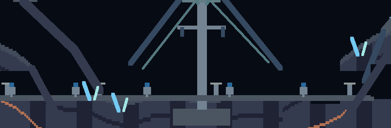
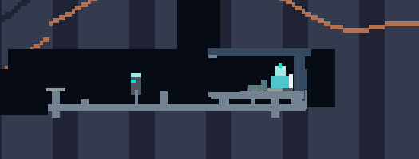

# Vesper Thermocline — Horizon Harp (R2 functional engineering)

> **ORIGINAL / NO REFERENCE · Sci-Fi Frontier Wide · 2048×1024 · actual CyberSand material cells · OPEN Draft/HOLD · R2 AUTHOR SOURCE-STATIC PASS · NATIVE-UNTESTED · INDEPENDENT R2 AUDIT REQUIRED**

An original off-world volcanic thermocline settlement spanning an enormous open aerial cleft. A split V-shaped Horizon Harp interferometer stands on rock-bedded foundations between the west inhabited service habitat and the east spectrograph, medical and boarding campus; a lower tectonic service/cryobank return provides a separate exploration loop. True orthographic side elevation only: no perspective, imported concept imagery or visual-only obstacles.

## R2 response to exact-HEAD Shepherd functional-workface P1

Compared with the initial Vesper submission at `0de5f781b73fd9e19c6ee54b9c6e3da27cec64db`, this revision changes **23512 genuine material IDs** (**20761 added**, **216 excavated**, **2535 reassigned**) instead of adding illustrative overlays. The West settlement now has two connected sample-handling bench stations, a recognisable rover chassis/diagnostics landing, and an independent crane at the relay. The Horizon Harp has separate tuning and receiving workfaces hanging from the west and east landed gantries. The east campus now contains physically different spectrometer collimation, medical scanning and boarding support mechanisms. The deep return contains a grounded, side-enterable cold-service vault, with an independently checked access centre `[1778,884]`. The central open canyon silhouette and original 21 waypoints are unchanged.

A first R2 workface blocked the 23×19/31×27 approach to the named spectrograph station; this was **rejected** and relocated to the far eastern telescope bay before publication. An initial service-bay chassis also disconnected the west landing; it was rejected and replaced with the low-profile, grounded chassis beneath the flyable circulation band. These are recorded design regressions repaired before the new candidate, not waived checks.

## Immutable source identity and material authority

- Writable repository/branch: `techrote/sandmapsreference`, `original/scifi-frontier-wide/vesper-thermocline-horizon-harp-261119`, starting default `main@99a166e7fcae45eb22be1740e9f33f62faccbcc7`.
- Accepted **READ-ONLY** engine `techrote/cybersand main@de109d0131641d6adc8d25bb9ced7ca3d4991105`: Workbench Setup-v2 loader blob `70dd964bc2d5bff9ca030edd57d7fc7aa5068fc9`, material definitions blob `dcf05895da3015a2e999e3d1cbbae0fdc7fe32b3`, Midge JSON blob `228399e38a0e0ab215b9f48698edce67a7a35799`, true authored Midge hull **4×3**, model hash `c226d73ae56a426820d2ef842a4856bf79ac23efabe64e66569dff8de62a7a96`.
- Deterministic `build.cjs`, fixed `SEED=81102619`, `serialize.cjs` lossless nonoverlapping ordered rectangles, real indexed-PNG material values, `generate.cjs` verifier. Node 22+ from the map directory: `node generate.cjs --verify` (fully regenerate into memory, match committed bytes and PNG material indices), or `node generate.cjs --write` to reproduce committed Setup/images. No network or npm dependencies required.
- Allowed construction solids: accepted immutable **Solid / RuleKernel::None** IDs as enumerated by `source_material_histogram` in `receipt.json`. No falling sand, unconfined fluids, molten liquids, reactive decoration or invented material IDs. **540105 / 540105** occupied final cells have a four-neighbour boundary-grounded structural connection. `16949` provisional ungrounded builder-stage cells were discarded **before** final serialization; no detached final material is accepted.

## Gameplay/route graph (strict actual named 31×27 envelopes)

**Spawn:** West arrival `[145,653]`. Primary loop: West arrival → Habitat canteen `[201,555]` → Archive overlook `[395,464]` → West transmitter `[119,348]` / Rover repair `[576,665]` → Cleft north `[802,345]` → Horizon Harp upper `[1020,525]` → west/east workfaces `[942,577]` and `[1123,579]` → east observation `[1624,352]` → spectrograph `[1698,440]` → medical `[1663,530]` → boarding `[1963,602]` / storage `[1814,609]`.

**Lower independent recovery:** West archive `[350,872]` → West drill relay `[620,670]` → Harp base `[1096,827]` → Tectonic corridor `[1107,910]` → Cleft lower `[1170,745]` → Cryobank `[1618,877]` → **new cold-vault maintenance `[1778,884]`** → East relief shaft `[1718,780]` → East campus. Every exact site is listed in the machine receipt, including those not expanded in this prose.

Two interconnected flight flanks surround the central V-shaped Harp. An actual `64×48` blocked-solid under-rift insertion at `[865,775]` converts **2730** real air cells to material yet retains **22/22** exact 31×27 destination reachability; the obstruction is not a simulated UI highlight. Static free-centre BFS establishes traversable spaces, **not** dynamic Midge steering success.

## Exact R2 final-plane and source-static receipt

| Check | Exact committed data |
|---|---:|
| Cell plane | **2048×1024 = 2,097,152** material IDs |
| Stable occupied / boundary-grounded cells | **540,105 / 540,105**; zero detached final |
| Canonical nonoverlapping rectangle edits | **5,543 / 32,768** |
| Setup-v2 JSON bytes | **105,492 / 1,048,576** |
| Construction work | **540,105 / 32,000,000** |
| Exact 19×15 Midge clearance | **22/22**, 1,295,589 reachable centres |
| Exact 23×19 Midge clearance | **22/22**, 1,244,408 reachable centres |
| Exact 31×27 Midge clearance | **22/22**, 1,154,150 reachable centres |
| Physical obstruction / return | **22/22**, 1,150,633 remaining centres |
| Ordered-rectangle exact whole-grid replay | **2,097,152 / 2,097,152** cell identities match |
| Real indexed material-PNG outputs | **7**: one full extent, six 1:1 district crops |
| Whole-plane SHA-256 | `4c9a39278d4c730090e92b683d136b7a5a49593d644372ae8e237204aa37627d` |
| Setup JSON SHA-256 | `23c910e9829403250b77f3d772b473d16401f15c09c614c99df6e1f28a9b0ddd` |

## Genuine material-cell gallery (indexed palette values = native material IDs)

| West inhabited service and rover (1:1) | Twin Harp tuning decks (1:1) |
|---|---|
|  |  |
| East spectrometer, medical and boarding (1:1) | Deep tectonic return (1:1) |
|  |  |

Binary SHA-256, raw dimensions and exact subarray coordinates of each PNG are in `receipt.json`. Images contain material IDs, *not* screenshot painting. The last crop is newly included because the earlier subplate crop did not contain the actual cryobank chamber.

## Native / independent gates

**DRAFT / HOLD — NATIVE-UNTESTED.** These are actual static material cells; no installed Godot, Workbench, CyberDemoBridge or Rapier binary was executed. Accepted source advertises **32,768** start rectangles but older **installed bridge** may report only **4,096**. The **5543** records still exceed that fallback: confirm the loaded bridge method, then import the unaltered Setup, exercise Midge steering/contacts and fresh-process save/reopen before promotion. Independent exact-R2-HEAD **Art, Technical and Shepherd** audit is required. Never mark Ready, merge, auto-merge or treat source-static tests as owner acceptance.
