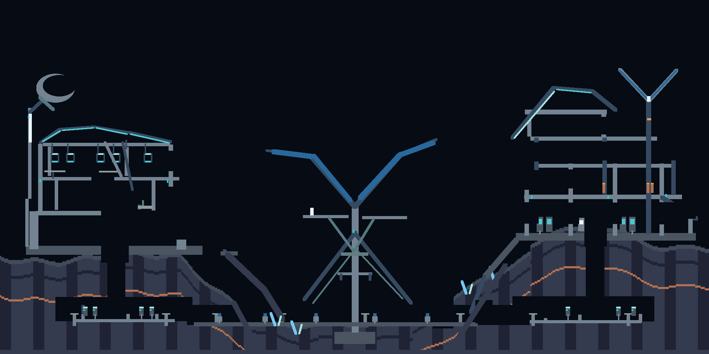
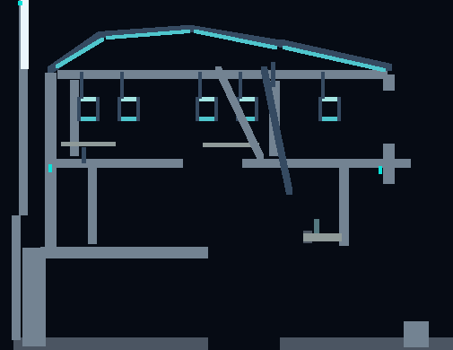
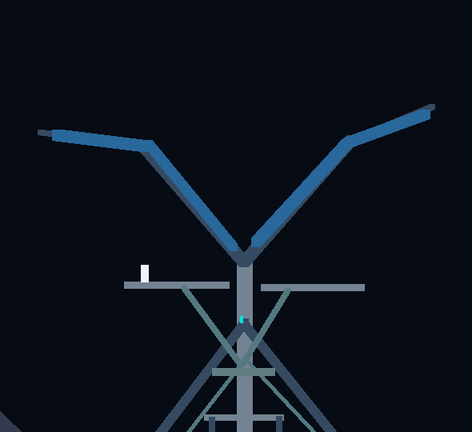
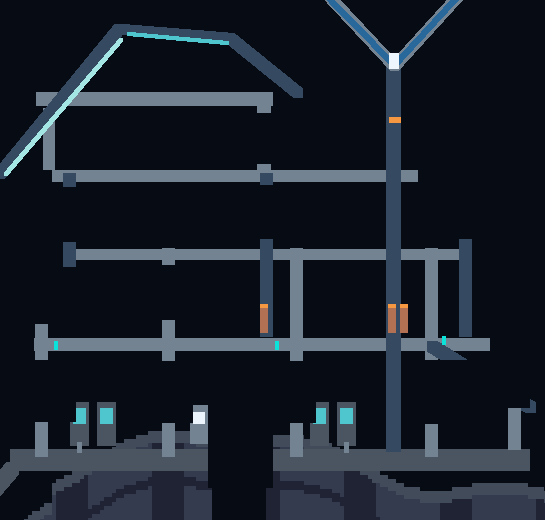
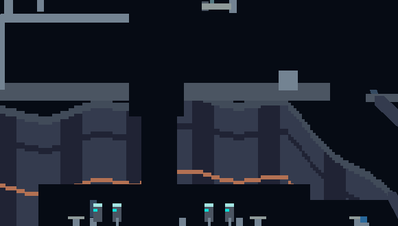

# Vesper Thermocline — Horizon Harp

> ORIGINAL / NO REFERENCE · Sci-Fi Frontier Wide · 2048×1024 exact CyberSand material cells · DRAFT/HOLD · SOURCE-STATIC TESTED · NATIVE-UNTESTED

A completely newly invented off-world observatory community built across a sheared volcanic thermocline. Its landmark is the **Horizon Harp**, a two-armed solar/geophysical interferometer pinned to deep foundation rock, spanning a natural cleft between a compact western greenhouse/rover settlement and an eastern stepped xenogeological spectrograph hospital. Beneath the open flight rift is a genuinely interconnected tectonic service/cryobank passage. Rendered strictly in perpendicular 2D side elevation; no reference art, painted overlays, isometric surfaces or visible platform tops.

## Source identity and technical authority

- Repository: `techrote/sandmapsreference`, new independent `original/scifi-frontier-wide/vesper-thermocline-horizon-harp-261119` branch rooted at accepted default `main@99a166e7fcae45eb22be1740e9f33f62faccbcc7`.
- **READ-ONLY CyberSand engine authority** `techrote/cybersand main@de109d0131641d6adc8d25bb9ced7ca3d4991105`, Workbench Setup-v2 loader blob `70dd964bc2d5bff9ca030edd57d7fc7aa5068fc9`, material enum blob `dcf05895da3015a2e999e3d1cbbae0fdc7fe32b3`, Midge 4×3 authored definition blob `228399e38a0e0ab215b9f48698edce67a7a35799`.
- Fixed original seed **81102619**. `build.cjs` creates all 2,097,152 physical cells, rooted supports and exact named target positions; `serialize.cjs` performs lossless ordered nonoverlapping rectangular encoding and generates truly indexed material-cell PNGs; `generate.cjs` verifies exhaustive replay, 31×27 flight and independently inflated PNG pixel parity.
- Run `node generate.cjs --verify` on Node 22+ from this directory; `node generate.cjs --write` re-creates exact Setup-v2 JSON and all images deterministically. No package installation or network required.
- **No engine code, imported artwork, historical conversion or other creator's PR was changed.**

## Physical gameplay scale and district graph

The actual Midge hull is **4×3** cells. We conservatively test **19×15, 23×19 and 31×27** completely unobstructed Midge-centre envelopes. The west habitable place has several people-scale storeys separated by enterable portals; elevated transmitter and east radio horns are attached to actual load-bearing columns. Four primary functional districts plus supporting facilities:

1. **West settlement:** arrival dock (145,653), canteen (201,555), archive overlook (395,464), rover repair (576,665), tall aerial transmitter (119,348), relay (620,670), sub-basement archive (350,872).
2. **Volcanic cleft:** sky-side cleft overlook (802,345), western rock descent, low tectonic corridor (1107,910), eastern relief shaft (1718,780).
3. **Horizon Harp:** split upper interferometer (1020,525), left console (942,577), right console (1123,579), embedded foundation service (1096,827), lower cleft (1170,745).
4. **East xenogeology campus:** sealed observatory (1624,352), spectral analyser (1698,440), medical triage (1663,530), canister storage (1814,609), rover boarding (1963,602).
5. **Subplate and cryobank:** cryobank (1618,877) connected to west archive, tectonic corridor, geological probe spine and eastern relief shaft.

**Route topology**: arrival → west settlement → open cleft sky → Harp → eastern observatory → medical/storage/boarding. Lower recovery loop: west archive → tectonic underplate → Harp footing → cryobank → eastern relief, connecting again to the mid-altitude campus. Test obstruction (865,775) size 64×48 fills **2,730 air cells**, yet **21/21** exact sites remain connected at 31×27 without coordinate shifting or target substitutions; a real alternative route exists in the static centre graph. This is not a guarantee of comfortable native manoeuvring under physics.

## Source-static qualification (full final grid)

| Test | Result |
|---|---:|
| Exact material plane | **2048×1024 = 2,097,152 IDs** |
| Boundary-rooted occupied inert solids | **519,560 / 519,560**, 0 detached |
| Preliminary unattached construction fragments discarded **before serialization** | 15,233 |
| Legal nonoverlapping rectangles | **5,285 / 32,768** |
| Setup-v2 JSON | **100,692 / 1,048,576 bytes** |
| Rectangle work | **519,560 / 32,000,000** |
| 19×15 exact-site reachable centres | 21/21; 1,322,929 |
| 23×19 exact-site reachable centres | 21/21; 1,271,561 |
| 31×27 exact-site reachable centres | 21/21; 1,180,519 |
| 31×27 physically blocked lower rift stress test | 21/21; 1,177,002 centres |
| Exhaustive rectangle replay and indexed image material-pixel construction | Exact same final grid |
| Material-plane SHA-256 | `33a261e8f90ce3de6ae2b376f54bc341caccbac10f9c893ea5d1533babfc6759` |
| Setup JSON SHA-256 | `c783b4adca00e7a82337de7535ad897d7dabb716cd9b59c601aeef015baed588` |

All occupied IDs in `receipt.json` are from the accepted inert, immobile Solid/None class. No falling powders, fluid volumes, growing vegetation, explosive or invalid IDs were staged. The algorithm removes would-be disconnected solids rather than treating them as grounded. Index-valued palette PNGs represent **actual material cells**; the color palette is only a viewer mapping and does not affect material identity.

**Risk — installed bridge capacity:** Accepted *source* advertises 32,768 Workbench rectangles but older *installed* CyberDemoBridge may fall back to **4,096**. This map requires **5,285**, so **native admission is unverified** until the actual loaded GDExtension/binary reports sufficient capacity. It must not be labeled native-compatible based only on this static count. Runtime flight, Rapier collision/advancement, long-running simulation, and fresh-process save/reopen are **NATIVE-UNTESTED**. Independent exact-HEAD art/technical/Shepherd review is requested. No merge, Ready promotion, auto-merge or owner acceptance.

## Real material-cell evidence

| Western habitation — 1:1 (505×390) | Horizon Harp — 1:1 (590×540) |
|---|---|
|  |  |
| Eastern spectrograph — 1:1 (545×520) | Deep subplate vaults — 1:1 (805×265) |
|  |  |

All crops select subarrays from the **same final material-ID grid**, no enlargement, AI visual substitutions, or source-photo artifacts. Each image's byte count, bounding extent and SHA-256 are retained in `receipt.json`.
