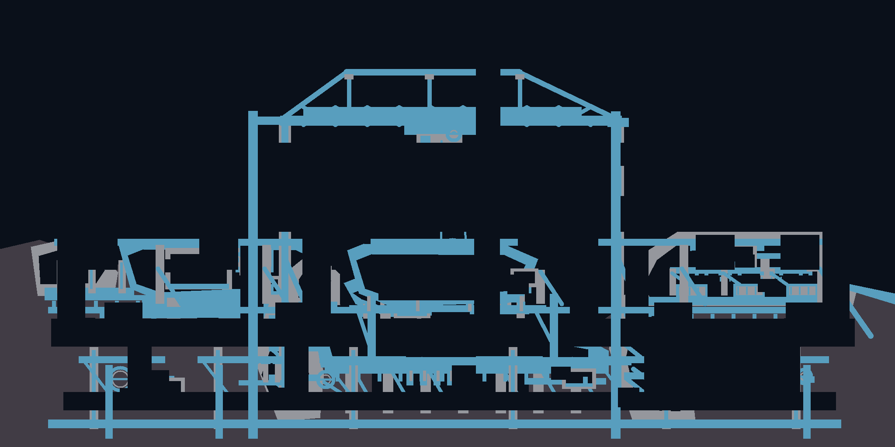

# Cleftline Logistics — Breakwater Recovery & Hull De-rigging Basin

**WORLDGROUP-FREIGHT-CLEFTLINE / Sibling 02** · New entirely original 2048×1024 strict orthographic CyberSand material-cell landscape · **CREATOR SOURCE-STATIC PASS · OPEN DRAFT/HOLD · NATIVE-UNTESTED**. This is not an accepted or owner-tested native game level.

## Family and geography

This is the heavy damaged-cargo salvage works downstream of [Sibling 01 — Outer Mooring Registry and Ballast Exchange](https://github.com/techrote/sandmapsreference/pull/86). Vessels inspected and registered at the Outer Mooring Registry enter the western breakwater and surrender rigging/cargo to the anchored twin-pier recovery gantry. The isolated central cradle receives cut-away assemblies; inspected reclaimed freight leaves through the eastern classification/dispatch plant. An upper service flight and below-grade emergency bypass connect independently useful sites. Future siblings may connect the salvage dispatch to an upper crane exchange or remote rebuild forge. **Target world family size: 4–8 genuinely distinct canvases.**

**Design-language donors only, no copied geometry or route plan:**
- [Peregrine Cleft / Halcyon Ark Drydock](https://github.com/techrote/sandmapsreference/pull/33), exact inspected R8 HEAD `0e872ce0987be7e6df047152beac470ba362c7c5`: cliff-rooted equipment, inhabited workrooms, gigantic traversable sky and legible drydock process transfer.
- [Graven Keel Ship-Tipper](https://github.com/techrote/sandmapsreference/pull/45), exact inspected R3 HEAD `7ce39e6eb6d701b515bd4f6b1ccea551bf467a2f`: scale of freight handling, readable cargo cradle/cutaway, entered operator space, robust load transfer.
- [Sibling 01](https://github.com/techrote/sandmapsreference/pull/86), HEAD `2f39de27b65d5d669b31b3d18a2a9829b89ed051`: shared Cleftline institutional concrete/steel/basalt and tall framed signal facilities.

**What is NEW:** a huge offset V-cut in two load-bearing rock shoulders; asymmetric anchored paired recovery jib and interrupted crown; damaged cutaway hull section secured over a deep basin; accessible mechanical stripping/workface pockets; fractured heavy salvage cradle and founded pumps; three distinct altitude traverses; recovered freight sorting and dispatch. NOT another long open quay, paired ballast-ring exchange, tipped hull or flying arkship.

## Operational and physical layout

1. **West breakwater / acceptance:** ingress, inclined shield, hull intake, secured hold, damage/refusal ledger. A static cut-away hull is borne by a founded dry-runner; it is not represented as an actual moving vessel.
2. **Upper inspection and paired recovery gantry:** west dry inspection, independent east signal space, upper cable switches and twin anchored crane piers spanning intentionally open aerial inspection volume.
3. **Center de-rigging and recovery cut:** salvage cut bay, rigging strip station, intermediate caged cradles, coupled gantry cable and material-handler interface; supported structural steel, not decorative free-floating terrain.
4. **East recovered cargo:** tiered sorter, separate inspection/cabinets, rail/pallet storage, outbound recovery dispatch and reinforced outer slope.
5. **Below-grade emergency works:** breakwater refuge, service return, center recovery crawl, separator, emergency east return, five specialized pump/traction/filter/rig retrieval/exchange stations.

The authored world contains `25` literal named waypoints; full coordinates are in `receipt.json`. World-group theme continuity is restrained institutional rock/concrete/steel, framed process-bay windows, inspection interfaces, high low recovery navigation, and clear cutaway cargo transactions. The offset V and split crane crown distinguish its geographic silhouette from sibling 01.

## Exact creator-source checks (not native execution)

| Metric | Result |
|---|---:|
| Final material grid | 2048×1024 = 2,097,152 cells |
| Stable occupied and boundary-rooted material cells | 570705 / 570705 |
| Final ungrounded or disconnected occupied cells | 0 |
| Deliberately rejected disconnected/decorative solids during construction | 55280 |
| Valid lossless disjoint Setup-v2 rectangles | 3714 / 32,768 |
| Setup-v2 JSON bytes | 69124 / 1,048,576 |
| Construction stamp work | 570705 / 32,000,000 |
| Exact waypoints 19×15, 23×19, 31×27 | 25/25 · 25/25 · 25/25 |
| Material obstruction (real rectangle) | `[208,460,78,81]`, 31×27 |
| Before/after physical shortest-path length | 180 → 268 steps, 25/25 remain reachable |
| Indexed PNG images with CRC, Adler and exact material-pixel verification | 6 / 6 |
| SHA-256 of entire material grid | `abfc2da3fbd40ad3ca680263fffc94784870ffbbd3fd46fbccaf51d749ddb1d6` |
| SHA-256 of Setup JSON | `09bb41600e1205fa74728303ee9312097f43c0e74bd8344313d4833463a45514` |
| Native Workbench, Midge physical contact, save/reopen | **NATIVE-UNTESTED** |

Final supported material IDs: `0=air`, `100=BasaltColumns`, `58=ReinforcedConcrete`, `62=SteelPlate`; all occupied materials are stable inert structural solids. Final cell plane is independently replayed from canonical nonoverlapping rectangles. All literal Midge centers must have complete in-bounds free hull rectangles and be traversable from exact spawn by four-neighbor center BFS at all three envelopes; no nearest-point substitutions. A rectangular obstruction removes the direct approach and forces a real longer detour. Static geometry is **not** a Rapier playtest.

Source engine authority: accepted `techrote/cybersand` main `de58bf1997ca75825cf3b29e046dc1c1022c45bf`; repository base: `techrote/sandmapsreference` main `99a166e7fcae45eb22be1740e9f33f62faccbcc7`. No engine files were changed. Source/native Workbench rectangle capacity is **32,768** following merged [CyberSand PR #680](https://github.com/techrote/cybersand/pull/680); there is no need to target an obsolete locally installed 4,096-record fallback.

## Reproduction and real cells

Run `node build.cjs --verify` inside this folder to check that regenerated Setup, receipt and PNG bytes match the committed artifacts, or `node build.cjs` to re-create them. `build.cjs` is standalone, deterministic and does not need external packages.

Unscaled one-to-one material crops (no concept art):
- [Breakwater and damaged-hull intake](01-breakwater-hull-intake.png)
- [Split rooted recovery gantry and inspection pilot](02-offcentre-gantry-pilot.png)
- [Center hull de-rigging cradle and material handling](03-rigging-strip-basin.png)
- [Eastern material sorting and reclaimed-cargo dispatch](04-recovered-cargo-dispatch.png)
- [Below-grade emergency return and service works](05-founded-recovery-works.png)

**Review gates:** Independent Art, Technical and Shepherd reviews must inspect exact committed HEAD and genuine images before promotion. Explicitly assess whether the salvage-flow sequence, cutaway hull and center machinery remain sufficiently legible at actual Midge scale; all source-static metrics above are creator self-checks. Native Godot 4.7/Workbench/CyberDemoBridge/Rapier loading, terrain contact, actor movement/ticks, paint/restore and fresh save/reopen remain untested. Preserve OPEN Draft/HOLD; no merge, Ready or owner acceptance.
