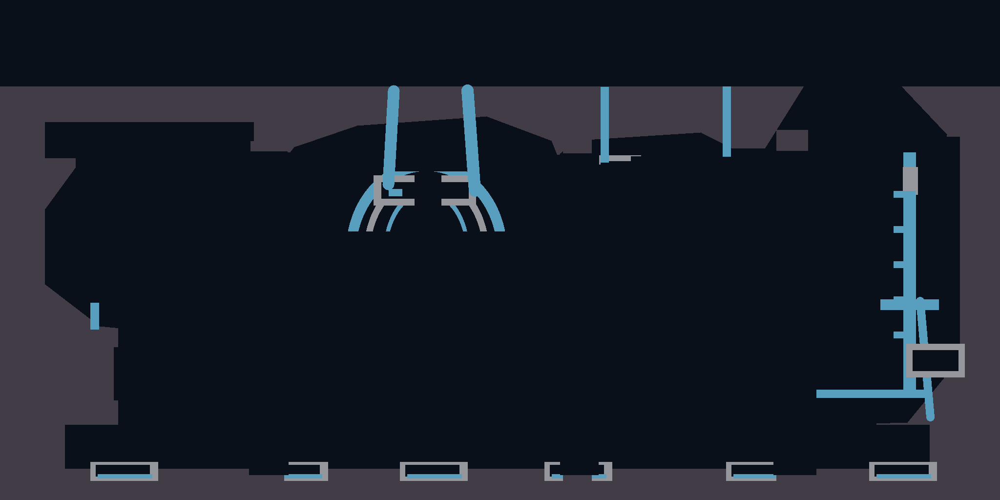
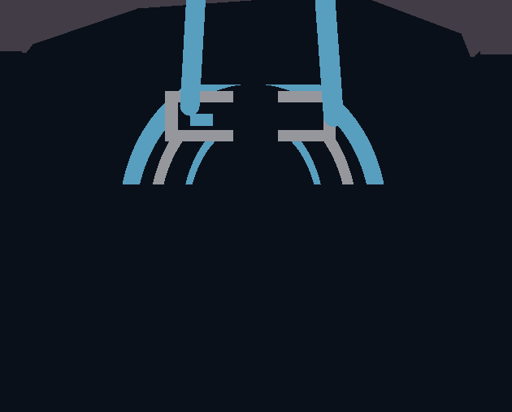
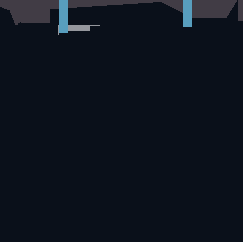
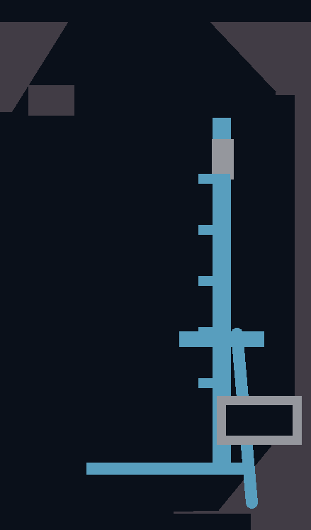
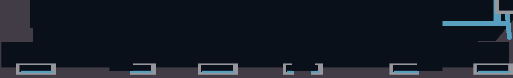

# Cleftline Logistics — Reclaimed-Hull Cold-Form Works / Inhabited Repair Ward

**World-group Freight Sibling 04** · Original **2048×1024** CyberSand material-cell world · **OPEN Draft/HOLD** · **CREATOR SOURCE-STATIC PASS** · **NATIVE-UNTESTED**.

## Position in the industrial world

Cleftline's import registry ([Sibling 01](https://github.com/techrote/sandmapsreference/pull/86)) receives cargo, its breakwater salvage basin ([02](https://github.com/techrote/sandmapsreference/pull/90)) strips damaged hulls, and the inland escarpment switchback ([03](https://github.com/techrote/sandmapsreference/pull/96)) classifies stock. **This map is the enclosed downstream factory-city**: admitted reclaimed material → cold-rib compression/inspection → inhabited repair ward → isolated vertical export/emergency relief. The maps are distinct standalone levels, not falsely pixel-contiguous stitches.

Design-language donors only: [Peregrine Cleft / Halcyon Ark Drydock](https://github.com/techrote/sandmapsreference/pull/33) and [Graven Keel Ship-Tipper](https://github.com/techrote/sandmapsreference/pull/45), read-only. **No source donor pixels, layouts, route coordinates, names, or branches copied.** Shared vocabulary: rooted basalt load paths, inert reinforced concrete and structural steel, coherent freight custody, enterable institutional service workfaces. **Accepted CyberSand `main`** read-only source authority: `de58bf1997ca75825cf3b29e046dc1c1022c45bf`.

## Spatial thesis / controlled corpus diversity

Unlike the outdoor pier, off-centre V-shaped salvage cut and grade-switchback siblings, the dominant silhouette is **an irregular roofed basalt massif with three unequal nested enclosed chambers and a single vertical sky relief cut**. A monumental cold-rib forming frame, dense inhabited repair rooms, perforated founded bulkheads and deep salvage return create intentionally different load-bearing relations. Sparse chambers and spare annexes are preserved as authoring affordances, not incompleteness defects.

Diversity classification (see `exemplar.json`): **nested_cavities / multi_strata / edge_dense_center_open / layered / ring / mixed support / geological / editable_gaps**. This intentionally varies macro topology, enclosed/interior ratio, vertical access, route grammar, load paths, landmark, and habitation-to-industry adjacency rather than palette.

## Distinct functional workfaces

- **West recovered freight intake:** held loaded carriages, ledger/securement and enclosed receiving bay.
- **Central cold-rib forming vault:** nested triple anchored compression ribs, guided access throat, equipment plinth and overhead operator observation.
- **Inhabited repair ward:** unequal roofed cabins, ward common spine, infirmary/inspection and lower archive; residential activity is represented only as editable physical geometry.
- **Eastern emergency/export relief:** large single-sided vertical exterior opening with a founded hydraulic guide, dispatch platforms and emergency high exit.
- **Deep salvage and coolant underworks:** low re-routing loop, expandable utility chambers, deep salvage ledger and independent discharge exit.

**Route grammar:** main receiving→press→repair→dispatch; irregular upper observer/ward/relief traverse; lower salvage bridge and full-width deep service return. 25 literal named sites are in the receipt, checked under three *full actor hulls*. Static features do not claim dynamic press actuation, resident AI, triggered events, vehicles, or Rapier simulation.

## Full material-cell and source-static verification

| Check | Creator result |
|---|---:|
| Entire exact final material plane | **2097152 cells** |
| Inert rooted occupied material cells | **514232 / 514232** |
| Detached occupied cells | **0** |
| Complete Setup-v2 rectangles | **1096 / 32768** |
| Setup-v2 UTF-8 bytes | **21737 / 1048576** |
| Rectangle work cells | **514232 / 32000000** |
| Named in-bounds site connectivity at 19×15 / 23×19 / 31×27 | **25/25 · 25/25 · 25/25** |
| Actual 58-material obstacle [512,467,76,113], 31×27 | **298 → 398 steps; all 25 sites retained** |
| Real indexed 2048×1024 overview plus genuine 1:1 crops | **6/6** PNG, CRC/Adler/pixel parity internally checked |
| Full material plane SHA-256 | `9d5d08807f683cec10312eff34e4405e8aacfd5dd3517c81512735a09c9c89f1` |
| Setup-v2 SHA-256 | `aecb24a2c8e80ca3ef3179d13b88baa49ffcbbb16d237bd22ce35c6ec02f9408` |
| Godot / Workbench / CyberDemoBridge / Rapier flight, collision, tick, cold save/reopen | **NATIVE-UNTESTED** |

The `build.cjs` deterministic in-memory V8 generation was **actually executed** and validates exact replay, no overlapping stamps, full-grid hash, rooted-cell pruning, three-envelope source-static flood, obstruction with material footprint, and PNG byte/pixel checks. `node build.cjs --verify` regenerates all committed binary artifacts; `node independent_verify.cjs` independently replays them with Node crypto/zlib and navigation. **These Node commands are supplied for subsequent execution, not claimed as executed in this run.** No source-matched native Godot/Rapier test was run.

## Authentic material-cell gallery

| Actual original-resolution crop | Actual original-resolution crop |
|---|---|
|  |  |
|  |  |

`exemplar.json` is **corpus metadata only**, not Setup-v2 or engine input. Intentionally unfitted machine bays, collision-safe offshoots and 4 potential unscripted setpieces are left for human authoring, SWARM/GENTEK extraction and subsequent event scripting.

**Independent exact-HEAD Art, Technical and Shepherd review still required; the PR remains Draft/HOLD. Never Ready/merge/auto-merge without owner approval.**
