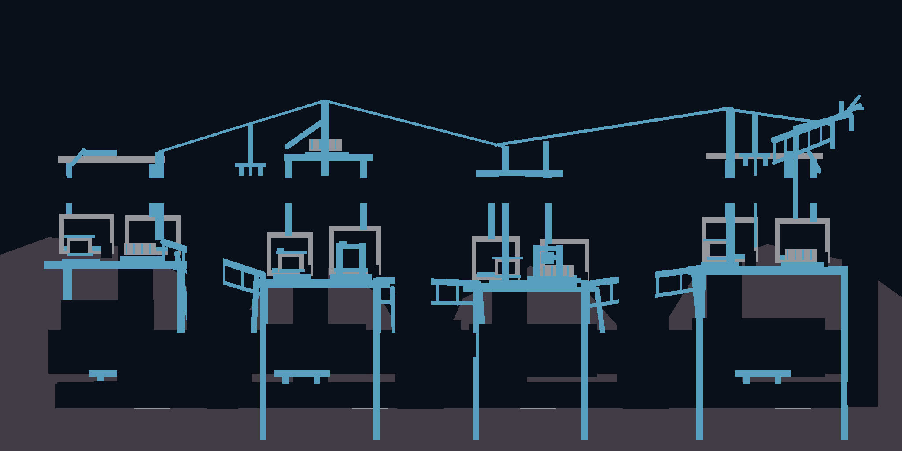
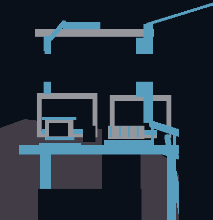
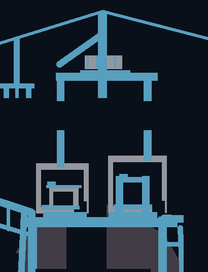
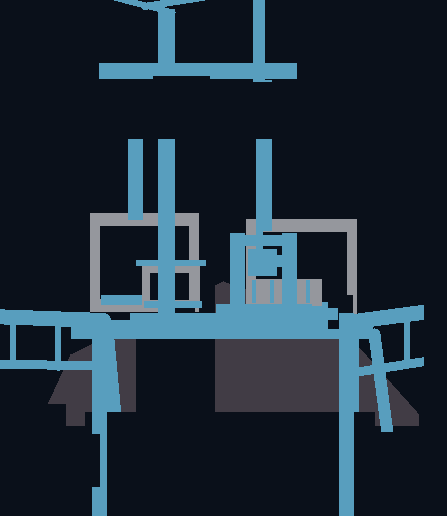
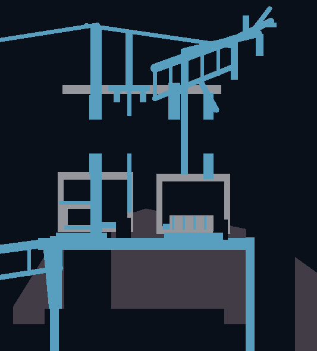
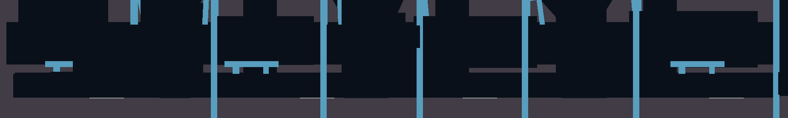

# Cleftline Logistics — Dispersed Reclamation Enclave / Workers' Causeways

**World-group freight Sibling 05 · ORIGINAL 2048×1024 material-cell canvas · Creator source-static PASS · NATIVE-UNTESTED · DRAFT/HOLD.**

## Role and provenance
Cleftline Logistics spans five standalone locations: [01 registry](https://github.com/techrote/sandmapsreference/pull/86), [02 salvage basin](https://github.com/techrote/sandmapsreference/pull/90), [03 inland escarpment](https://github.com/techrote/sandmapsreference/pull/96), [04 cold-form repair ward](https://github.com/techrote/sandmapsreference/pull/103), and **05 distributed reclamation worker enclave** (this map). Independent branches and separate levels; no fake world-contiguous stitching.

Style anchors only: [Peregrine Cleft / Halcyon Drydock](https://github.com/techrote/sandmapsreference/pull/33) exact HEAD `0e872ce0987be7e6df047152beac470ba362c7c5` and [Graven Keel Ship-Tipper](https://github.com/techrote/sandmapsreference/pull/45) exact HEAD `7ce39e6eb6d701b515bd4f6b1ccea551bf467a2f`. No anchor branches, source pixels, coordinate networks or geometries copied. Accepted engine authority read-only `techrote/cybersand main@de58bf1997ca75825cf3b29e046dc1c1022c45bf`; sandmapsreference default base `99a166e7fcae45eb22be1740e9f33f62faccbcc7`.

## Structural thesis
Unlike the prior four maps, this is a **discontinuous multi-settlement scrap civilisation** across four unequal bedrock shelves. Its different workfaces are (a) western labour intake, refuge and levy, (b) elevated cooperative tools and minor forming, (c) a separate reclaim exchange and sorter, (d) asymmetrical customs/village export with abandoned high cantilever, and (e) lower recovery, medical refuge and salvage tunnels. Three non-identical founded worker causeways and several upper cable relations connect the economy; deep excavated returns offer alternative flight. The west side is more inhabited, the centre more industrial, and the east more derelict. Sparse intentional vacancies remain for later human-authored parts and unscripted setpieces. This is *not* a large central machine, copied crane, or an endless empty void.

**Transaction:** admitted stock → labour levy → tool cooperative → reclaim market → customs/export. Mechanisms are static material geometry only, no animated crane, damage simulation, NPC control or event scripting.

The corpus metadata `exemplar.json` records controlled **array-valued** `diversity_axes`: `multi_settlement/islands`, `high_low_bypass/multi_strata`, `alternating/clustered`, `branch_rejoin/layered`, `bridge/cableway`, `multi_leg/floor_rooted`, `dry/damaged` and `modular_append_zones/damaged`. Macro topology and route grammar are separate descriptive metadata, not Setup/engine law.

## Creator qualification on genuine committed cells

| Check | Current result |
|---|---:|
| Full physical grid | 2,097,152 cells / 2048×1024 |
| Source grounded inert solids | 542941 / 542941; detached 0 |
| Material histogram | `{"0":1554211,"58":38135,"62":165318,"100":339488}` |
| Lossless nonoverlapping Setup-v2 stamps | 1701 / 32,768 |
| Setup bytes | 32727 / 1,048,576 |
| Rectangle work | 542941 / 32,000,000 |
| Exact literal named sites at 19×15, 23×19, 31×27 | 24/24 · 24/24 · 24/24 |
| Temporary material obstruction | `[471,392,80,88]` on 31×27 route: 459 → 595 steps; 24/24 sites retained |
| Indexed PNG source-material parity | 6/6 builder verified incl. overview and five 1:1 crops |
| Final material SHA-256 | `8b8817e8f3e194bc9eb22ddb95a1c6b9018c8c587a8963a7511081e29aa2d276` |
| Setup SHA-256 | `99cb403911e7e1ea4f9f05377d604d73d7c4f0b331797e1fd7f5d14b729f151d` |
| Installed native Workbench / Rapier load, ticks, flight and cold save-reopen | **NATIVE-UNTESTED** |

Source: `build.cjs` deterministic source and `setup.json` complete playable-material input; `receipt.json` hashes/sites/rectangles/crops. Run `node build.cjs --verify` to compare all committed artifacts byte-for-byte; run `node independent_verify.cjs` for separate replay, conservation, clearance and material PNG parity. These commands are provided for reviewer execution; a native engine run is **not** claimed.

## Authentic material-cell gallery

| Genuine 1:1 crop | Genuine 1:1 crop |
|---|---|
|  |  |
|  |  |

**Review request:** Independent Art — judge whether four settlements, distinct small processes, non-identical bridges and broken spur communicate at Midge scale. Technical — independently replay Setup, check all three actor hulls, actual physical obstruction, rooted connected components, material PNG parity. Shepherd — validate provenance, corpus index, originality, sibling distinction, source authority, exact HEAD. Keep **OPEN Draft/HOLD**; no merge, Ready or auto-merge.
