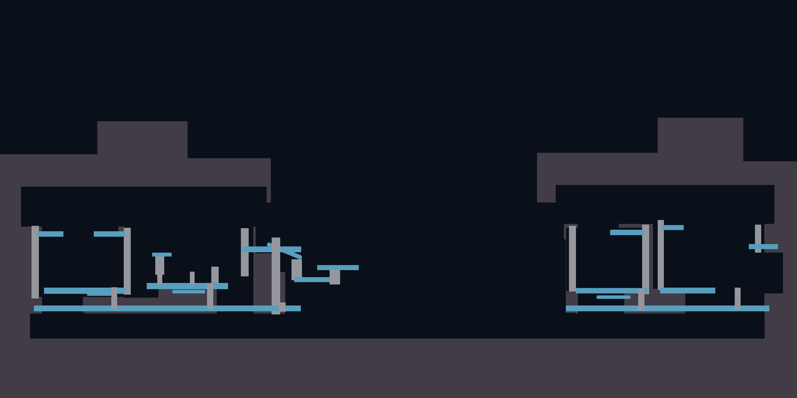

# Keelbone Reclamation Vaults 01 — Buried Component Cellars / Dismantling Service Circuit

**New WORLDGROUP Freight family Keelbone 01.** New 2048×1024 orthographic material-cell level. **OPEN Draft/HOLD · creator-source static PASS · NATIVE-UNTESTED.**

## Provenance and read-only engine authority
This separate new branch is based on sandmapsreference `main@99a166e7fcae45eb22be1740e9f33f62faccbcc7`; CyberSand accepted `main@f7e056c9b8791106e22f2d1c295043783d8a9701` is read-only for Setup-v2, immovable inert material IDs and player-hull assumptions. The two live design anchors were inspected at their current exact heads: [Graven Keel #45](https://github.com/techrote/sandmapsreference/pull/45) `7ce39e6eb6d701b515bd4f6b1ccea551bf467a2f`, [Peregrine Cleft #33](https://github.com/techrote/sandmapsreference/pull/33) `0e872ce0987be7e6df047152beac470ba362c7c5`. Their actual source/material-cell README, receipts, generator layouts and reviews supplied an engineering culture, **not** copied geometry/pixels/route graphs, ship, tipper, or crane.

## New geography and purposeful transactions
The first Keelbone sibling is a **grounded, interior-dominant lateral reclamation system** under two unlike basalt crest ridges and an open central excavation. Five distinct workfaces answer different tasks:
1. West sump receipt, seal and billet inspection: grounded side-entered transfer and load-accountability.
2. Unequal coupling/component vaults: separate actual excavations, physical store/press fixture and short steel parts handoff.
3. Off-centre open cutter atrium: fixed founded shear-frame and low receiver; no pretence that static geometry animates.
4. East assay, tool and small workers' maintenance cells: more compact enclosed room arrangement, not serial tariff towers.
5. Lower repair/relief airway: multiple material-cell ascents and positive under-service girders; real cut-throughs maintain conservative Midge accessibility.

Upper excavated sky, two cavity margins, outer damaged export cut and spare underfloor cells are **intentional authoring sockets**, not finish defects. The map provides alternate and emergency flight routes for future human editing and scripted-event staging; **no event is scripted**.

## Authentic material-cell evidence

One cell/pixel genuine unscaled crops from the *same* plane: [west intake](01-west-arrivals.png), [coupling and entered cellars](02-coupling-cellars.png), [dismantling circuit](03-dismantling-circuit.png), [east assay](04-assay-vault.png), [workers and export](05-crew-export.png). Indexed palette 0=air,1=100 basalt,2=58 concrete,3=62 steel. No image was generated independently of the final material grid.

## Exact source static qualification
| Contract | Result |
|---|---:|
| Exact plane | 2048×1024 = 2,097,152 physical cells |
| Disjoint ordered legal Setup-v2 edits | 167 / 32,768 |
| Setup JSON UTF-8 bytes | 3949 / 1,048,576 |
| Inert stable boundary-grounded occupied cells | 617829 / 617829 |
| Pruned truly ungrounded preliminary decoration | 37426 |
| Invalid/overlapping/out-of-bounds final writes | 0 |
| Literal 19×15, 23×19, 31×27 Midge destinations | 27/27 · 27/27 · 27/27 |
| Physical obstacle [850,116,350,244] (31×27) | 955 → 1181 cardinal steps |
| Genuine source-index full PNG and 1:1 crops | 6/6, CRC/Adler and pixel parity checked |
| Material plane SHA-256 | `3fe9e58ecd8ecdec897eace82a5d026412473f1dcbd13ee8753170c3b6e1f9b6` |
| Setup SHA-256 | `ba11823b84a9aa26c2cda08d353547325014ffc4505743b1dd456e73acd5aa06` |
| Native Godot/Workbench/Bridge/Rapier ticks/collision/save/reopen | **NATIVE-UNTESTED** |

Regenerate via `node build.cjs`. Repeat byte-for-byte qualification via `node build.cjs --verify`; run the separate Node-zlib `verify.cjs` after obtaining committed files. **Standalone Node verifier not run in this execution**; generator has performed in-memory reconstruction, full-hull routing, physical obstruction test, PNG CRC/Adler and material index comparisons.

`exemplar.json` schema-v1 records controlled eight-axis diversity classification, two-route/cavity grammar, setpiece candidates and deliberate voids. Independent exact-HEAD Art/Technical/Shepherd review pending; no actual native play/saves claimed, no merge/Ready/auto-merge authorization. All files in this new owned folder.
