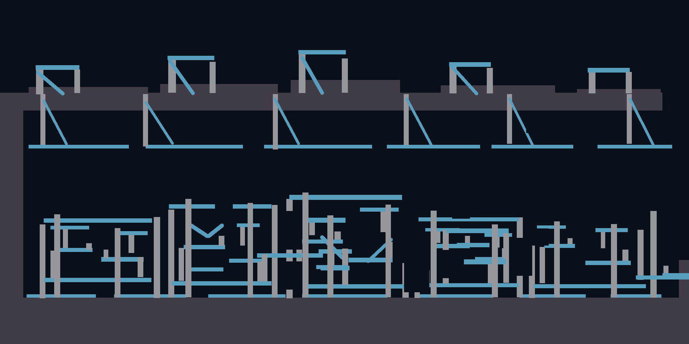

# Keelbone Reclamation Vaults · Sibling 03 — Continuous Covered Reclaim Spine

**Original Freight World-group B · 2048×1024 exact material-cell canvas · DRAFT/HOLD · creator SOURCE-STATIC PASS · NATIVE-UNTESTED.**

This map extends the Keelbone industrial ecosystem with a **single enclosed lateral manufacturing and component-exchange quarter**, in place of the previous siblings' two-sided cliff/empty-chasm composition. Five distinct entered or entered-threshold workfaces line one continuous covered hull-service artery: dry wet-strip intake and catch tray, grounded magnetic classification forks, torque dismantling drive/infeed/die, customs/ledger, and inhabited worker repair leading to an intentionally damaged export annex.

No source art was traced. Graven Keel's supported industrial load relationships and Peregrine Cleft's Midge-scale inhabitability were studied as **read-only design-language donors**, not as geometry, route, pixel or coordinate donors. User/editor-visible empty bays, upper flight volume, and eastern expansion seam remain deliberately incomplete.

## Operational identity and topology

- **World-group:** Freight / Drydock / Port Systems; **family:** Keelbone Reclamation Vaults; **sibling role:** continuous covered industrial sorting and reclamation, not another excavation/drydock.
- **Anchor donors:** `wide-graven-keel-ship-tipper` (PR #45, `7ce39e6eb6d701b515bd4f6b1ccea551bf467a2f`) and `wide-peregrine-cleft-halcyon-drydock` (PR #33, `0e872ce0987be7e6df047152beac470ba362c7c5`).
- **Sibling novelty:** one largely continuous, edge-rooted roof; asymmetric covered bays; five genuinely different floor-rooted machinery families; one far-east sky escape; staggered overhead truss workwalks; low foundation recovery.
- **Primary freight transaction:** western strip/catch → opposed magnetic sorter/stock cradle → founded torque press/infeed/receiver → bonded ledger/count → worker repair/export. Machinery is authored static material, not simulated.
- **Main flight:** Western intake → Sorting rail → Torque drive control → Ledger registry → Eastern export.
- **Alternates:** high inspection/workwalk over the same bays, lateral and low machine relief gaps, exterior sky escape from the far east. Conservative 31×27 obstruction [778,460,75,83] genuinely increases Sorting rail → Eastern export cardinal route from 1241 to 1375 steps, preserving all named sites.
- **Editing/set-piece affordances:** sorting gate lockout, torque press failure, custody encounter, eastern outboard escape/collapse. No scripted gameplay is inserted.

## Source-static qualification

| Evidence | Exact final source grid |
|---|---|
| Material extent | 2048×1024 = 2,097,152 cells |
| Materials | 0 Empty; 100 BasaltColumns; 58 ReinforcedConcrete; 62 SteelPlate (inert, immovable) |
| Grid SHA-256 | `76b668760422189ef79051576fc60e0b55bc3c9d348a1f739b3ba2142e7a488c` |
| Setup-v2 disjoint rectangles | 1,974 / 32,768 cap |
| Setup JSON | 37,016 bytes / 1,048,576 cap |
| Ground-rooted occupied cells | 700,419 / 700,419 after deliberate removal of 27,850 disconnected decoration cells |
| Invalid IDs, overlapping edits or out-of-bounds writes | 0 |
| Spawn and exact sites, 19×15 / 23×19 / 31×27 | 27/27 each |
| Physical obstruction with all 31×27 sites reachable | 1241 → 1375 steps |
| Actual materials overview and true 1:1 district PNG crops | 6 images with per-pixel parity, checked CRC and zlib Adler |
| Godot / Workbench / CyberDemoBridge / Rapier, actor movement/ticks, save/reopen | **NATIVE-UNTESTED** |

Source-matched policy/actor authority: accepted `techrote/cybersand` main `f7e056c9b8791106e22f2d1c295043783d8a9701`, **READ-ONLY**. sandmapsreference accepted base: `99a166e7fcae45eb22be1740e9f33f62faccbcc7`.

## Source artifacts

- `build.cjs`: fixed-seed deterministic generator for all 2,097,152 cells; exact ordered bounded rectangles, SHA-256 receipt, three actor envelopes, physical obstruction detour, PNG generation and CRC/zlib/pixel validation. `node build.cjs --verify` compares regenerated outputs to the committed assets; `node build.cjs` regenerates them.
- `verify.cjs`: independent Node replay and exact file/PAL PNG parity verification.
- `setup.json`: actual loadable Setup-v2 with the accepted Midge actor definition and conservative inert material policy.
- `receipt.json`: exact histogram, material hash, route graphs/sites, byte counts, image checksums, grounding and native status.
- `exemplar.json`: corpus-index v1 annotations, eight controlled diversity classifications, novel relationships and unscripted editing opportunities.
- `overview.png`: complete no-retouch 2048×1024 indexed material-cell plane.
- `01-wet-strip.png`, `02-magnet-sort.png`, `03-torque-spine.png`, `04-ledger-custody.png`, `05-crew-emergency.png`: genuine 1:1 unscaled crops from the identical committed material array.

**Review request:** Art should examine scale-readable process relationships and the domestic/duty windows, *not require optional gap filling*. Technical should execute `node build.cjs --verify`, `node verify.cjs`, then native runtime only when source-matched binaries are actually installed. Shepherd should review donor originality, family distinctions and exact-HEAD evidence. Remain Draft/HOLD: no Ready, merge, auto-merge or owner-acceptance claim.

## R2 bounded Art-P1 material repair — 21 November 2026

Independent Art review on predecessor `e7b8516c5336d01b1a1178fe994b2b4d1436a8b5` confirmed the sorter-to-torque physical handoff was too ambiguous and the ledger read as another open post frame ([review](https://github.com/techrote/sandmapsreference/pull/159#issuecomment-7059763855)). This revision changes the committed **material cells**: a continuous material tray bridges the sorter output to a founded, downturned torque receiver; a distinct entered bonded-duty portal has a counter and side opening. The roof, five workfaces, 27 literal sites, alternate flight and deliberately vacant authoring annex are retained. In-process source-static Setup replay and six genuine indexed-material PNG pixel/CRC/Adler checks pass. Standalone `node verify.cjs` and compatible Godot/Workbench/Rapier have not been executed in this session. Preserve Draft/HOLD pending independent exact-new-HEAD reviews.
