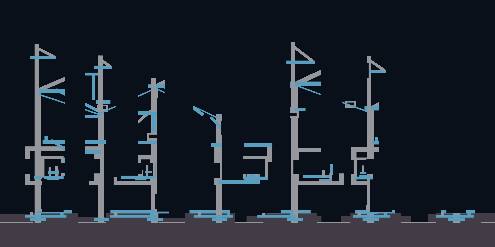

# Tidefault Bonded Freight Districts — Signal-Rack Cargo Stilts / Split Receipt Exchanges

**World group:** CyberSand Freight / Drydock / Port — Tidefault Sibling 04. **New original 2048×1024 material-cell canvas.** **Draft/HOLD; creator source-static PASS; native gameplay and persistence NATIVE-UNTESTED.** Nothing is merged, promoted, force-pushed, or owner accepted.

## Family and design-language anchors

Read-only anchor references: [Graven Keel ship-tipper #45](https://github.com/techrote/sandmapsreference/pull/45) at `7ce39e6eb6d701b515bd4f6b1ccea551bf467a2f`; [Peregrine Cleft / Halcyon Drydock #33](https://github.com/techrote/sandmapsreference/pull/33) at `0e872ce0987be7e6df047152beac470ba362c7c5`. The family borrows disciplined grounded steel load paths, cargo transfer stages, entered workrooms and industrial negative space—not coordinates, pixels or route graphs.

Tidefault's siblings are [01 Sealed Customs-Lock Grid #116](https://github.com/techrote/sandmapsreference/pull/116), [02 Quarantine Return Arches #123](https://github.com/techrote/sandmapsreference/pull/123), [03 Bonded Depth Repository #127](https://github.com/techrote/sandmapsreference/pull/127) and **this new Sibling 04**. Sister family Cleftline Logistics currently has five standalone canvases. These are different locations in one industrial world, not adjacent stitched tiles.

## Structural thesis

An asymmetric **open-air, distributed cargo exchange on seven different rooted stilt/cable piers**. Several short crane and signaling arms at unlike elevations, differentiated small receiving and custody bays, and an independent lower emergency return replace the prior sibling's cliff-embedded vaults and tall customs gates. The source shows static machinery and staged loads, not mechanically simulated hoists. Large sky volumes, unused bays and unfinished outer signal works are deliberate human-editing and SWARM/GENTEK exemplar surfaces.

### Materially distinct operational districts

1. **Western tally mouth:** bounded inspection booth, west customs handling and outward-facing freight receipt; cargo/manifest stage separate from the first signal pier.
2. **West straddle/winch exchange:** supported short hoist with load, winch operator station and side-entered service pocket.
3. **Central split receipt:** narrow transfer and axle/ledger workfaces at different heights, over a broad unoccupied approach volume; not a single sealed warehouse.
4. **East bonded tariff and custody:** separate short-stay receiver, inhabited workroom and independently staged customs handoff.
5. **Outer damaged signal nose:** unfinished departure relay and an emergency lower approach rather than a fully furnished export sector.
6. **Low return underworks:** maintenance footings, protected route exits and multiple large assembly/expansion gaps.

The actual conservative route graph consists of **26 exact literal named stations**: nine main freight-air, five upper signal, seven entered workface and five deep return stations. A rooted physical obstruction rectangle `[1080,130,150,180]` tested at 31×27 clearance changes **West cable watch → East signal crossing** from **1109 to 1197 cardinal steps**, leaving all 26 sites reachable. No substitute nearest-site search.

## Authentic indexed material-cell evidence

Genuine unscaled 1:1 source material pixel crops:
- [West berth and trolley intake](01-west-berth.png)
- [Distinct straddle hoists and winch booths](02-straddle-hoists.png)
- [Central split cargo receipts](03-mid-cargo-exchange.png)
- [East tariff ward and damaged signal spur](04-east-tariff-ward.png)
- [Deep maintenance route](05-lower-recovery.png)

Indexed palette: empty=0; basalt columns=100; reinforced concrete=58; steel plate=62. Each image pixel corresponds to **one committed material cell**, not perspective concept art or a native-render screenshot.

## Source-static reproducibility and qualification

| Test | Exact result |
|---|---:|
| Full material-ID plane | 2,097,152 cells |
| Disjoint Setup-v2 rectangles | 1447 / 32,768 |
| Complete JSON bytes | 27402 / 1,048,576 |
| Boundary-grounded occupied cells | 443977 / 443977 |
| Invalid or overlapping writes | 0 |
| Source-static Midge route sites, 19×15, 23×19, 31×27 | 26/26 each |
| 31×27 inserted obstruction detour | 1109 → 1197 |
| PNGs (full plane and 5 crops) | 6; CRC/Adler and material-pixel parity PASS |
| Material grid SHA-256 | `dc9652082fb7b9cbc5874117b5e82df275754969baba871b88cbc70b5eb059c1` |
| Setup JSON SHA-256 | `0923a26729424b662737283c97768226a1b92402def439ff12886006b15327f0` |
| Native Workbench/Godot/CyberDemoBridge/Rapier runtime, collision, ticks, fresh save/reopen | **NATIVE-UNTESTED** |

**Reproduce source:** `node build.cjs --verify` to regenerate and byte-compare committed Setup, receipt and six PNGs; `node verify.cjs` to independently replay committed rectangles, check SHA-256, PNG pixels and structural support, then call source for its full-envelope route tests. The independent Node script is committed but has **not** been executed under Node; the deterministic generation, full replay, material hashes, PNG integrity/pixel parity, three hull route checks and physical detour were executed in a V8 environment, including an additional separate replay and grounding check before publication.

**Read-only authorities:** sandmapsreference current accepted `main@99a166e7fcae45eb22be1740e9f33f62faccbcc7`; CyberSand accepted `main@f7e056c9b8791106e22f2d1c295043783d8a9701`. `exemplar.json` records eight controlled diversity classifications and four unscripted human-editing/set-piece affordances. Independent Art, Technical and Shepherd exact-HEAD reviews remain required; previous Tidefault 03 provisional watch over room distinctness is not a confirmed Art P1 and that sibling has not been modified.
