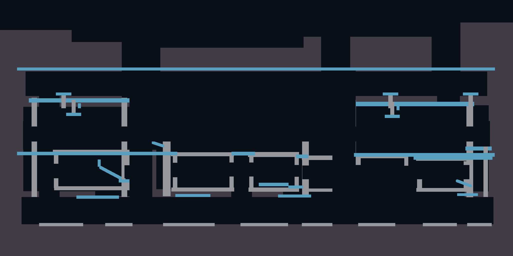

# Tidefault Bonded Freight Districts — Bonded Depth Repository / Entered Custody Worktown

**World-group:** Freight / Drydock / Port, Tidefault Sibling 03. **Status:** NEW 2048×1024 ORIGINAL material-cell canvas · OPEN Draft/HOLD · CREATOR SOURCE-STATIC PASS · NATIVE-UNTESTED · independent Art/Technical/Shepherd reviews PENDING.

## Corpus role and structural thesis

A cliff-embedded bonded archival worktown, not another exposed yard of low arches or high serial customs gates. The asymmetrical orthographic landscape has high rocky shoulders, a very long roof-inspection bridge, a deep central excavation void, unequal physically entered custody chambers, an inhabited eastern repair/dispatch ward and an independent low emergency route. The long centre bay is intentionally **unfurnished authoring volume**, not an omission requiring compulsory decoration. The map teaches terrain-cut cavities, side-entered custody, a long rooted cross-void service transfer and staged roof/ground/emergency routes. No simulated operating doors, live transfer machine, hazards, scripted events or NPCs are claimed.

**Read-only donor language:** [Peregrine Cleft/Halcyon Drydock #33](https://github.com/techrote/sandmapsreference/pull/33) at `0e872ce0987be7e6df047152beac470ba362c7c5`, [Graven Keel Ship-Tipper #45](https://github.com/techrote/sandmapsreference/pull/45) at `7ce39e6eb6d701b515bd4f6b1ccea551bf467a2f`. Industrial berth/custody material language only; no coordinates, named routes, pixels, geometry or entire arrangement copied. Only the lossless Setup/PNG helper was adapted from owned Tidefault 02; all 26 stations and authored spatial forms are original.

**Family:** [Tidefault 01](https://github.com/techrote/sandmapsreference/pull/116), tall customs thresholds; [Tidefault 02](https://github.com/techrote/sandmapsreference/pull/123), exposed low quarantine return; **this Sibling 03**, deep enclosed worktown with nested archive chambers. Standalone canvases, not adjacent stitched tiles.

## Four-plus material-cell workfaces

1. **West intake / weighing:** enclosed floor-founded weighing bowl, graded incline freight handoff and entered inspector chamber.
2. **Middle archival ledger:** side-entered unequal bonded rooms with different steel examination trays, retained freight stock and registered handoff thresholds, tied to the west cliff by physically founded service rail.
3. **East worktown:** entered inhabited service and dispatch chamber, separate recovered cargo locker and damaged outgoing nose, tied to the east cliff.
4. **High roof-access corridor:** asymmetrical cliff columns, inspection canopies and 1,908-cell long grounded steel way.
5. **Lower relief return:** independent wide recovery route, ventilation pockets, ledger bypasses and expansion seams.

**Routes:** west exact Midge spawn at (125,535) → main freight apron and all nine named main stations → eastern release (1905,535). Upper gallery traverses from west cliff (220,329) through assay (655,329) and central aperture (1050,329) to eastern relief (1480,329). Seven entered lower custody/settlement sites are at y691–692. Five deep return sites at y835 give an emergency path. Three conservative hulls pass all **26/26 literal site centres**; physically inserting a 116×89 concrete obstruction at [844,286] increases roof-assay-to-east-gallery route distance **825 → 943** while all 26 remain accessible.

## Authentic material-cell evidence

Genuine 1:1 unscaled physical-material crops, all from the identical committed plane:
- [West receiving and weighing chamber](01-west-weighing.png)
- [Bond vaults and assay rooms](02-bond-vaults.png)
- [Inhabited east worktown / export](03-east-worktown.png)
- [Roof inspection and spanning gallery](04-roof-gallery.png)
- [Deep recovery and ventilation return](05-deep-return.png)

Lossless indexed PNG palette: 0 empty, 100 basalt, 58 reinforced concrete, 62 steel. One original material cell per PNG pixel. These are physical cells, not generated concept art, perspective imagery or native-render capture.

## Source-static exact checks

| Invariant | Result |
|---|---:|
| Full material plane | 2048×1024 = 2,097,152 cells |
| Complete Setup-v2 root fields | 14 |
| Disjoint valid lossless 5-word rectangles | 336 / 32,768 |
| Complete Setup JSON bytes | 7165 / 1,048,576 |
| Grounded inert material cells | 765854 / 765854 |
| Disconnected decoration pruned before emission | 59806 |
| Invalid / overlapping emitted writes | 0 |
| 19×15, 23×19, 31×27 exact Midge sites | 26/26 each |
| Material obstruction, all remaining routes | 825 → 943, 26/26 preserved |
| Indexed PNGs | 6 generated; integrity, decoded-pixel parity PASS |
| Full plane SHA-256 | `99fe028cff48118eb32750050348ab8f08252cf0871c9e1e4abc14d55b9261d5` |
| Complete Setup SHA-256 | `10c4e73130b4be05a92268b8d4ec0213aaa24cf45c495f5c2d7ac7558172c27d` |
| Native Workbench/Godot/Rapier tick, collision, Midge and fresh save/reopen | **NATIVE-UNTESTED** |

**Independent verification status:** The deterministic generator and built-in full-grid replay/grounding/BFS/PNG CRC+Adler+pixel-parity checks were executed in a V8 runtime. The separate `verify.cjs` independent Node source is committed but **not executed under Node or native engine**; no claim is made for Godot, Rapier, bridge admission, dynamic actor playability or persistence.

**Reproduce:** Run `node build.cjs --verify` and `node verify.cjs` from this folder. Every input is committed. Read-only engine authority: `techrote/cybersand main@f7e056c9b8791106e22f2d1c295043783d8a9701`; sandmapsreference default base: `main@99a166e7fcae45eb22be1740e9f33f62faccbcc7`.

**Unscripted setpiece affordances:** intake weighbridge lockdown, ledger quarantine reveal, occupied worktown NPC encounter, emergency ventilation bypass/bridge-failure reroute. Room shells, vault pockets and open expansion spaces are deliberately editable. These are only future script/source opportunities.

**Owner policy:** Preserve Draft/HOLD pending independent Art, Technical and Shepherd exact-HEAD judgement, and native acceptance if required for promotion. No other worldgroup, donor, historical source-led branches or CyberSand files changed.
