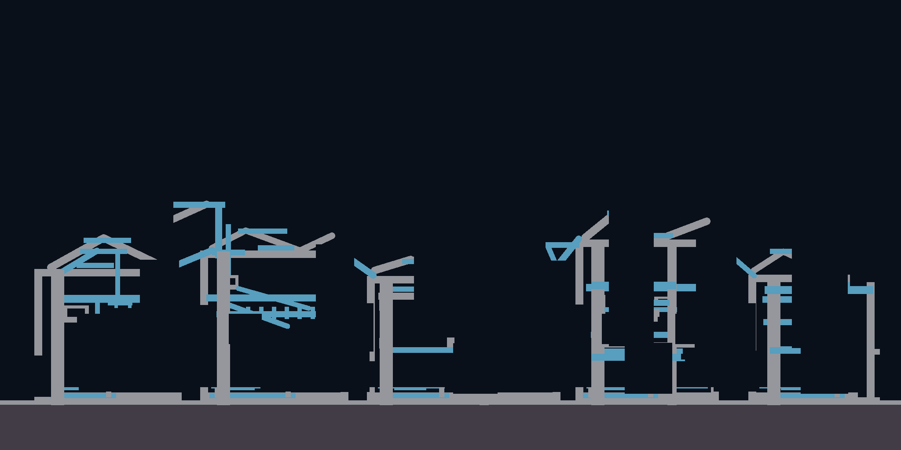

# Tidefault Bonded Freight — Low-Roof Parcel Borough / Stepped Customs Arcade

**WORLDGROUP FREIGHT — Tidefault Sibling 05.** Original 2048×1024 CyberSand material-cell canvas. **Draft/HOLD; source-static PASS; NATIVE-UNTESTED.** No engine or donor edits and no owner approval implied.

## Source authorities and donors

Read-only anchor **Graven Keel Ship-Tipper** [PR #45](https://github.com/techrote/sandmapsreference/pull/45) @ `7ce39e6eb6d701b515bd4f6b1ccea551bf467a2f` and **Peregrine Cleft / Halcyon Drydock** [PR #33](https://github.com/techrote/sandmapsreference/pull/33) @ `0e872ce0987be7e6df047152beac470ba362c7c5`; both authentic overviews, original README and generation sources inspected. Current accepted CyberSand `main@f7e056c9b8791106e22f2d1c295043783d8a9701` read-only authority; sandmapsreference branch founded from `main@99a166e7fcae45eb22be1740e9f33f62faccbcc7`.

The family retains grounded steel/concrete workfaces, parcel accountability, multi-grade maintenance returns, and deliberately monumental industrial negative space. Unlike Tidefault's prior tall gates / low return arches / cliff repository / signal piers, this sibling builds a **lower, multi-roof parcel borough with five unlike hall silhouettes**, entered bonded interior cells and a distinct inhabitation zone; no exact donor geometry, route graphs, coordinates or pixels have been copied.

## Districts / physically readable transactions

1. **West manifest quay and crane intake:** fixed supported cargo hook, represented load, two-roller berth receiver and entered ledger.
2. **First classifier / transfer hall:** visibly stepped dual-grade sorter, hand sorting bays, local pulley/repair workface and broad courtyard access.
3. **Bonded customs exchange:** separately bounded parcel receipt, screened examination and release workfaces with real physical side-entries and paired roof courts.
4. **Workers' customs borough:** unlike elevated warehouse level and inhabited tariff/office stations, independent lower rescue route and noncontinuous roofs.
5. **Damaged outward cargo berth:** asymmetric interrupted dispatch canopy, incomplete transfer deck and a navigable escape line.
6. **Under-service:** founded utility footings, wide recovery band, repair niches and separate routes beneath bonded and habitation districts.

Static materials are not animated machinery or scripted events. Empty upper flight regions, unfilled bays and damaged east append are **intentional authoring affordances**, not automatic P1s. Four unscripted set-piece candidates and eight controlled corpus diversity axes are in `exemplar.json`.

## Authentic committed indexed material imagery

True 1:1 one-cell-per-pixel crops from the identical committed plane: [West manifest quay](01-west-arrival.png), [roofed sorter](02-roofed-sorter.png), [bonded exchange](03-bonded-exchange.png), [workers' borough](04-workers-borough.png), and [damaged outward underworks](05-broken-export-underworks.png). Palette indexes: 0=empty, 1=basalt material 100, 2=reinforced concrete 58, 3=steel plate 62. These are material pixels, not native renderer captures.

## Exact source-static qualification

| Test | Exact result |
|---|---:|
| Full material plane | 2,097,152 cells |
| Valid disjoint Setup-v2 rectangles | 1107 / 32,768 |
| Setup JSON bytes | 21105 / 1,048,576 |
| Boundary-grounded occupied solids | 397603 / 397603 |
| Pruned ungrounded decoration | 22557 cells |
| Invalid/overlapping writes | 0 |
| Midge 19×15, 23×19 and 31×27 exact named sites | 28/28 at each |
| Physical inserted wall [850,180,110,250], rooftop crossing | 840 → 1068 steps, 28/28 sites retained |
| Indexed PNG source parity | 6/6, CRC and Adler verified |
| Source material SHA-256 | `b6d36f82c2da0ae13e5515c5e2a04b660bb29e2abb47c93321c755c3b759b3bb` |
| Source Setup SHA-256 | `2e600e8b6d876096a8448174eee4eb4a517fa03999003245d6e84bd654a97421` |
| Godot / Workbench / bridge / Rapier / ticks / cold-save reopen | **NATIVE-UNTESTED** |

### Reproduce

Run `node build.cjs --verify` to regenerate the exact committed `setup.json`, `receipt.json`, overview and five true 1:1 images. Run `node verify.cjs` for a separate committed-Setup replay, independently implemented material support/hash verification, Node-zlib PNG decompression, CRC validation and source-pixel comparison. The deterministic in-process generator performed all three conservative full-hull route and obstruction tests; the separate Node verifier has **not yet been executed in this run**.

**Review gates:** independent Art/Technical/Shepherd exact-HEAD receipts are pending. Inspect especially the physical legibility of bonded handoff and inhabitants rather than insisting on filling open sky. Actual native runtime/persistence remains untested. Hold Draft; no merge or Ready.
