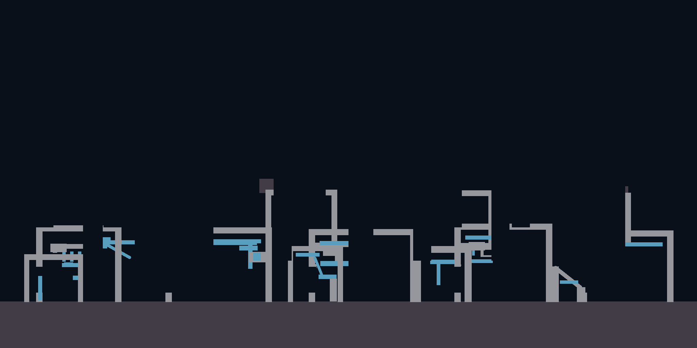

# Tidefault Bonded Freight Districts — Quarantine Return Arches / Fallen Evacuation Spur

**World-group Freight B · Sibling 02 · NEW original 2048×1024 CyberSand material-cell canvas · OPEN Draft/HOLD · creator SOURCE-STATIC PASS · NATIVE-UNTESTED.**

## Spatial and operational thesis

Unlike [Tidefault Sibling 01](https://github.com/techrote/sandmapsreference/pull/116)'s serial towering custody gates, this is a **horizontal, floor-founded bonded return yard with sparse, unequal low industrial arches**. Its readable static freight sequence is **arrival stamping → classification hook/receiver → quarantine handling → crew/refitting exchange → damaged emergency return**. The overflight space and unbuilt bays are intentionally preserved for manual edits, modular-part grammar derivation and future scripted set-pieces. Most upper visual space is blank by design, *not* an assertion of a completed subterranean city. High and low Midge-safe return movements share a sparsely built grounded yard with recovery gaps.

Four+ structural districts/workfaces: west inspection/stamping arch; offset diagonal classifier chute with rooted receiver; central isolated bonded/quarantine handling cell; crew and return-tray exchange; eastern damaged evacuation nose. Significant material-cell features use basalt substrate (100), concrete (58) and steel (62). No dynamic gates, simulated machinery, NPCs or fluids are claimed.

**Design-language donors (read-only):** [Graven Keel Ship-Tipper #45](https://github.com/techrote/sandmapsreference/pull/45) at `7ce39e6eb6d701b515bd4f6b1ccea551bf467a2f` and [Peregrine Cleft Halcyon Drydock #33](https://github.com/techrote/sandmapsreference/pull/33) at `0e872ce0987be7e6df047152beac470ba362c7c5`. Reuses selected structural materials, not geometry, pixels, named sites or route graphs. The deterministic lossless Setup/PNG helper is adapted from the owned Tidefault 01 utility, but this canvas' layout and stations are newly authored.

## Genuine full resolution material-cell evidence

- [West return arch / stamping](01-west-return-arch.png)
- [Classifier underworks / hook](02-classifier-underworks.png)
- [Quarantine exchange](03-quarantine-exchange.png)
- [Damaged evacuation](04-damaged-evacuation.png)
- [Lower workface return panorama](05-two-level-return.png)

All PNGs are 2-bit indexed lossless, genuine unscaled one-pixel-per-material-cell crops from the *same* final committed material plane. `build.cjs` generates these and validates each PNG's CRC, Adler and material-index parity. `verify.cjs` separately checks committed files without importing the generator; it has **not yet been run under Node**.

## Source qualification

| Test | Result |
|---|---:|
| Exact cell plane | 2,097,152 (2048×1024) |
| Legal disjoint Setup-v2 rectangles | 280 |
| Setup JSON bytes | 5930 |
| Root-connected occupied cells | 380410 |
| Invalid/overlapping writes | 0 |
| Literal Midge sites at 19×15, 23×19, 31×27 | 25/25 at each |
| Real physical obstacle with all sites retained | 865 → 975 steps |
| Authentic indexed overview + 1:1 crops | 6 |
| Plane SHA-256 | `0ea0bd719ea6658e56655267f05ca37bf6a9534fb9d450299be0a7f1d5bb6fc8` |
| Native Workbench/Rapier load, movement, ticks, save/reopen | NATIVE-UNTESTED |

**Read-only accepted engine/main authority** `8d07e04459a2705a6f96c908c0b565a483cc5beb`; sandmapsreference current default main base `99a166e7fcae45eb22be1740e9f33f62faccbcc7`. Engine schema inspection found the intervening main change set concerned world-art tooling rather than Setup/Midge/material law files; this does not substitute for fresh native acceptance.

## Authoring and event affordances

Unscripted arrival/customs dialogue, classifier failure and rerouting, quarantine examination, refuge at the crew exchange, and damaged emergency-span collapse. Spare bays and open flyable space are intentional. `exemplar.json` records these plus the controlled v1 diversity classifications; it is descriptive corpus metadata, not an engine gate.

**Draft/HOLD only.** Require independent source-matched Art, Technical and Shepherd review; no merge/Ready/auto-merge or owner-acceptance assertion.
