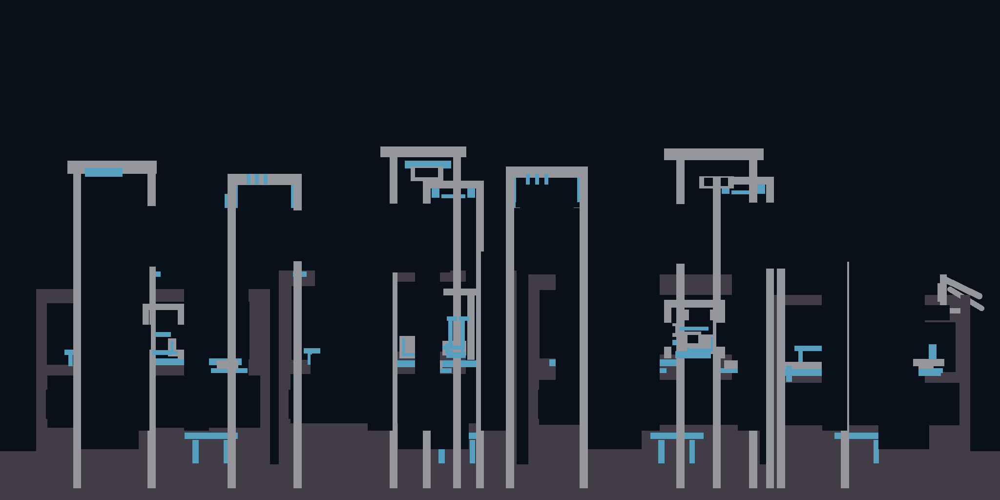

# Tidefault Bonded Freight — Sealed Customs-Lock Grid / Abandoned Pressure Ward

**R2 bounded independent-Art-P1 repair (21 November 2026; source-static requalification only).** Added three unlike, physically entered custody workfaces within existing founded stations: a double-side-entry sample inspection booth, an offset bonded-rack handling cell which preserves the central maintenance shaft, and a two-entry quarantined examination pocket with low transfer tray. These do not claim working doors or simulated pressure, and the main overflight, 25 Midge literal sites, lower emergency route and editable abandoned annex remain available. The previous Art verdict at R1 does not qualify R2; fresh exact-HEAD independent reviews remain required. R2 full plane SHA-256: `ff5509d3167f6576c5df469ddcc99f53e4afaa95013c1e6d13d2b9a149ea1cca`; 503 lossless rectangles; 25/25 reached for each of 19×15, 23×19 and 31×27; hard obstacle route 1022 → 1078 steps; NATIVE-UNTESTED.

**World-group Freight B · new Tidefault Bonded Freight Districts family, sibling 01 · completely original map geometry · 2048×1024 material-ID side elevation. DRAFT/HOLD. Source-static qualified, NATIVE-UNTESTED.**

## Operational role and world-family design language

A dryland *bonded freight custody* complex between the established harbour salvage/grade-classification economy and remote export. Its horizontal progression is **arrival weighing → serial lock admission → bonded stock registration → custody sorting → quarantine examination → derelict annex/evacuation**. Static gates represent structural thresholds only: no functioning doors, water pressure, fluid pumps, NPC scripts or dynamic machinery are claimed.

Five purposeful workfaces: **western registration/ledger warehouses**, **entered unequal bonded vault grid**, **central custody seals and inspection benches**, **eastern pressure/isolation workfaces**, and **damaged abandoned pressure ward**. A sixth, comparatively empty, **drained underfloor relief network** is reserved for human staging and procedural detail. The architecture is rooted masonry with blue-steel machinery cues and serial side-entered gates. Open sky above the lock crowns, foundry-like storage cavities below, and unfinished eastern rooms provide strong density-to-void cadence.

This map is purposely unlike Cleftline Logistics' long open quay (#86), V-cut salvage (#90), hillside switchback (#96), enclosed central cold-form press (#103) and four inhabited causeway settlements (#110). Its landmark grammar is **distributed gate/arch/inspection**, not another crane or giant hull. Prior original anchors [Peregrine Cleft / Halcyon Drydock #33](https://github.com/techrote/sandmapsreference/pull/33) @ `0e872ce0987be7e6df047152beac470ba362c7c5` and [Graven Keel Ship-Tipper #45](https://github.com/techrote/sandmapsreference/pull/45) @ `7ce39e6eb6d701b515bd4f6b1ccea551bf467a2f` contributed only engineering vocabulary, not pixels, coordinates, route graphs, geometry or named places.

## Authored world, Midge and Setup-v2

| Static-source check | Exact value |
|---|---:|
| World plane | 2048×1024 = 2,097,152 final material cells |
| Material IDs | 0 Empty, 100 BasaltColumns, 58 ReinforcedConcrete, 62 SteelPlate |
| Disjoint lossless Setup-v2 rectangles | 437 / 32,768 |
| Complete UTF-8 Setup JSON | 9238 / 1,048,576 bytes |
| Rectangle application work | 487,033 / 32,000,000 |
| Occupied, boundary-grounded / detached | 487,033 / 0 detached |
| Illegal or overlapping writes | 0 |
| Exact Midge sites, conservative 19×15 | 25/25 |
| Exact Midge sites, conservative 23×19 | 25/25 |
| Exact Midge sites, conservative 31×27 | 25/25 |
| Physical material-58 obstruction [x,y,w,h] | 370, 272, 100, 96 |
| 31×27 actual obstruction detour | 1022 → 1078 cardinal centre steps |
| Full-grid SHA-256 | `b8460d67f47b94c2997ac1d4f80a0fb03b9bd021786a722efa0e696af248250d` |
| Native Workbench / Rapier Midge / cold save-reopen | **NATIVE-UNTESTED** |

The complete Setup has the accepted 14-field root envelope and authored Midge 4×3 model hash `c226d73ae56a426820d2ef842a4856bf79ac23efabe64e66569dff8de62a7a96`; spawn **(125, 463)**. All 25 exact named sites were checked from that spawn by conservative complete-footprint, in-bounds, four-neighbour clearance. The simulated rectangular obstruction is added only during the **static route test**, not to the normal Setup. All sites remain accessible.

The map uses a deterministic standalone generator with generic Setup-v2/PNG/sha helpers adapted from an earlier Freight B creator's tooling, but all district geometry, machine arrangements and routes here were independently authored for Tidefault. Run `node build.cjs --verify` to regenerate and byte-compare the committed Setup, receipt, full overview and five true one-cell-per-pixel crops. Run `node verify.cjs` for a *separate* replay, grounding, route and PNG-integrity check using Node built-ins. The source authority is read-only accepted [CyberSand main](https://github.com/techrote/cybersand) @ `de58bf1997ca75825cf3b29e046dc1c1022c45bf`; sandmapsreference base `99a166e7fcae45eb22be1740e9f33f62faccbcc7`.

## Actual material-cell visual evidence

- [overview.png](overview.png) — actual source-cell crop 0, 0, 2048, 1024, 2,097,152 material pixels
- [01-west-bond-ledgers.png](01-west-bond-ledgers.png) — actual source-cell crop 78, 304, 498, 490, 244,020 material pixels
- [02-vault-cell-grid.png](02-vault-cell-grid.png) — actual source-cell crop 576, 293, 493, 506, 249,458 material pixels
- [03-pressure-locks.png](03-pressure-locks.png) — actual source-cell crop 1080, 309, 508, 495, 251,460 material pixels
- [04-abandoned-ward.png](04-abandoned-ward.png) — actual source-cell crop 1570, 376, 470, 490, 230,300 material pixels
- [05-lower-relief-ways.png](05-lower-relief-ways.png) — actual source-cell crop 86, 739, 1850, 205, 379,250 material pixels

## Literal, exact authored site centres

| Site | X | Y |
|---|---:|---:|
| West bonded intake | 125 | 463 |
| Arrival weigh registry | 340 | 462 |
| First inspection lock | 555 | 463 |
| Seal witness office | 744 | 462 |
| Bond vault threshold | 1012 | 460 |
| Custody sorter | 1245 | 460 |
| Pressure gate crossing | 1440 | 459 |
| Isolation checkpoint | 1646 | 460 |
| Abandoned annex entry | 1786 | 459 |
| East bonded exit | 1921 | 462 |
| West signal parapet | 215 | 262 |
| Ledger watch | 489 | 282 |
| Overhead bond signal | 885 | 254 |
| High ward monitor | 1450 | 255 |
| Ruined annex lookout | 1830 | 278 |
| West tally room | 192 | 694 |
| Sample seal laboratory | 402 | 690 |
| Bonded rack chamber | 778 | 709 |
| Custody inspection vault | 1010 | 707 |
| Dry lock equipment | 1325 | 692 |
| Quarantine custody | 1536 | 703 |
| Damaged archive | 1844 | 712 |
| West underpass | 280 | 826 |
| Central maintenance return | 875 | 827 |
| East evacuation culvert | 1709 | 828 |

## Corpus and future setpieces

See [exemplar.json](exemplar.json). The main new structural combination is **compact yard/nested cavities + multi-strata + alternating clustered density + distributed gate/tower landmarks + founded loads + damaged annex**. Future event proposals, not current scripts: bond inspection holdout, side-entry gate actuation, abandoned bulkhead failure and lower-gallery evacuation. Preserve unused warehouse slots and empty duct mouths for later hand editing, SWARM/GENTEK rule extraction and scripted-event staging.

## Review gates

No native source-matched Workbench host, CyberDemoBridge/Rapier ticks/collision, piloted flight or fresh-process save/reopen has been executed. **Creator static checks are not independent Art/Technical/Shepherd reviewer approval.** Independent source-exact reviews must inspect every genuine crop, rebuilt site collision, grounded solids, evidence provenance and portfolio differentiation. Keep OPEN Draft/HOLD; do not mark Ready, merge or auto-merge.
