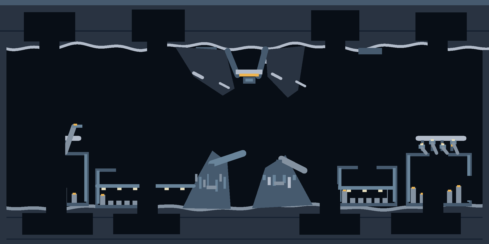
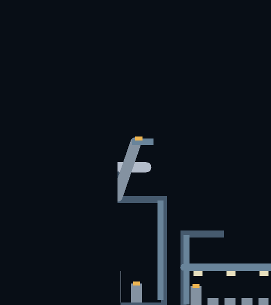
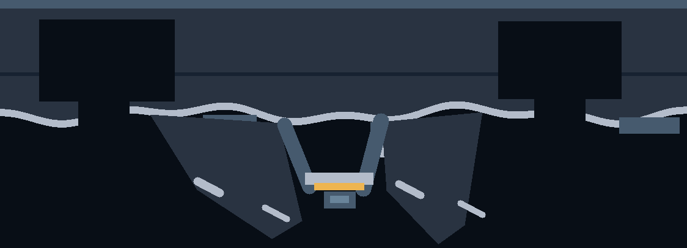
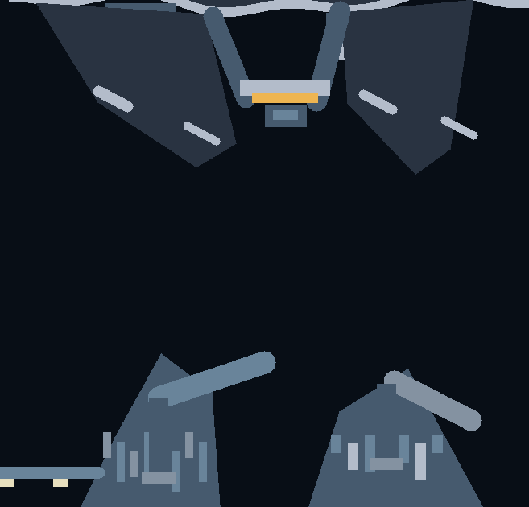
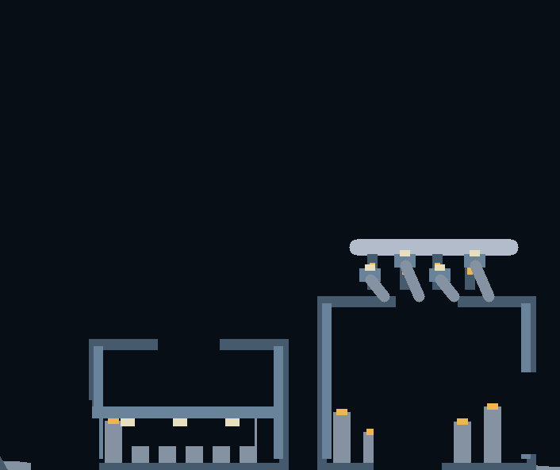
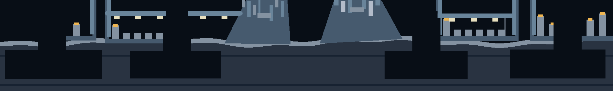

# Meridian Counterweight Corridor — Ingot Quarter Venturi Lockworks

**Sibling 05 · Original 2048×1024 / 2,097,152-material-cell landscape · Draft/HOLD · NATIVE-UNTESTED**

## Structural thesis

An enclosed dry-energy **nested-cavity pressure lockworks**. Four deeply cut, entered roof operator caverns rise over a huge open freight/racing throat. Two opposed giant roof-rooted compression jaws face grounded floor buttresses. A low freight/recovery line connects four entered undertrack workshops and several dense side industrial quarters. This is a different world topology from Tungsten's central rotor, Latchreach's A-frame, Forkfield's signal-yard, Subgrade's twin buried arteries and Tiltglass's open-air cascade.

**Workfaces/districts:** western inlet/switching quarter; western and eastern populated roof-operator vaults; central opposed Venturi compression throat; right-hand cylinder and freight-catch district; four entered lower industrial workshops. Open pressure-throat air, unfinished side courts and spare machine shops are deliberate human-edit and GENTEK/SWARM design affordances, not unfinished qualification defects.

## Traversal and physical obstruction

Midge starts at (111,493). All **23/23 named sites** (including four actual roof vaults, west/east freight courts, both throat lips, four low machinery rooms and east finish at (1948,771)) are conservatively traversable at exact 19×15, 23×19 and 31×27 rectangular clearances. A physical **102×91 solid steel obstacle** at (1005,425) covers only the named High vent interlock; full 31×27 rerouting still connects **22/23** sites, including lower bypass, workshops and finish.

Potential *unscripted* event/edit hooks: central pressure-lock activation/shutdown; west high-to-low rescue shaft; east roof dispatch NPC encounter; undertrack repair-bay holdout.

## Exact creator source-static receipts

| Contract | Result |
|---|---:|
| Material plane | 2048×1024 / 2,097,152 cells |
| Supported inert solids | 49,58,62,100,101,113,117,122 |
| Grounded solid cells / final detached | 747094 / 0 |
| Detached candidate cells discarded during grounding | 80847 |
| Non-overlapping Setup-v2 rectangles | 2593 / 32768 |
| Setup JSON bytes | 49932 / 1048576 |
| Material visits / work budget | 747094 / 32000000 |
| Full Setup source-to-replay equality | All 2,097,152 cells |
| Exact Midge clearance sites | 23/23 at 19×15, 23×19, 31×27 |
| Physical 102×91 closure | 22/23, only high interlock blocked |
| Indexed PNGs | 1 whole map + 6 true 1:1 material-derived crops |
| Grid SHA-256 | `bee61157199a35f58d5921e4f90b2715a05dab3f6ba29bafc7d3b010284421c7` |
| Setup SHA-256 | `2c182b4266af8cee7d744c90e77085bf624213babad78c0bd5ecaa07cdcb7789` |
| Native Workbench/Godot/CyberDemoBridge/Rapier flight, save/reopen | NATIVE-UNTESTED |
| Independent Art/Technical/Shepherd | PENDING |

## Reproduce

`geometry.cjs` is the original deterministic geometry; `node build.cjs` reproduces the lossless `setup.json`, `receipt.json` and indexed `*.png` material cells using a fixed deterministic R1 geometry (identity seed `0x261121c5`). `node verify-independent.cjs` independently checks on-disk Setup replays, true pixel indexes and PNG CRC/zlib integrity; its authoring does not constitute an external review.

`exemplar.json` is *corpus metadata*, schema_version 1 with controlled diversity_axes and four unscripted setpiece candidates. No engine contract added.

**Read-only design donor:** [Tungsten Sawtooth Tramworks PR #69](https://github.com/techrote/sandmapsreference/pull/69) @ `7fc24855cf521c90bf67f4afb08685e490473201`.
**Read-only accepted CyberSand source:** `main@8d07e04459a2705a6f96c908c0b565a483cc5beb`; reference repo parent `main@99a166e7fcae45eb22be1740e9f33f62faccbcc7`.

## Authentic indexed-material overview and crops

**Retain Draft/HOLD**. No owner acceptance, Ready, merge or auto-merge. Real native qualification and independent review must use the exact PR HEAD.
