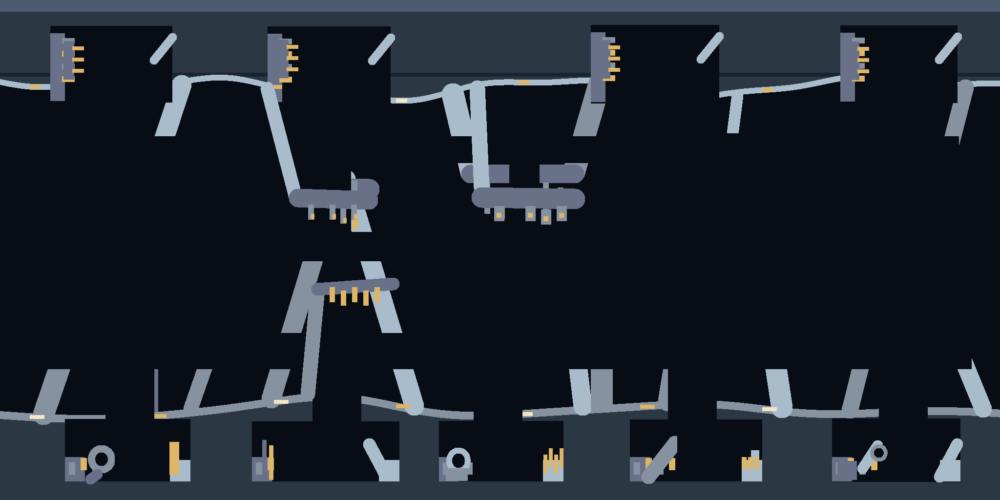
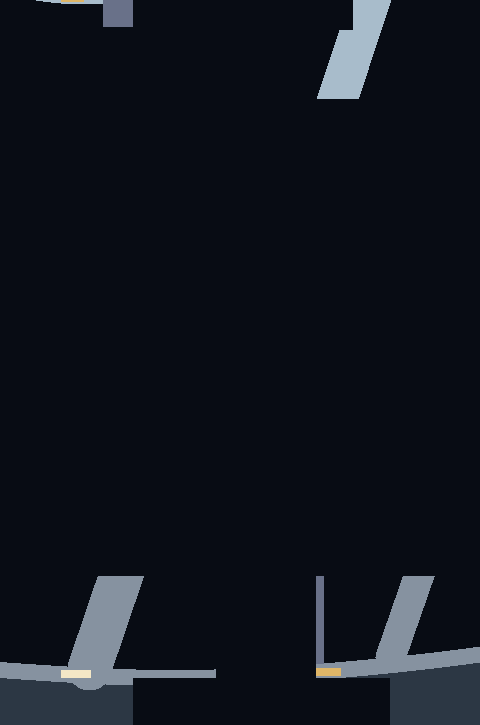
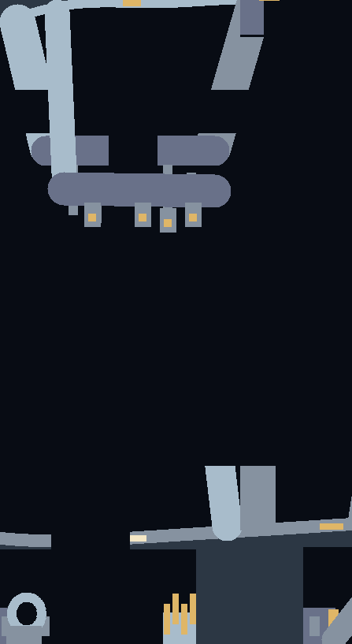
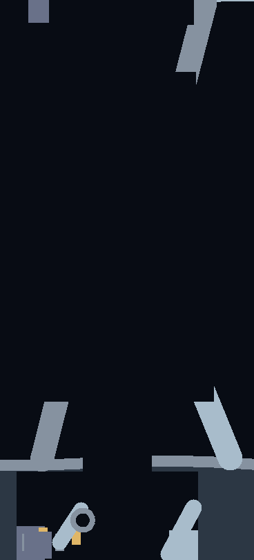
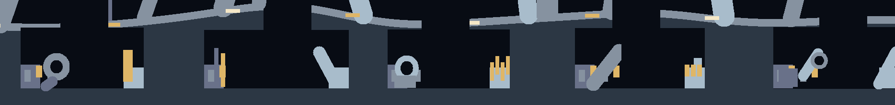

# Meridian Counterweight Corridor — Latchreach Switch Exchange (2048×1024)

**World-group:** Meridian Counterweight Corridor / **Sibling 01:** Latchreach switch exchange. **R2 mechanical detail pass.** **DRAFT/HOLD**; entirely new material-cell world, no source-image conversion or donor geometry copied. Creator source-static checks only. Independent Art / Technical / Shepherd reviews PENDING. **NATIVE-UNTESTED.**

This is the first location in a planned family of 4–8 related mechanical-transit levels. Its world role is the **regenerative counterweight rail-switch and lift-transfer interchange** between the upstream impulse tram corridor and downstream freight/racing branches. Recurring family vocabulary: bare-iron crossheads, zinc countersigns, heavy grounded basalt footings, concrete counterweight cases, braced tram mast gantries, roof-hung telemetry and floor-entered workshops.

**Primary stylistic anchor:** [Tungsten Sawtooth Tramworks R2](https://github.com/techrote/sandmapsreference/pull/69) (exact consulted HEAD `7fc24855cf521c90bf67f4afb08685e490473201`). Unlike that source, there is **no central six-spoke rotor, repeating alternating roof/floor teeth, salt screen or equivalent route copy**. The new spatial program is west intake switch → differential A-frame gantry → **long horizontal six-channel transfer crosshead** with actual counterweight service line → eastern offset cantilever mast → regenerative catcher/recovery. The engineering looks static; there are no fake moving machine claims.

## R2 mechanical plant revision

The original source-static R1 route map already connected every named Midge site but its large middle band was under-equipped, with too-similar floor workshops. R2 materially reauthors the same owned grid: a new suspended differential gantry, a slotted *horizontal* crosshead, a separate eastern mast head, grounded lower tram chassis, and five non-identical actual-cell workshops (actuator, stators, clutch, tension ram and recovery winch). The new 24-site source-static clearance and blocked-route tests have been rerun at the new grid SHA; **R1 image and geometry qualification must not be inherited**. Native/independent review remains pending.

## Five independent physical workfaces

1. **West intake switch** — supported angled capture jaws, lower piston, roof-entered telemetry, entered floor actuator shop.
2. **Differential lift gantry** — tall unequal A-frame rooted in floor with a roof tension anchor, visible nested counterweight guides, upper highline and lower recovery.
3. **Transfer crosshead** — roof-anchored bridge, six differently descended shuttle lugs, founded opposed weight-cradles and entered coupler vault.
4. **Eastern counterweight mast** — off-axis double mast, chain slots, enterable signal control room and service shop.
5. **Regenerative east dispatch** — asymmetric capture horns, open turn-around, operator station, lower recovery winch room.

All cells are 2D orthographic perpendicular side elevation with real material indices. High/middle/lower cross-world flyways and generous vertical alternate passages were cut into final material geometry; route destinations are real named centres, not snapped substitutes. Open air is deliberately larger than equipment.

## Literal Midge route

West ingress (130,497) → Intake switch (328,494) → High west glide (482,322) → A-frame gantry high (817,298) → Crosshead upper (1074,309) → Crosshead middle (1098,504) → East mast upper (1509,293) → Discharge approach (1837,487) → Turnaround (1900,705) → East mast low (1507,708) → Counterweight bypass (1114,711) → A-frame service lower (699,706) → West recovery (466,718) → Finish (149,497). In addition, four roof control rooms and five floor-entered shops are distinct tested destinations.

A genuine solid **96×56 obstruction at XY (1050,476)** covers the Crosshead middle destination, while the upper crosshead, lower counterweight bypass, east turnaround and return remain connected by 31×27 full-hull routes.

## Creator source-static evidence

| Check | Exact candidate |
|---|---|
| Material plane | 2,097,152 / 2,097,152 cells |
| Disjoint canonical Setup-v2 rectangles | 2439 / 32,768 |
| Complete Setup-v2 JSON | 46129 / 1,048,576 bytes |
| Grounded inert solids / material work | 560340 / 560340 |
| Detached, flowing or reactive final cells | 0 |
| Full ordered replay | 0 overlaps, 0 mismatches |
| Literal sites at 19×15, 23×19, 31×27 | 24/24 at each |
| Real 31×27 blocked alternative | 23/24 (only covered site unavailable; finish reached) |
| Genuine material-ID PNGs | 1 full 2048×1024 overview + 6 exact 1:1 crops |
| Source-material grid SHA-256 | `232780d1080ebafe93b7f9dc0fcaa023782388248ad57e4b1d4b15d7b0996963` |
| Native Workbench / Rapier / installed bridge / cold reopen | **NATIVE-UNTESTED** |

**Reproduce:** `node build.cjs`, then `node verify-independent.cjs`. The standalone verifier reconstructs the *committed Setup JSON*, hashes and floods every material cell, tests fully contained literal Midge envelopes, physically inserts the blockage, and inflates every committed indexed PNG to compare each pixel with the Setup grid. The author generated and internally checked the source representation; do **not** treat this as executed independent GitHub CI or a native physics test.

**Accepted source authority, read-only:** CyberSand `main@7b03aa437561ec63e31fd09531171360ab60eeb4`. Accepted source Setup-v2 nominal ceiling is 32,768 rectangles and 1 MiB. Historical installed bridge may expose only 4,096 rectangle slots; this candidate is 2439, below that historical number, but actual installed capacity is **not verified**. Actual Godot/Shared Workbench/Rapier load, flight/collision, ticks and fresh-process save/reopen remain untested.

## Actual material-cell image gallery

New future sibling maps should explore track-classification yard, high-tension power transfer, cliffside lift repair and failure recovery **without repeating this particular crosshead topology**. Keep Draft/HOLD; never merge or mark Ready without owner instruction.
