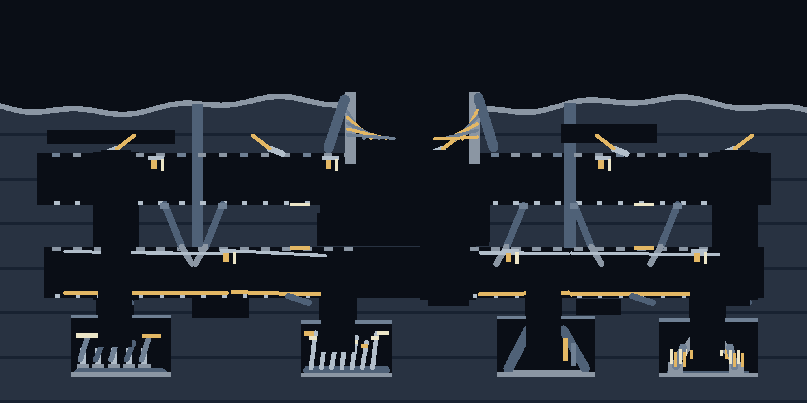

# Meridian Counterweight Corridor — Subgrade Braided Traction Return

**New, original 2048×1024 material-cell canvas. Transit world-family sibling 03. Draft/HOLD.**
Creator SOURCE-STATIC checks only. **NATIVE-UNTESTED; not owner-accepted.**

## Corpus role and distinct spatial thesis

A buried emergency sliplane under the upstream switching works. Two visually and physically distinct long transit cuttings pass through a dense geology envelope, connected by three deliberately unequal grade-transfer throats. Two founded median abutments interrupt isolated upper stretches; the lower return is the recoverable through-route, even if a long upper section is obstructed. The central ceiling breaks into a broad open-air traction aperture spanned by rooted **paired tension harps**, not a wheel, mast line, switch matrix or sawtooth capacitor. Four entered machine workbays are left intentionally expandable.

1. **West twin-artery intake:** compressed roofed inbound cutting and relief lane, angled contact plates, west interchange and opposed mechanical rams.
2. **Countershaft and cable-comb district:** independent upper/lower return, roof-rooted median structure, a physical emergency rejoin and entered tension-comb workface.
3. **Exposed traction aperture:** big central void, roof and side-rooted tension harps, upper transit sightline, distinct lower buried through-route.
4. **East supported divergence:** low/high service choice, grounded load supports, deep catch magazine and side rejoin.
5. **Rescue release and east reversal:** wide low recovery line, third cross-grade throat, founded emergency traction workface, east return.

**Underrepresented dimensions selected before authorship:** braided rather than yard macro-topology; predominantly dual-level underground excavation rather than elevated mast skyline; roof-rooted median load transfer rather than central machine; dense-rock/open-void cadence; modular unfinished side expansion; sparse interchanges rather than repeated junctions. See `exemplar.json` for all eight controlled Corpus-Index V1 axes and four unscripted staging sites.

**Primary anchor inspected:** [Tungsten Sawtooth Tramworks R2](https://github.com/techrote/sandmapsreference/pull/69) at `7fc24855cf521c90bf67f4afb08685e490473201`. Sibling contrasts: [Latchreach](https://github.com/techrote/sandmapsreference/pull/87) at `c68c3e067972356f842ffd7e52f0fbd27f3d8c19`, [Forkfield](https://github.com/techrote/sandmapsreference/pull/92) at `f80acfab74f6ff21d0c07dd28795f3ed46b0fa44`. They supply material/engineering culture only. All committed geometry, route topology, staging locations and authored pixels are original.

## Physical path evidence

Representative named exact-site route: West entry (144,458) → upper west (455,457) → first interchange (287,572) → lower return (453,691) → west rejoin (751,465) → broad exterior reveal (1018,455) / buried relief (1023,694) → east supported cutting (1359,461) → final interchange (1858,577) → east turn (1844,686) → finish (1940,461). Four real interior service destinations at (291,852), (865,858), (1392,851), (1800,850) connect to the same network; see all 21 exact literal sites in `receipt.json`.

The temporary hard material obstruction **[570,387,103,140]** covers the upper checksum (617,459) and blocks that direct passage. At the largest 31×27 hull, the remaining **20/21** sites remain connected from spawn through lower recovery; the covered literal checkpoint alone is rejected. There is no site snapping, scripted door or fake teleport.

## Source-static reproducibility at final geometry

| Check | Creator result |
|---|---:|
| Physical plane | 2048×1024 = **2,097,152 indexed material cells** |
| Setup-v2 rectangles, disjoint | **4,308 / 32,768** |
| Setup JSON bytes | **82,155 / 1,048,576** |
| Grounded inert solid cells | **874,442** |
| Remaining detached solids | **0** (9,655 floating draft candidate cells were discarded) |
| Replay exact match | Entire final grid, zero differences |
| 19×15 exact centre sites | **21/21** |
| 23×19 exact centre sites | **21/21** |
| 31×27 exact centre sites | **21/21** |
| Physically blocked 31×27 | **20/21**, only deliberately covered checkpoint excluded |
| Source grid SHA-256 | `f0ffa928fb1727b354e5fd4a7aa67e0f53efe7ba37d010cff95d3da820ecdeb9` |
| Complete Setup SHA-256 | `920cc181645fe2069fc12dc94bba431afd7b71da6a11a2ccd983b7ecbef5894f` |
| Material palette | Inert IDs 49, 58, 62, 100, 101, 113, 117, 122 |
| Material source work | 874,442 / 32,000,000 |
| Native flight/collision/ticks/save/reopen | **NATIVE-UNTESTED** |
| Independent Art/Technical/Shepherd | PENDING |

Run `node build.cjs` to regenerate the exact `setup.json`, `receipt.json` and seven PNGs. Run `node verify-independent.cjs` to independently decode/replay Setup, check PNG chunk/CRC/zlib/pixel parity and destination receipts. The generator source checks were performed while composing this exact file set, but actual GitHub CI and external independent reviewers are **not** claimed. Seven GitHub binary images were re-fetched as base64 and byte-compared against source-regenerated images: **7/7 match**.

## Actual indexed-material images

**Unscaled 1:1 indexed-material details:** [West twin-artery](01-west-dual-artery.png) · [First countershaft](02-first-countershaft.png) · [Central traction aperture](03-exterior-traction-aperture.png) · [East subgrade rejoin](04-east-subgrade-rejoin.png) · [Rescue works](05-emergency-rescue-works.png) · [Undertrack workfaces](06-undertrack-machine-workfaces.png).

These are direct pixel crops of one final indexed material plane, not generated concept art. Full 256-entry PNG PLTE uses the eight chosen material IDs plus empty ID 0; transparent black void is represented as empty material index 0. The intended empty chambers, undertrack seams and bare industrial walls are future editing affordances, not accidental omission.

**Source authority:** `sandmapsreference main@99a166e7fcae45eb22be1740e9f33f62faccbcc7`; current CyberSand accepted read-only source `main@de58bf1997ca75825cf3b29e046dc1c1022c45bf`. No engine edits, donor branch edits, other creator work, native claims, Ready promotion or merge.
