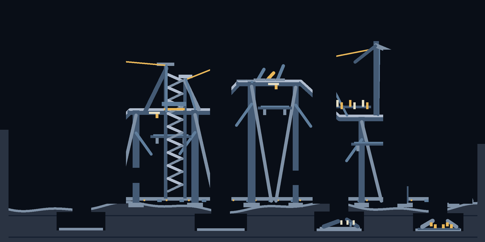
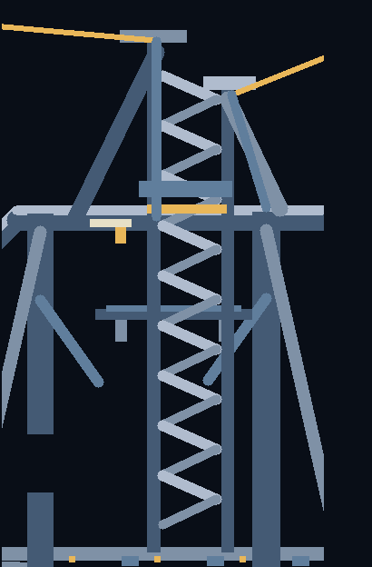
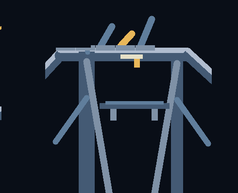
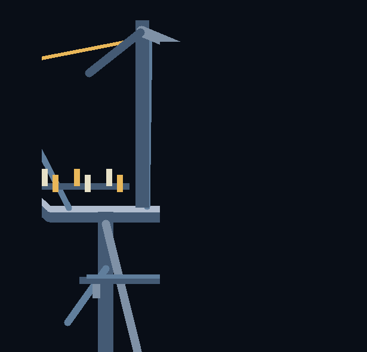
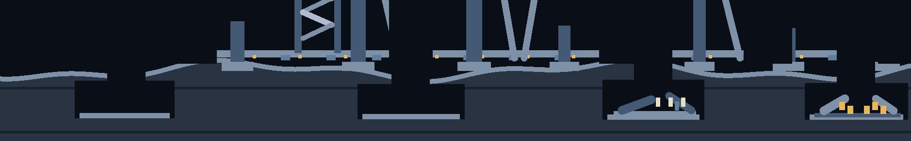
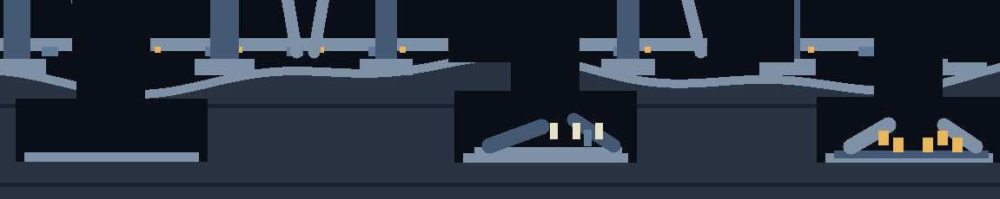

# Meridian Counterweight Corridor — Tiltglass Catenary Cascade

**Original 2048×1024 CyberSand material-cell canvas · Sibling 04 · Draft/HOLD · NATIVE-UNTESTED.**

## Structural proposition

An asymmetrical **open-air five-grade liftworks and freight glide**: west pulse intake rises via uneven decks into an off-axis 420-cell tall traction rack, high energy-transfer crest, eastern downhill catch, and a crane-jib departure. A broad lower rescue strip has five generous carved vertical access slots. **This is not Tungsten's central radial wheel/baffle grammar, Latchreach's long horizontal A-frame crosshead, Forkfield's shallow three-way yard, or Subgrade Braided Return's mirrored gorge and two buried arterial bands.** Source geometry is newly authored, not borrowed.

**Five distinct districts/workfaces:** (1) west pulse-loading and buffer yard, (2) offset rack-and-counterstroke lift, (3) elevated transformer/interlock crest, (4) asymmetric long catenary/crane exchange, (5) east catcher and lower rescue depot with four grounded enterable excavated service shops. The long exposed flights, unused machinery bays and expansion seams remain intentionally incomplete for human editing and SWARM/GENTEK structural exemplars.

## Literal traversal and obstruction

Primary landmarks: Start (104,548) → west ramp (422,526) → tower inspection (622,388) → upper glide (877,401) → high interchange (1018,295) → high grade (1230,293) → transformer (1372,401) → crane reveal (1671,301) → east catch (1879,561). The far-east turn (1938,725), low rescue (215,792; 629,784; 1200,789; 1680,786), all four entered workshop centres, and finish (1917,781) are directly reachable from Midge spawn at each three whole-body hull checks. The physical **92×84 wall** at (979,254) blocks only the high interchange; the lower alternative and the other 21 locations remain reachable.

## Creator-level static qualifications

| Test | Exact result |
|---|---:|
| Material grid | 2048×1024 = 2,097,152 cells |
| Inert supported material IDs | 49, 58, 62, 100, 101, 113, 117, 122 |
| Grounded solid cells | 456,909; zero detached in final grid |
| Disjoint Setup-v2 rectangles | 4,222 / 32,768 |
| Setup JSON size | 79,281 / 1,048,576 bytes |
| Material construction/visit work | 456,909 / 32,000,000 |
| Lossless source-to-Setup replay | 0 overlap, 0 material differences |
| Literal 19×15 / 23×19 / 31×27 free-centre routes | 22/22 each |
| Actual obstruction with 31×27 | 21/22; only covered high checkpoint refused |
| Genuine indexed PNG evidence | complete 2048×1024 overview + 6 true 1:1 crops |
| Final grid SHA-256 | f32bf927a392993587ff569aaca720aec53799239c77409475c222250de77479 |
| Setup SHA-256 | 4a1bf0a93a88a6933f3f1bdb3232da9b1afe34e3974a7fef799b38e591c63584 |
| Native Godot, Workbench, bridge, Rapier, actor control / collision / save-reopen | **NATIVE-UNTESTED** |
| External Art/Technical/Shepherd verification | **PENDING** |

## Reproduction and evidence

- Deterministic final-material source: geometry.cjs (fixed authoring seed 0x261120c4; no randomness required)
- Complete Setup-v2: setup.json; full SHA/histogram/Midge/PNG receipts: receipt.json
- Rebuilder: run `node build.cjs`; independent-from-encoder committed-file verifier: run `node verify-independent.cjs` with Node. The verifier's external execution/CI is not claimed.
- Authoring/corpus metadata: exemplar.json, schema_version 1 with eight controlled **array-valued** diversity-axis classifications.

**Primary anchor:** wide-tungsten-sawtooth-tramworks PR #69 @ 7fc24855cf521c90bf67f4afb08685e490473201, used for industrial design vocabulary only. **Read-only accepted CyberSand main:** de58bf1997ca75825cf3b29e046dc1c1022c45bf. **Reference base:** main@99a166e7fcae45eb22be1740e9f33f62faccbcc7. No donor, older sibling, engine or historical file edited.

**Disposition:** experimental corpus exemplar, independent qualification pending; DRAFT/HOLD, do not merge, mark Ready or claim owner acceptance.
