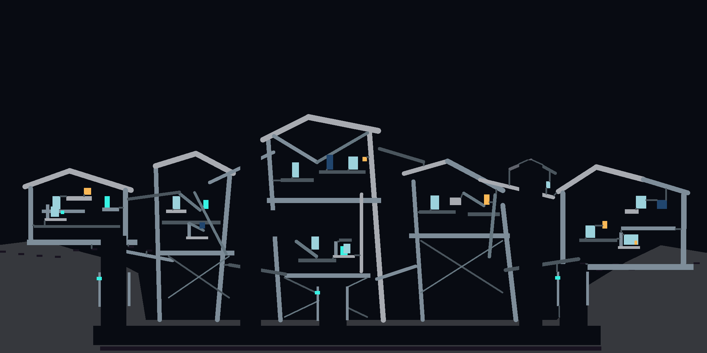
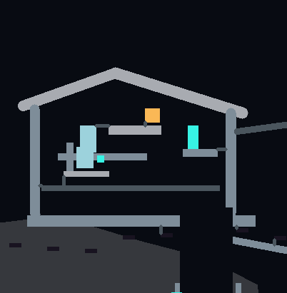
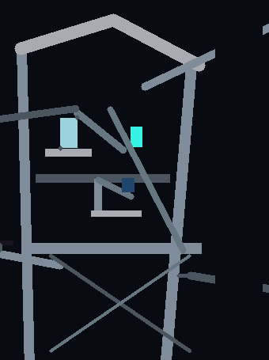
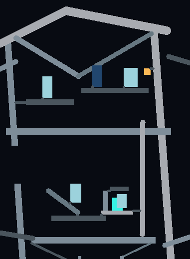
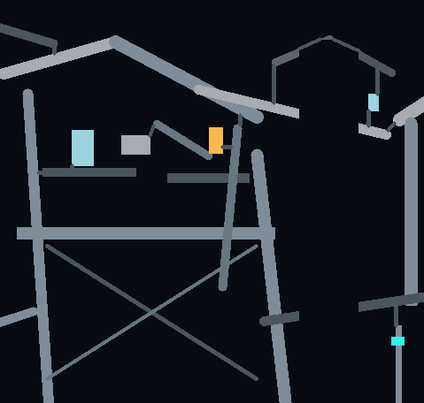

# Cinderfold Seed Courier Districts - Sibling 02: Braided Span Exchange

**Original 2048x1024 material-cell canvas. CREATOR-STATIC-PASS. NATIVE-UNTESTED. OPEN Draft/HOLD.**

World-group: Xenobiome / Frontier Clusters. Role: asymmetric double-height courier crossing with a west intake registry, receiver, high and low assay workfaces, selector, and east sterile freight.
Inherited family vocabulary: Threnody Scar #73 @ 00cb6b6b86b875d8b81cc387c711aa56f172d9dd and Graftloom Slipway #22 @ b0d1e5216aabb9b5e009e599ffbffcec6fd8a657 as read-only material/engineering-language donors. New original layouts and pixels; no copied geometry or route coordinates.
Distinct from Cinderfold Sibling 01: slanted dual-height braided causeways and founded off-center load paths above an intentionally sparse basin, a lower freight lane and actual dry underpass. Editable voids, crossovers and damaged gangway sockets are deliberate corpus value.

## Static checks

- 396798 grounded occupied cells / 396798 occupied; zero detached or invalid writes.
- 3682 valid lossless ordered Setup-v2 rectangles / 32768; JSON 68994 bytes / 1048576; full world e2bbdb8967a6ae69c53973e32fdce770bff4bae5f3fbf1f35517ca38787b25b1.
- Exact 19x15, 23x19 and 31x27 Midge static hull routes: 24/24 | 24/24 | 24/24. Physical upper lock obstruction 23/24; restricted true underpass 6/6.
- Deterministic `node build.cjs` source reproduces the exact Setup, receipt, exemplar and six material-index PNGs; use `node build.cjs --verify` for exact byte checks.
- CyberSand accepted read-only main f7e056c9b8791106e22f2d1c295043783d8a9701; sandmapsreference baseline 99a166e7fcae45eb22be1740e9f33f62faccbcc7. No native Godot/Workbench/Rapier test performed; NATIVE-UNTESTED. Independent Art/Technical/Shepherd verdict pending.

## Authentic full-grid and unscaled district images

Never merge or Ready promote without owner approval.