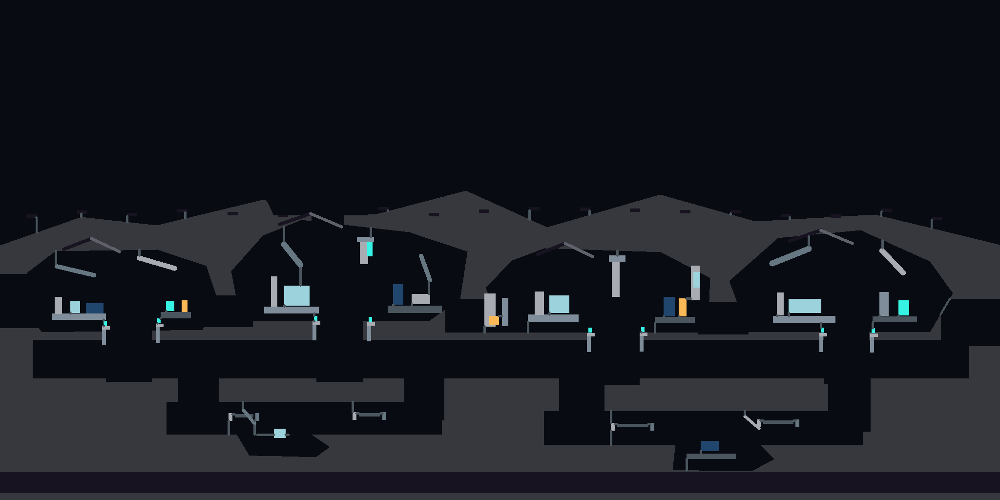
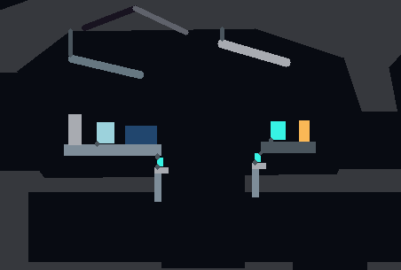
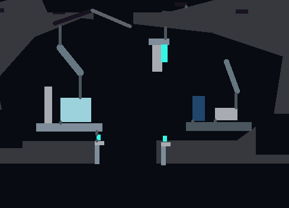
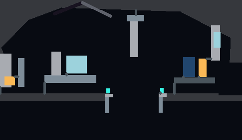
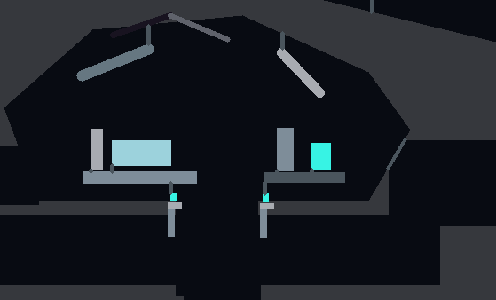
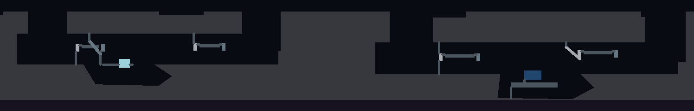

# Cinderfold Seed Courier Districts - Sibling 03: Buried Assay Interchange / Seed-Vault Croft

**Original 2048x1024 material-cell canvas. CREATOR SOURCE-STATIC PASS. NATIVE-UNTESTED. OPEN Draft/HOLD.**

World-group: Xenobiome / Frontier Clusters. Role: inhabited, geology-embedded xenoseed intake, diagnostics, isolation and staffed refuge, with two short looped lower-service alternatives.
Donor anchors (read-only): Threnody Scar #73 @ 00cb6b6b86b875d8b81cc387c711aa56f172d9dd and Graftloom Slipway #22 @ b0d1e5216aabb9b5e009e599ffbffcec6fd8a657. Only material palette, seeded-sample engineering culture and folded brace language inherited; no donor geometry, pixels, routes or rectangle streams.
New structural idea: deeply roof-enclosed and uneven interlocking rooms, separate 31x27-safe floor penetrations, thick rock thresholds, two NON-full-width loops, and preserved vacant upper excavation. Distinct from both Cinderfold 01 open sheds and 02 aerial trestles.

## Source qualification

- Full material grid: 2097152 cells, 640817 occupied and 640817 grounded, zero detached, replayed rectangular encoding exact.
- Setup-v2: 2493 ordered, legal, disjoint rectangles / 32768, 48215 JSON bytes / 1048576; rectangle work 640817 / 32000000.
- Midge exact full-hull static point routes at 19x15, 23x19, 31x27: 28/28 | 28/28 | 28/28. No nearest-point substitutions.
- A literal blocked assay wicket leaves 27/28 sites; two separate restricted lower loops 3/3 and 3/3 for 31x27.
- Deterministic node build.cjs generator recreates full indexed PNG overview and five exact material-cell crops, setup.json, receipt.json, exemplar.json and README.md; use node build.cjs --verify to compare output bytes.
- Source SHA-256 of full material grid: 747146c2d24e0baebe361d223074b86e93b9aaf40a9467e83c83ee72498b3d3e.

## Actual engine truth

Accepted CyberSand main 69209acaffb34ebe18c45e19290b5976b7fb2c82 read-only authority. Reference repository baseline 99a166e7fcae45eb22be1740e9f33f62faccbcc7. Godot/Workbench/CyberDemoBridge/Rapier movement, collisions, ticks and cold save/reopen NATIVE-UNTESTED; independent Art/Technical/Shepherd current-HEAD reviews pending.

## Authentic material-ID overview and true 1:1 district crops

Intentionally unfinished ridge annex and service pockets are corpus authoring opportunities, not technical qualification defects. Do not merge or Ready promote without owner approval.