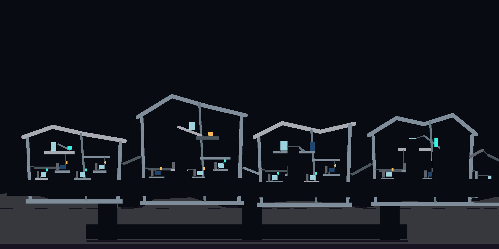
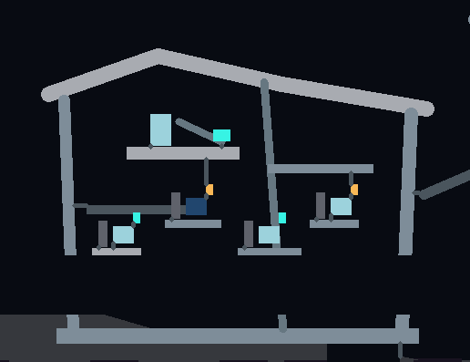
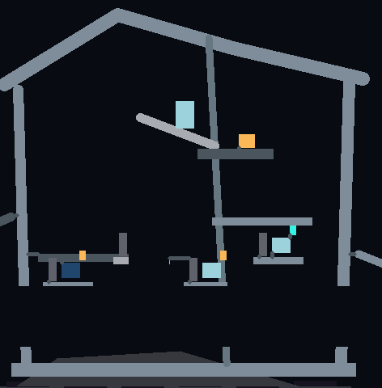
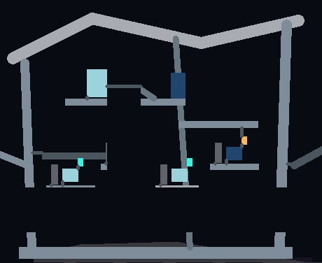
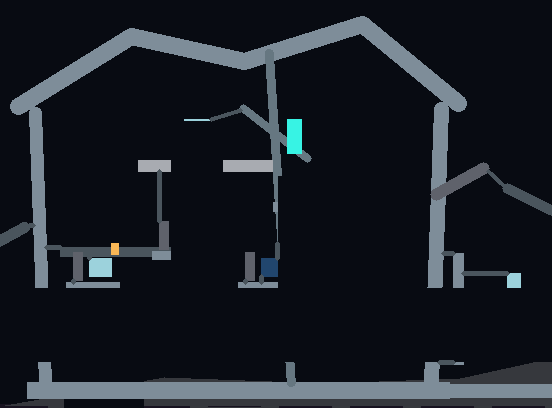

# Cinderfold Seed Courier Districts — Sibling 01: Fold-Seam Courier Hamlet

**Original CyberSand 2048×1024 material-cell canvas · CREATOR SOURCE-STATIC PASS · NATIVE-UNTESTED · OPEN Draft/HOLD.**

World-group: Xenobiome / Frontier Clusters. Role: a connected cluster of four inhabited, partly roof-bounded courier quarters, each with a different seed-custody process: western intake and handoff, tiered specimen assay, temporary refugee/clinic, and eastern sterile exchange. A damaged quarantine wing is intentionally unfinished and remains editable.
The small houses connect with short offset public/sterile links and entered 31×27-clear corridors. Three shafts reach a bounded dry lower service strip, while upper roof/inspection regions offer alternate movement. Vacant repair seams and unused bays remain useful design-corpus affordances.

Anchor donors, read-only: Threnody Scar #73 at 00cb6b6b86b875d8b81cc387c711aa56f172d9dd and Graftloom Slipway #22 at b0d1e5216aabb9b5e009e599ffbffcec6fd8a657. Inherited only folding brace principles, biological specimen handling, diagnostic fixtures, and material culture. New roof profiles, routes, cells, coordinates, names and district layout; no donor pixel/rectangle copying.
New structural thesis: multi-settlement, alternating density, off-centre interior manufacture, dual-level short rescue bypass, damaged modular annex. Not another giant rotor, suspended ark, ring, chasm or drydock.

## Source-static qualification

- Final material-ID cells: 2,097,152. Stable occupied/grounded: 409964/409964; zero detached.
- In-bounds disjoint lossless Setup-v2 rectangles: 2247 / 32,768. JSON bytes: 42728 / 1,048,576. Material plane SHA-256: 27ec751e8ff7bb3c43467addc2cd64a0f92f016391cd307f3b1767a6cfcabcd0.
- Exact full-body 4-neighbour Midge routes at 19×15 / 23×19 / 31×27: 28/28 | 28/28 | 28/28. Physical obstruction [1795,639,1832,682] leaves 27/28 accessible; one literally covered sterile lock is denied.
- Deterministic source: node build.cjs regenerates the Setup, receipt, metadata and six authentic indexed-material PNGs; node build.cjs --verify compares output bytes with the committed artifacts.
- Source authority: CyberSand read-only accepted main f7e056c9b8791106e22f2d1c295043783d8a9701. Source acceptance does not prove installed native CyberDemoBridge admission, collision, ticks, actor input, save/reopen or persistence. **NATIVE-UNTESTED**. Independent Art / Technical / Shepherd exact-HEAD reviews PENDING.

Keep OPEN Draft/HOLD; no owner acceptance, Ready, merge or auto-merge.

## Authentic material-cell gallery

