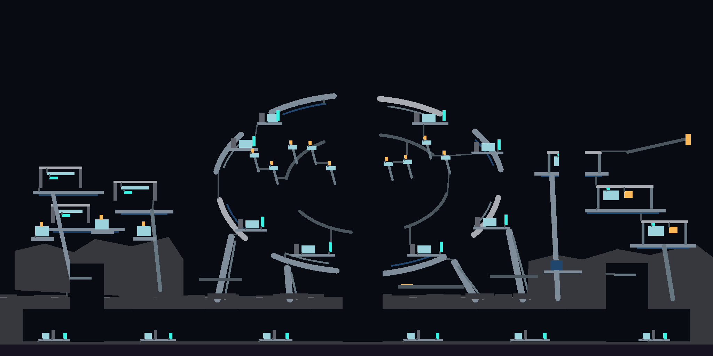
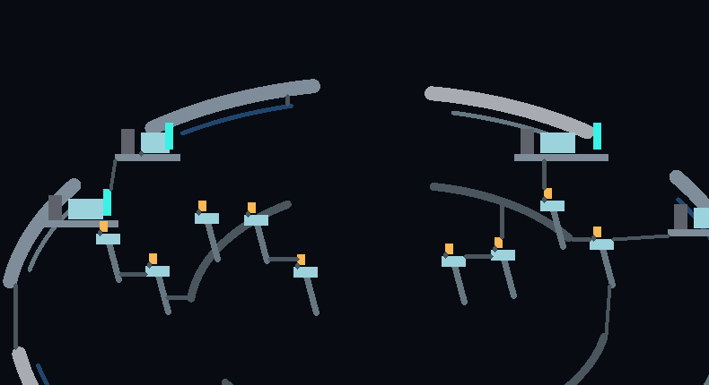
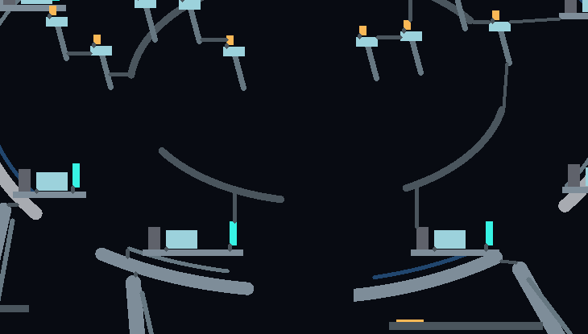
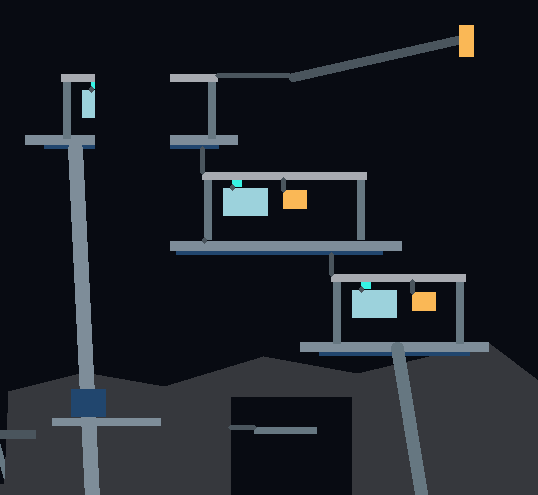

# Mireward Levee Communes — Sibling 04: Censer Loop / Radial Biofilter Commons

**NEW ORIGINAL 2048×1024 indexed CyberSand material-cell world · OPEN Draft/HOLD · NATIVE-UNTESTED**

A large asymmetrical stationary segmented annular culture framework, resident west reagent works, eastern sterility/shipping, and three dry return shafts. The broken ring and empty living centre are intentional authoring spaces.

Donors: Harrow Mere #64 @ 1202aea8d696e2bfecd7e4f3353c9738a9435858 and Graftloom #22 @ b0d1e5216aabb9b5e009e599ffbffcec6fd8a657. Family language: basalt-grounded bioindustrial machinery, specimen custody, inert sample screens and asymmetric structural supports. NEW: ring rather than dam, low-founded service rather than hanging canopy, three-shaft dry recovery. No donor pixels, route plans, rectangle streams or district layouts reused.

## Qualification (creator source-static only)

- Exactly 2,097,152 indexed material-ID cells. Occupied 409348; physically grounded 409348; zero detached/unsupported writes.
- 3881 lossless nonoverlapping ordered Setup-v2 rectangles of source capacity 32768, bytes 72573 of 1048576; no invalid writes, all bytes exactly reproduce the final grid.
- Exact Midge full-hull sites at 19×15,23×19,31×27: 29/29 ; 29/29 ; 29/29. A temporary physical purge obstruction [1710,635,1770,695] preserves 28/29 sites.
- Grid SHA256 0d958f92a1f578702056d72363622e2de204c6267f204485585b59096574cff4; Setup SHA256 2df38530c76e11f461d88b86413ce03edbb79b07f84a61738b4b7b5a0a6a6886. Fixed deterministic seed mireward-censer-loop-radial-biofilter-261121-v1. Run node build.cjs --verify for committed bytes.
- Accepted CyberSand main f7e056c9b8791106e22f2d1c295043783d8a9701 was READ-ONLY. Native Workbench/CyberDemoBridge/Rapier gameplay, collisions, ticks and save/reopen NATIVE-UNTESTED. Installed bridge may retain 4096 rectangle fallback; 32768 source max does not prove admission. Independent Art, Technical, Shepherd PENDING. Never Ready or merge without owner.

## Authentic material-cell gallery

