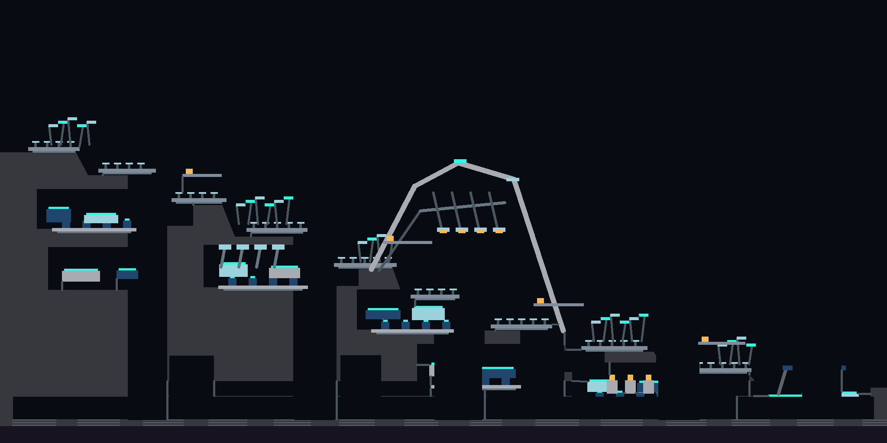
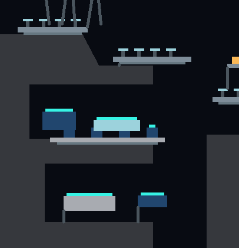
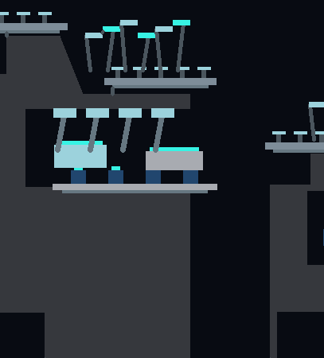
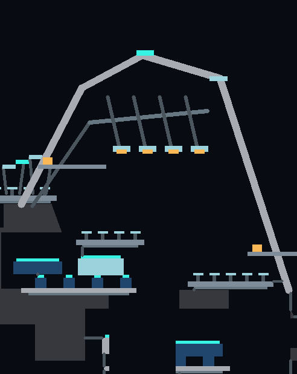
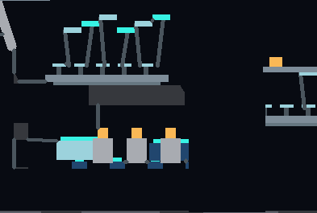
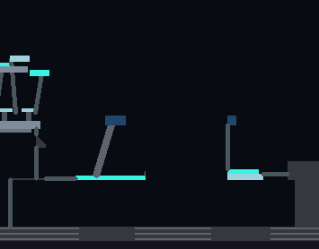

# Mireward Levee Communes — Reedfall Staveworks / Downhill Biofilter Terraces

**Original Sibling 02 · 2048×1024 genuine material-cell grid · CREATOR-STATIC-PASS · NATIVE-UNTESTED · OPEN Draft/HOLD.**

Five descending bedrock-rooted biofilter shelves: uphill cold-seed ledger, assay/filtration, fungal transfer cantilever, entered sterile quarantine, and downstream byproduct dispatch. Multiple separately entered side-halls, upper flight and a dry lower service trunk serve recovery and authoring. This structural cascade does not reuse Mireward Sibling 01's five island banks/short arches. Intentional editable voids are preserved.

**Read-only donors:** [Harrow Mere #64](https://github.com/techrote/sandmapsreference/pull/64), [Graftloom Slipway #22](https://github.com/techrote/sandmapsreference/pull/22). Only material palette and biological industrial culture are inherited, never geometry, pixels, edits, coordinates or district layouts.

## Reproducible checks

- 439214 occupied static cells, 439214 grounded, zero detached; 2131 legal disjoint Setup-v2 rectangles; 40319 JSON bytes. Exactly 2,097,152 cells.
- 19×15, 23×19, 31×27 Midge full-hull routes: 27/27, 27/27, 27/27. Literal 31×27 blocked upper spool: 26/27 accessible.
- Grid SHA256 21845d3facfd9f63f976d437813a0a209116904b0b405220e1a67bdf7cf8aa4e, Setup SHA256 0f61cd4ffa258b612e1cc43cda7a2659a2a33db2918ce2bbad7911d2b8e96143. Accepted CyberSand main f7e056c9b8791106e22f2d1c295043783d8a9701 read-only; native Workbench/Rapier gameplay, collision, ticks, save/reopen **NATIVE-UNTESTED**. Exact-HEAD independent Art/Technical/Shepherd PENDING.
- `node build.cjs` regenerate; `node build.cjs --verify` byte-compare; actual full image + five true 1:1 native material-index crops derive from same material grid.

## True indexed-material images

