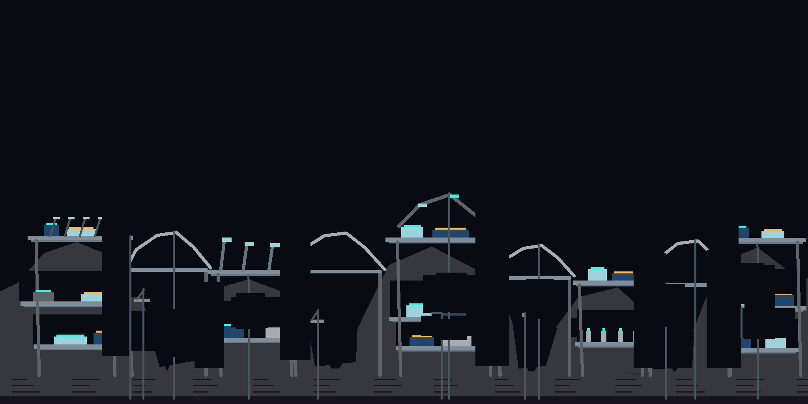
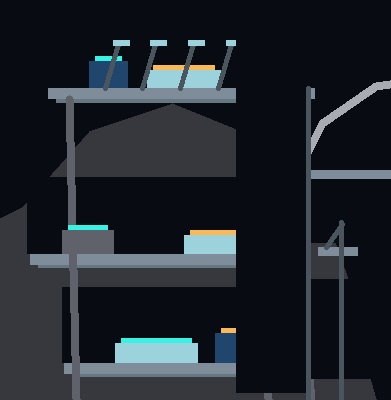
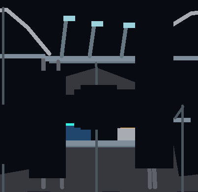
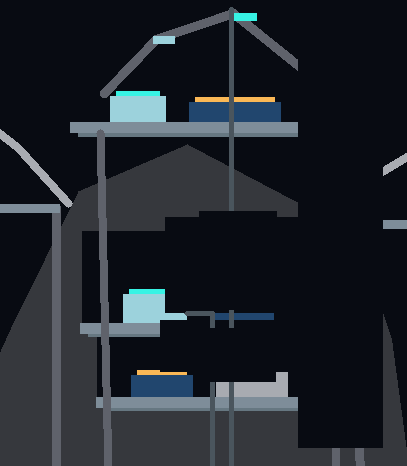
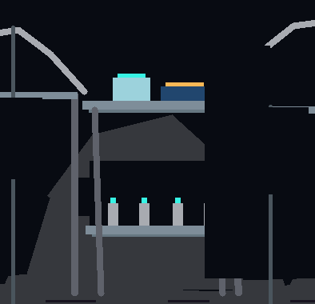
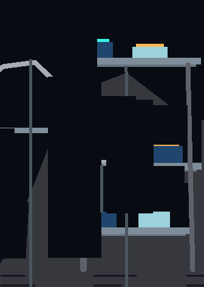

# Mireward Levee Communes — Split-Polder Mycelial Settlements / Dry Reed Outfalls

**Original world-family Sibling 01 · 2048×1024 genuine material-ID canvas · Xenobiome / Frontier Clusters · CREATOR-STATIC-PASS · NATIVE-UNTESTED · Draft/HOLD.**

Five irregular inhabited raised islands form a spore-settlement network through dry polders. West seed ledger/cold registry, reed purification island, central culture hospice and rooted overhead canopy, east quarantine/decon commune, and remote freight outfall differ in both spatial placement and physically entered hardware. Four distinct short arched crossings take the place of a central dam, with wide, intentional negative-space authoring basins.

**Primary design-language donors:** [Harrow Mere #64](https://github.com/techrote/sandmapsreference/pull/64) and Graftloom Slipway. They lend basalt material culture, mycelial industry, quarantine and spore freight engineering, not geometry, pixels, edits, name/location or district composition. Unlike Quoin Veil and Underroot siblings, this is a multi-island biological commune network.

## Exact source-static qualification

- 413922 stationary occupied cells, 413922 boundary-grounded, no detached structures. 2280 disjoint legal Setup-v2 rectangles, 44106 JSON bytes and 2,097,152 full plane cells.
- Full 19×15, 23×19 and 31×27 conservative Midge literal-site navigation: 26/26, 26/26, 26/26. Physical obstruction [918,415,980,477] leaves 25/26 named sites available (one directly blocked). Static check is not native gameplay.
- Exact grid SHA-256 8c9db7ef68a6c531b400703839af6877339beb1334a7c3215decab165aa03175; Setup SHA-256 8e30c044d5bd1c2c7324e5b1400b638364449c722057005acfdf6a0b8df8a6b2. Only stable static material laws. Accepted CyberSand main f7e056c9b8791106e22f2d1c295043783d8a9701 consulted read-only. Source limits 32768 rectangles, 1MiB JSON and 32M edit cells; older installed 4096 fallback may differ.
- Deterministic source: `node build.cjs`, and `node build.cjs --verify` to compare all committed generated files. The full indexed PNG overview and five native 1:1 crops below are generated from the same final grid (no concept art).
- Godot/Workbench/CyberDemoBridge/Rapier movement, collisions, native ticks and save/reopen remain **NATIVE-UNTESTED**; independent Art/Technical/Shepherd matching-HEAD acceptance pending. OPEN Draft/HOLD; no merge or Ready.

## Material-cell evidence

