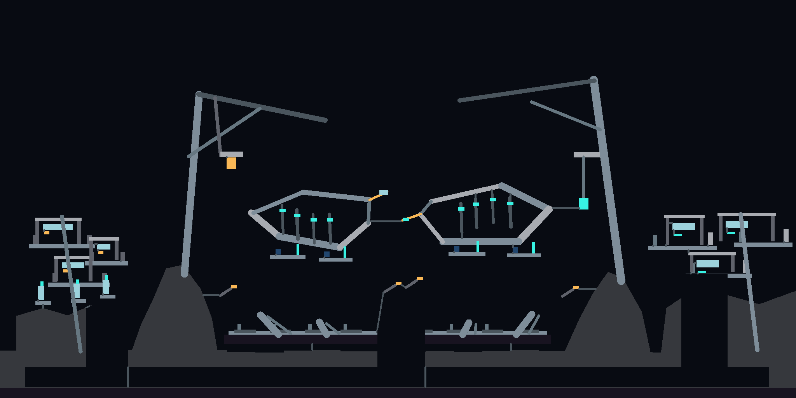
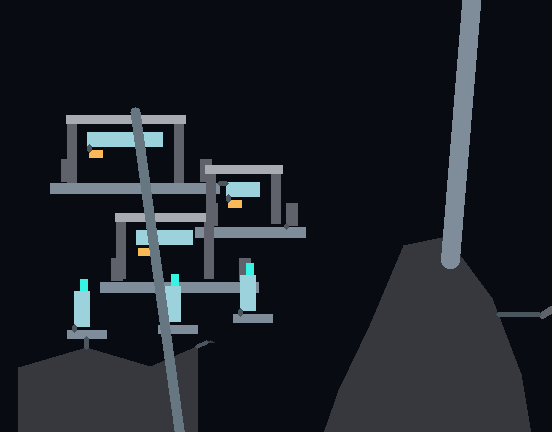
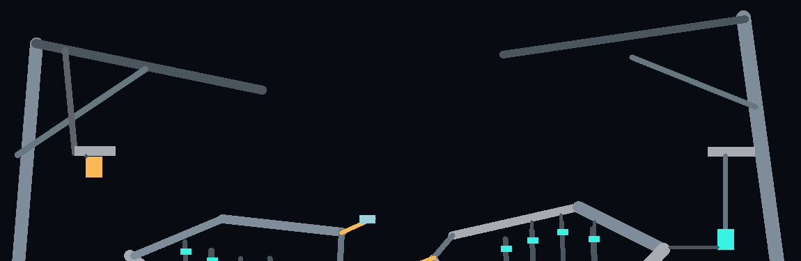
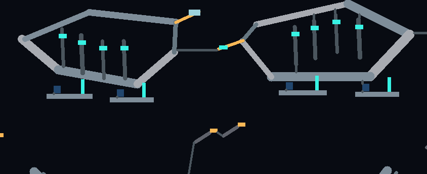
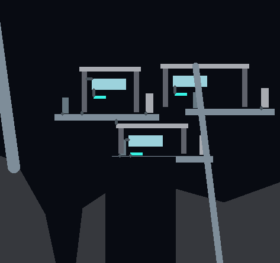

# Mireward Levee Communes — Sibling 05: Sundered Spore Ark / Excavated Drydock Quarantine

**NEW original 2048×1024 material-cell world · CREATOR STATIC-PASS · NATIVE-UNTESTED · OPEN Draft/HOLD.**

World-group: Xenobiome / Frontier Clusters. Sibling role: a damaged seed-vessel retrieval, assay and quarantine drydock. Opposed asymmetrical anchored gantries frame a two-part broken spore ark above a dry dockbed. Three carved wells link the massive central flight volume to an independently traversable low service passage. The break, unused storage, unfinished berth and broad empty workfaces are intentional authoring affordances, not unfinished mandatory art.

Anchor donors: Harrow Mere #64, Graftloom Slipway #22, Threnody Scar #73 at HEADs listed in receipt. Inherits founded basalt, materialized seed logistics, xenocustody apparatus and nonuniform crane engineering culture. No exact donor pixels, rectangle streams, paths, coordinates, names or layouts reused.
New structural argument: drydock, damaged divided vessel, opposed gantries, edge-dense and centre-open industrial volume, lower parallel bypass rather than polder arch, cascade, roof suspension or radial ring.

## Source-static qualification

- Exact final 2,097,152 indexed material-ID cells; 384807 occupied and 384807 grounded; zero detached or invalid writes.
- 3406 lossless disjoint in-bounds ordered Setup-v2 rectangles (source limit 32,768), JSON 64531 bytes (source limit 1,048,576). Histogram and material plane SHA-256 f4c82dcb67b3c0370ba0db436c8e369a75e872867e6780e6568a75298ea010c3.
- Exact conservative Midge centres at 19×15, 23×19, 31×27: 26/26, 26/26, 26/26. Physical purge obstruction [1746,447,1806,510] leaves 25/26 destinations reachable.
- Fixed seed mireward-sundered-spore-ark-drydock-261121-v1; reproducible with node build.cjs; node build.cjs --verify tests committed bytes. Six indexed PNGs represent authentic full-grid and true 1:1 crops, no scaling.
- Read-only CyberSand main f7e056c9b8791106e22f2d1c295043783d8a9701; source limit acceptance is not installed/native admission. Godot/Workbench/CyberDemoBridge/Rapier actor movement, ticks, collision and save/reopen **NATIVE-UNTESTED**. Independent Art/Technical/Shepherd PENDING. Keep Draft/HOLD; do not merge or promote.

## Authentic material-cell gallery

