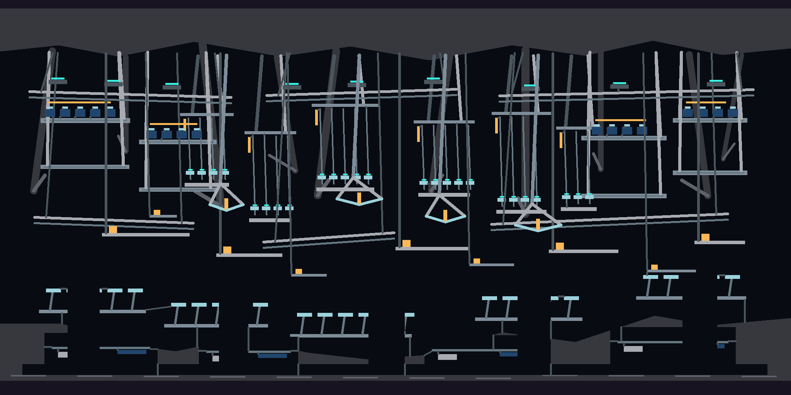
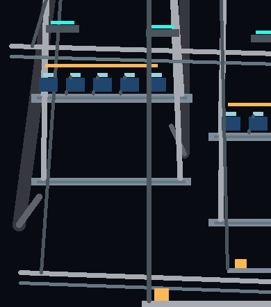
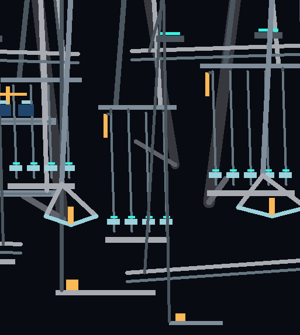
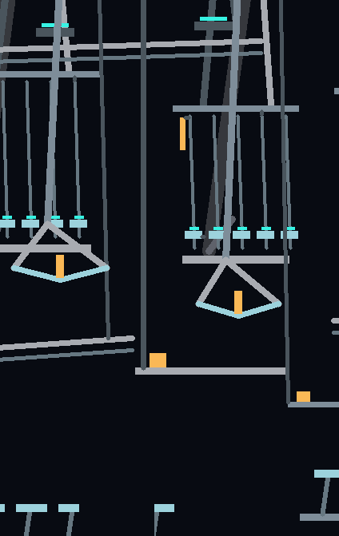
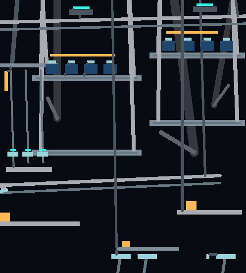
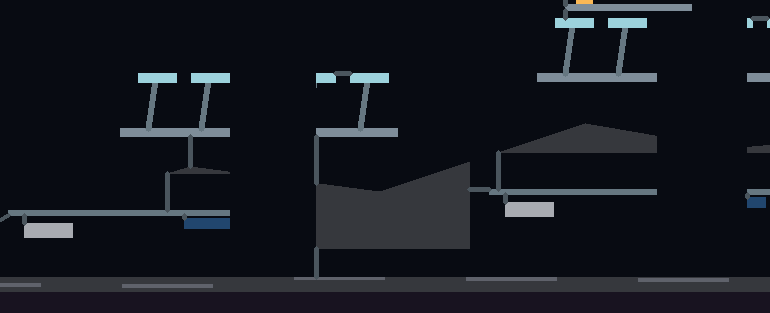

# Mireward Levee Communes — Sibling 03: Vesper Inverted Root Orchard / Hanging Culture Exchange

**NEW original 2048×1024 material-cell canvas · CREATOR-STATIC-PASS · NATIVE-UNTESTED · OPEN Draft/HOLD.**

The Xenobiome world hangs from an inverted basalt ceiling: western lantern registry, roof-rooted culture orchard, wide open midair custody exchange, eastern quarantine lantern and separate dry basal salvage works. Continuous central voids and incomplete work sockets are intentional manual-authoring opportunities, not missing geometry.

**Anchor vocabulary:** Harrow Mere #64 at 1202aea8d696e2bfecd7e4f3353c9738a9435858 and Threnody Scar #73 at 00cb6b6b86b875d8b81cc387c711aa56f172d9dd. Borrowed biological engineering and xenoseed logistics only; no donor pixels, rectangle streams, machinery stamps, routes, coordinates, district layout or names.

## Source-static qualification

- Final plane 2,097,152 cells, 728087 occupied / 728087 grounded, 0 unsupported. Ordered non-overlapping Setup-v2 rectangles 5901 / 32768; Setup JSON bytes 110560 / 1048576.
- Exact named Midge destination reachability, 19x15 / 23x19 / 31x27: 28/28 ; 28/28 ; 28/28. Real opaque obstruction [1124,815,1192,877] denies only customs chamber, leaving 27/28 sites accessible.
- Plane SHA256 5d42c98d9af8d7c9b1874b7660087d8f4c270941bf7ea623ec4e6167a6e6d082; Setup SHA256 de1c005902efee3285f3251c07544472460ae41514889670e3fb6b80536e8b4d. Fixed seed mireward-vesper-inverted-root-orchard-261121-v1. Deterministic regeneration: node build.cjs. Check committed bytes with node build.cjs --verify.
- Accepted CyberSand main f7e056c9b8791106e22f2d1c295043783d8a9701 was read-only. Source 32768 limit is not an installed-bridge admission claim; installed legacy fallback may have only 4096. Actual Godot/Workbench/CyberDemoBridge/Rapier actor flight, physical collisions/ticks, cold save/reopen are NATIVE-UNTESTED. Independent Art/Technical/Shepherd reviews PENDING. Never Ready/merge without owner.

## Genuine indexed material-cell images

