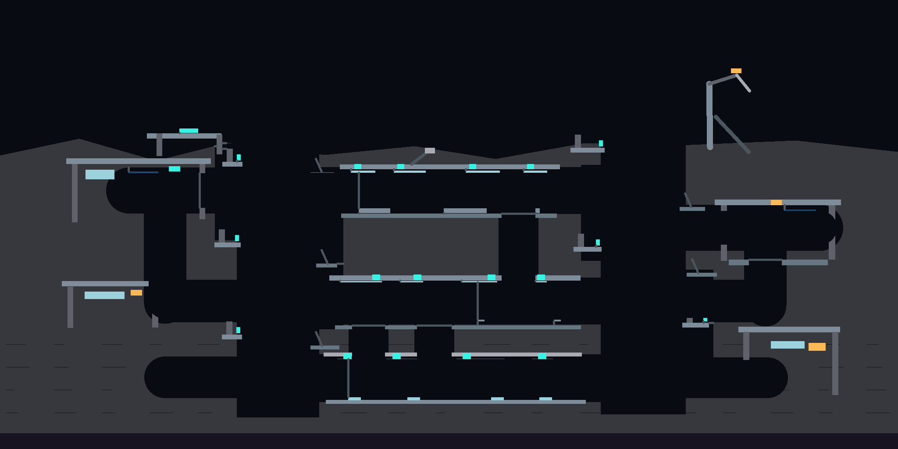
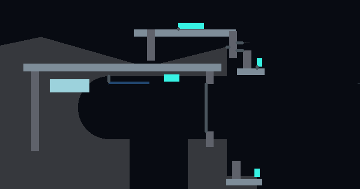
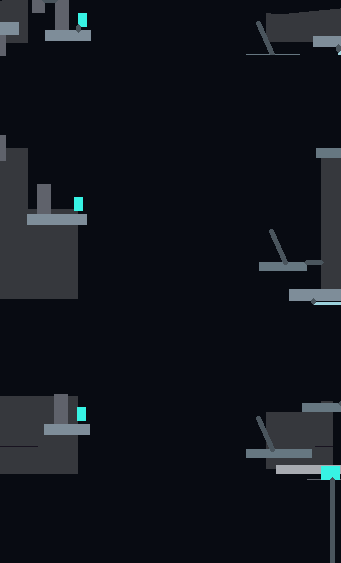
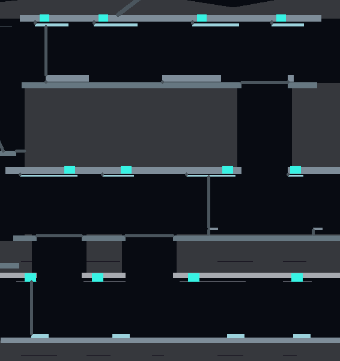
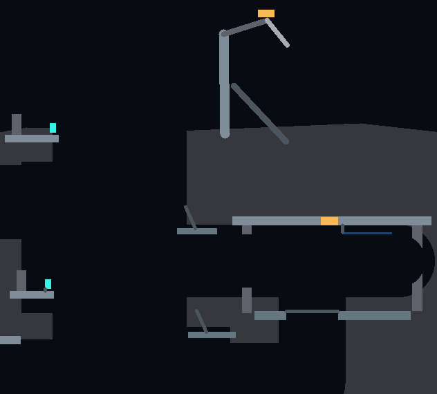
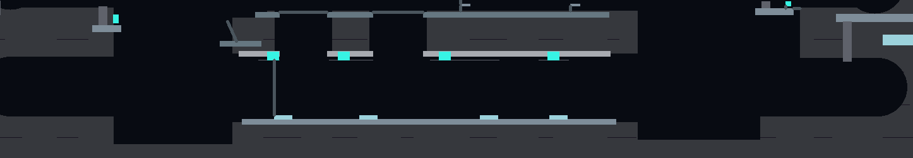

# Quoin Veil Survey Network — Split Faultwell / Vertical Census Escarpment

**Xenobiome / Frontier Clusters · Sibling 04 · new 2048×1024 material-cell canvas · CREATOR-STATIC-PASS · NATIVE-UNTESTED · OPEN Draft/HOLD.**

Two unequal **vertical faultwells** are cut into an exposed basalt-obsidian plateau. Three long transverse entered laboratories connect them at upper calibration, mid-level cartography and deep dry recorder strata. The west inhabited isotope observatory, cantilevered bore measurement fixtures, east xenoseed custody/sterile dispatch and partly wrecked high instrument head give at least four distinct functioning workfaces; large deliberately vacant geology/edit margins remain. Each well has a separately entered shaft and alternative route/recovery. Unlike Quoin Veil siblings [01](https://github.com/techrote/sandmapsreference/pull/108) (opposing cliff crater/rafts), [02](https://github.com/techrote/sandmapsreference/pull/114) (oblique interior ascent) and [03](https://github.com/techrote/sandmapsreference/pull/121) (three-town shallow groundline), this is a coupled dual-vertical-fault system.

**Donor vocabulary, not geometry:** Current approved Sable Quoin and Threnody Scar original anchors lend only gravitic calibration, inhabited frontier survey and xenoseed quarantine language, not pixels, rectangle streams, routes, names, coordinates, or district layouts.

## Physical qualification (creator source-static only)

- Final grid **2,097,152 exact material-ID cells**, **1695** valid disjoint Setup-v2 rectangles, **32952** serialized bytes, **780379** inert solid cells, **780379/780379** rooted; no invalid, overlapping or out-of-bounds final writes. Grid SHA256 `de56ecc67744576902ff681768932747cf291608b89adc5078730fc2bfc3f9a3`, Setup SHA256 `583971e408094620c90c2899726ada496326bf28ba5b7a1b470104b8130bcbc3`.
- Full Midge 19×15, 23×19 and 31×27 conservative traversable-centre flood reaches **29/29, 29/29, 29/29** exact named sites from literal spawn `[625,434]` without substitutions. Solid obstruction `[954,396,1025,471]` denies only the named upper calibration interlock; **28/29** others remain reachable. Static topology does not prove native flight, contact physics or shortest-path detour time.
- Complete authentic 8-bit indexed material overview plus five true 1:1 district crops generated directly from that same final grid, with dimensions, origins and SHA256 in receipt. No native screenshot or AI conceptual art claim.
- Fixed seed `quoin-veil-split-faultwell-261121-v1`. Rebuild all data with `node build.cjs`, or compare committed bytes with `node build.cjs --verify`. Accepted read-only CyberSand `f7e056c9b8791106e22f2d1c295043783d8a9701`; source cap 32,768 rectangles / 1 MiB; installed bridge may fall back to 4096, never assumed.
- Native Godot 4.7 / Workbench / CyberDemoBridge / Rapier actor load, movement, ticks, save and cold reopen **NATIVE-UNTESTED**. Independent Art/Technical/Shepherd exact-HEAD acceptance **PENDING**. Draft/HOLD always; no merge or Ready.

## Actual indexed-material images

`exemplar.json` schema-v1 controlled axes are descriptive corpus metadata only; setpiece annotations identify four unscripted authoring sockets, not installed game events. Empty gaps are intentional.
