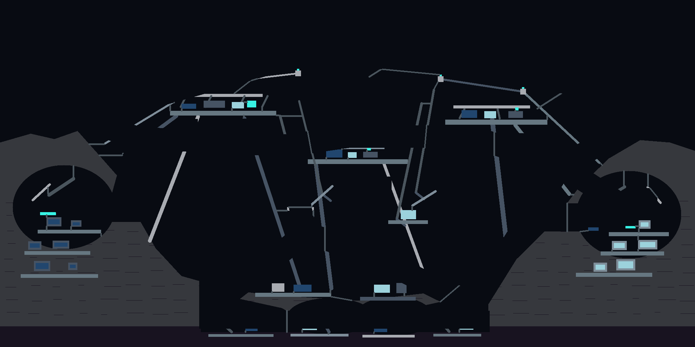

# Quoin Veil Survey Network — Suspended Shear Basin / Crown-Reach Observation (Sibling 01)

**NEW original 2048×1024 CyberSand material-cell canvas. OPEN Draft/HOLD. Creator-static pass; independent Art/Technical/Shepherd pending; NATIVE-UNTESTED.**

## Family and donors

World-group: Xenobiome / Frontier Clusters. Donor design-language anchors: **Sable Quoin Gravitic Core** (tethered scientific geology and inhabited survey stations) and **Threnody Scar Foldwing Seedlift** (xenoseed frontier sampling/quarantine culture). No source pixels, rectangle streams, coordinates, room topology, routes, district layouts, geometry or image assets were taken from either. Both are inspiration, not templates.

This starts a new **Quoin Veil Survey Network** family rather than forcing a fifth Underroot Relay into the same architecture.

## Distinct structural idea

An asymmetric V-eroded crater separates two inhabited cliff-mouth laboratories. Three unequal high-altitude survey rafts float visually above a thinly inhabited central low basin, but are tied to bedrock by long eccentric metal legs, tension braces and a broken cable-harp skyline. Four separate dry underworks create a full-width recovery/service passage beneath the basin. The elevated modules are *not* a symmetrical spoke or ring pattern.

Five workfaces: western cliff habitat/assay; suspended upper isotope receiving raft; middle shear-quay comparison platform; eccentric east survey/mast and quarantine settlement; low dry service and maintenance return. The purposeful gaps beneath and between platforms are future authoring seams.

## Literal Midge traverse and qualification

- Exact full plane **2048×1024 = 2,097,152 final material-ID cells**; PNG uses palette-index values equal to cell IDs.
- Lossless disjoint Setup-v2 rectangles **4308 / 32,768**; Setup JSON **81089 / 1,048,576 bytes**; material writes **561568 / 32,000,000 work-cell budget**.
- **561568/561568 occupied cells rooted**, **0 disconnected**, zero bad/overlapping/out-of-bounds writes; stable inert physical materials.
- **26/26 exact named Midge centres** independently queried by source-static four-neighbour BFS at each full clearance envelope: **19×15; 23×19; 31×27**. Exact serialized Midge spawn **[147,324]**.
- Physical obstruction `[1008,378,1059,428]` covers **Midair transfer cleft**. All other **25/26 literal named destinations** remain accessible at 31×27; high bypass, lower bridge-rejoin and twin deep rescue shafts are present in the material plane.
- Source material SHA-256 `18ba0de0c2dbd9c6231bb39bc5ce40ce291eb94532818b46b1e749ee46d86a9b`. Complete Setup SHA-256 `2d3cea1e31caf4733b3d716c8cd3daab498d201a98b0b19c8dc221bac7c37400`. Deterministic builder `build.cjs` supports `node build.cjs --verify` for byte-exact reproduction and source pixel parity of every PNG.
- **Six authentic indexed-material PNGs**: full overview plus five unscaled district crops sampled from the identical final grid. Source-static decoded Deflate/CRC/pixel parity checks performed at creation.
- **Bridge compatibility caution:** 4308 rectangles exceeds the potential 4,096-rectangle installed legacy CyberDemoBridge fallback, although within accepted source Setup-v2 limits. Validate installed bridge at native gate.

Native Godot/Workbench/Bridge/Rapier load, real actor movement/collisions/ticks and save/reopen **NOT RUN**. Independent Art/Technical/Shepherd review **PENDING**. No accepted-main engine edits, Ready promotion, merge or owner-acceptance assertion.

## Corpus and future authoring

The committed `exemplar.json` classifies eight controlled v1 diversity axes. Key underrepresented classes selected before authoring: `crater`, `edge_dense_center_open`, `cableway`, `branch_rejoin`, and `mixed` load paths. Four unscripted set-piece sites are recorded: central quay failure; broken-cable reveal vista; quarantine encounter; low-basin machinery activation. Preserve unfinished bays and central negative space rather than furniture-filling them.

## Authentic 1:1 evidence

[West cliff habitat](01-west-cliff-habitat.png) · [Suspended crown shuttle](02-suspended-crown-shuttle.png) · [Central shear air basin](03-shear-air-basin.png) · [East counterweight/quarantine](04-east-counterweight-quarantine.png) · [Deep dry rescue](05-deep-dry-rescue.png)

Deterministic instructions: `node build.cjs` creates outputs; `node build.cjs --verify` validates byte-for-byte exact committed Setup, receipt and indexed images. Corpus metadata is descriptive and does not alter engine Setup-v2 contract.
