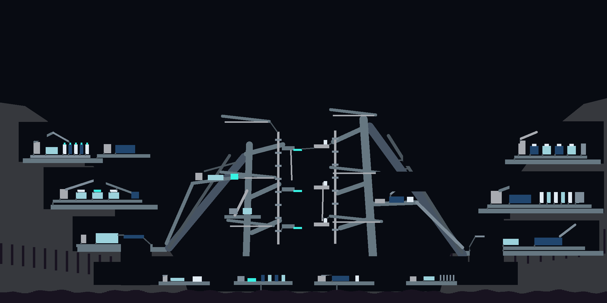
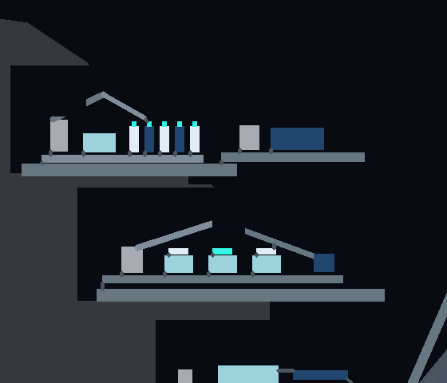
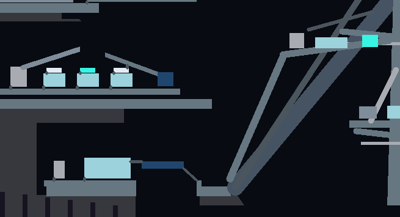
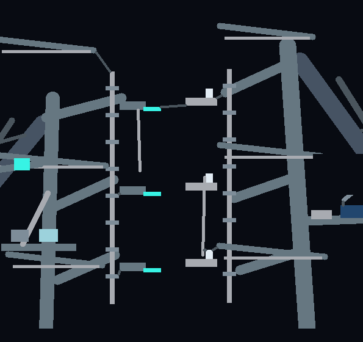

# Underroot Relay System — Assay Freight Annex

**CyberSand ORIGINAL · first world-family sibling · 2048×1024 genuine material cells · OPEN Draft/HOLD · creator static PASS · independent Art/Technical/Shepherd PENDING · NATIVE-UNTESTED.**

## The world family

Approved inspiration donor: [wide-graftloom-slipway, R6](https://github.com/techrote/sandmapsreference/pull/22) at exact `b0d1e5216aabb9b5e009e599ffbffcec6fd8a657` (independent Art PASS and Technical STATIC-PASS). Carry forward *only* its cold bio-industrial palette, keyed specimen optics, rooted mechanical supports, deliberate flight voids and assay/handling worldbuilding grammar. This is not copied geometry: unlike the source's hanging split Memory crown, circular Core and high ceiling network, the Annex has **two asymmetrical ground-dominant stepped scarps**, a *two-column rooted vertical cassette transfer spine*, entered cliffside custody/three-drum assay/bio-alloy processing, a physically separate eastern cold-freight dispatch, and an extended **dry underroot freight carriage** housing four different service workfaces. Neither donor pixels nor rectangle data, route coordinates or site names were reused.

The Annex receives biological freight arriving from elsewhere in the world, identifies custody cassettes, sorts/examines samples, packs dry bio-alloys and dispatches them through a sterile freight exchange. It is a functional sibling of a larger **Underroot Relay System**, to be expanded with remote nurseries, quarantine intakes and an emergency relay in independently authored, topologically distinct canvases.

## Measured material/source contract

| Invariant | Actual creator result |
|---|---:|
| Final material-ID cells | 2048×1024 = 2097152 |
| Five-field canonical disjoint Setup-v2 edits | 4092 / 32768 |
| Exact Setup JSON bytes | 76630 / 1048576 |
| Occupied inert-solid material cells | 486038 |
| Grounded/unsupported occupied cells | 486038 / 0 |
| Exact named-site full Midge envelope 19×15 | 19/19 |
| Exact named-site full Midge envelope 23×19 | 19/19 |
| Exact named-site full Midge envelope 31×27 | 19/19 |
| Temporary physical obstruction [1008,509,1056,569] | Only covered Vertical cask throat refused; 18 other exact sites reached |
| Grid SHA-256 | `f85b4f219d675cd0a3bf6bb696a40f57848321aa1194e330461d2b11f83b4f42` |
| Setup SHA-256 | `3b06c945f5055b1db2778daf7e2dda233288ec782c94ac28f8d5487034e7ab5a` |
| Real Workbench/Godot/Rapier load, flight, simulation, cold save/reopen | **NATIVE-UNTESTED** |

The complete material plane has been replayed from the legal non-overlapping edits and verified for exact byte equality, and 4-neighbour 31×27 conservative centre floods tested every literal site without nearest-site substitution. The deterministic `build.cjs` generates the committed Setup, receipt and indexed PNGs. `node build.cjs --verify` additionally checks canonical output equality, Node SHA-256, PNG chunk CRC, zlib inflate and every real PNG material pixel against the source plane. This is not a claim that independent review or native runtime testing has occurred.

## Authentic one-cell-per-pixel gallery

| Real unscaled district 1:1 | Real unscaled district 1:1 |
|---|---|
|  |  |
|  |  |

## Gates

Accepted CyberSand main consulted READ ONLY at `7b03aa437561ec63e31fd09531171360ab60eeb4`. Setup source permits 32768 rectangles; a legacy installed bridge may expose 4096. Godot/Workbench/CyberDemoBridge/Rapier movement/collision/ticks and persistence require actual source-matched native testing. Independent Art, Technical and Shepherd exact-current-HEAD reviews remain pending. Keep OPEN Draft/HOLD, no Ready/merge/auto-merge/owner acceptance.

## R2 — legacy bridge fallback-compatible source candidate

Without changing any district topology, keyed examination geometry, named site, route, or functional workface, the bottom-only geological schist line was resampled at an eight-cell rather than four-cell step. This reduces canonical Setup rectangles from 4128 to **4092**, below the **4096** possible installed Workbench fallback while preserving **19/19/19** exact routes and **0** detached cells. Bottom texture and full material plane are regenerated, not a capacity waiver. **Does not prove the installed bridge loads**; actual native piloting/ticks/save/reopen remains NATIVE-UNTESTED. Current material SHA `f85b4f219d675cd0a3bf6bb696a40f57848321aa1194e330461d2b11f83b4f42`, Setup SHA `1a0da6d48af7383b6d7b68d0fd0a1dddb2c425f6e12bfcd38c043e89b3ffa889`.
