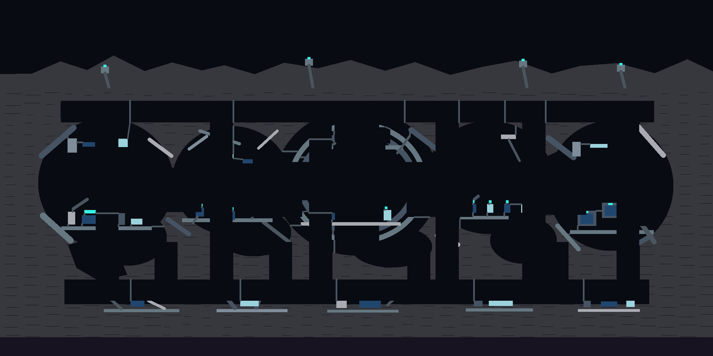
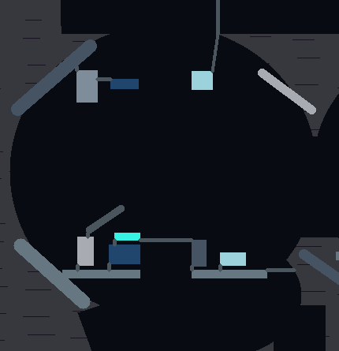
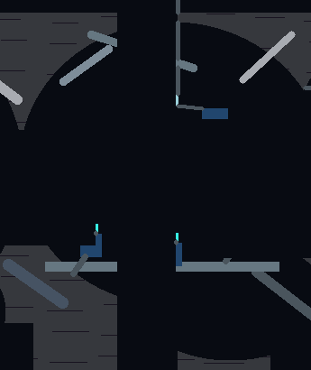
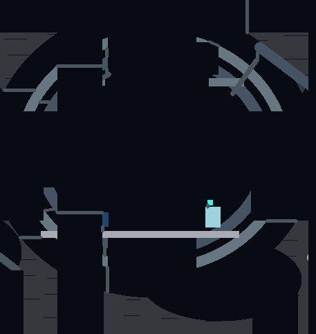
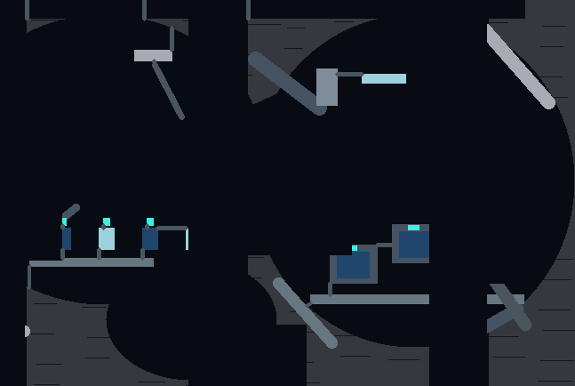
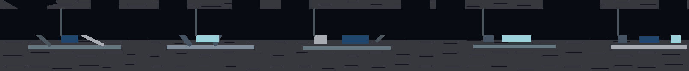

# Underroot Relay — Root-Archive / Sealed Quarantine Vault (Sibling 04)

New original 2048×1024 orthographic material-cell world. **OPEN DRAFT/HOLD — NATIVE-UNTESTED**.

## World family and authorship
Upstream Nursery, Assay Freight Annex and Seepage Catchment are sibling worlds, not cut-and-paste donors. Visual-language donors: Graftloom Slipway, Sable Quoin and Threnody Scar. No donor source pixels, coordinates, rectangles, room geometry or route graph were reused.
This world intentionally changes the family grammar: **five differently shaped enclosed cavities** cut into one anchored subterranean basalt mass, a double-shell diagnostic aperture, staggered access shafts, three altitude corridors and a continuous lower recovery loop. It is **interior-dominant**, unlike previous exterior-biased siblings.

## Entered workfaces
West specimen custody and aseptic refuge; irregular root-lattice archive; central shell-contained examination; eastern sterile decontamination and filter stage; isolated specimen/quarantine vault; four different deep underfloor apparatus stations. Large unfurnished bays are **human-editable authoring affordances**, not omissions to automatically polish away.

## Exact creator-static qualification
- Final material plane: 2048×1024 = 2,097,152 cells.
- Ordered disjoint lossless Setup-v2 rectangles: 5628 / 32,768.
- Setup JSON: 107632 bytes / 1,048,576.
- Stable grounded material cells: 869387 / 869387; unrooted: 0.
- Exact literal Midge sites: 25/25 at 19×15, 23×19 and 31×27 full hulls.
- Solid obstruction [1001,497,1047,545] covers only the diagnostic aperture target; 24/25 named sites remain reachable through alternate routes.
- All six PNGs are full indexed-material renders directly from the same final plane; five district crops are true 1:1.
- Material plane SHA-256: 2aecfa0dcd0e7e1e30b093001060eb5b51685bd1edc631ffaed2b4ed962ae1aa
- Setup SHA-256: 3febfb26b76e1d5a5f31af3c8773301f6ff8cf708815fbbcc27bbf0023d79b5b

Run `node build.cjs --verify` for deterministic, byte-exact Setup/PNG/receipt comparison and PNG decompression/pixel parity; without --verify it reproduces these artifacts. Requires Node built-ins only.

**Native load, collision, movement, ticks, save and fresh restore: NOT TESTED.** Independent Art/Technical/Shepherd exact-HEAD review required. No Ready, merge, auto-merge or owner-acceptance claim.

## Genuine material-cell gallery

 
 

`exemplar.json` is descriptive corpus metadata for SWARM/Gentek, not an engine contract.
