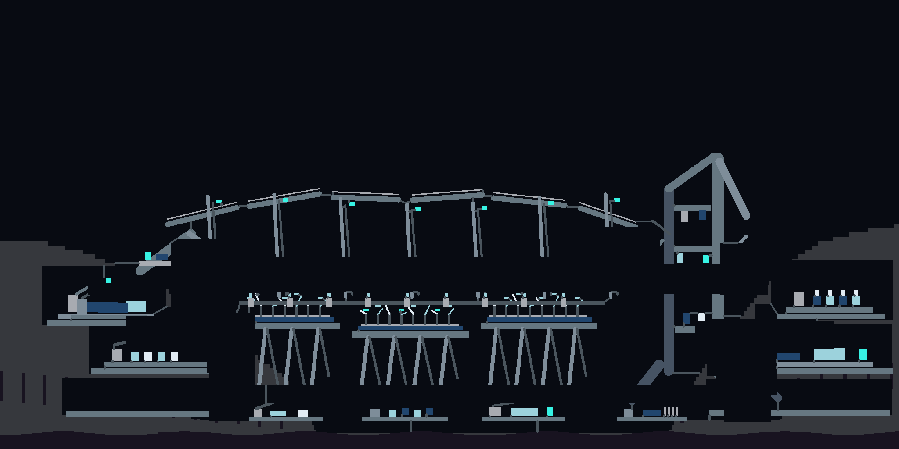
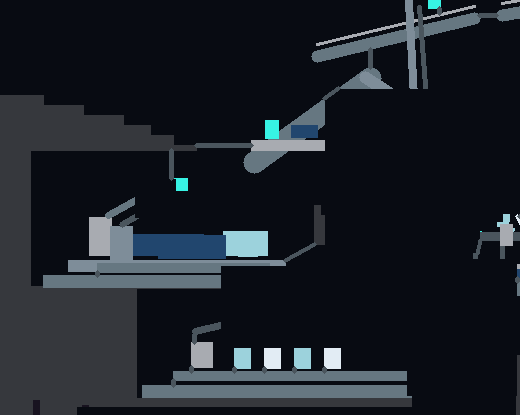
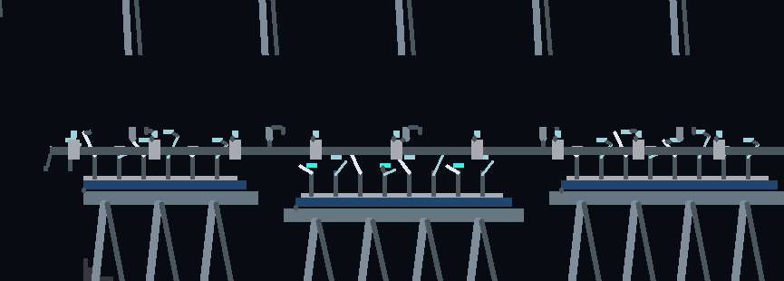
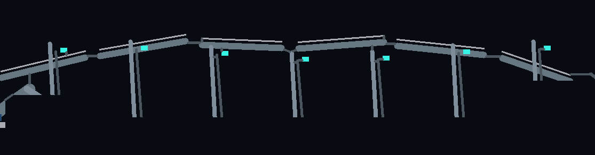
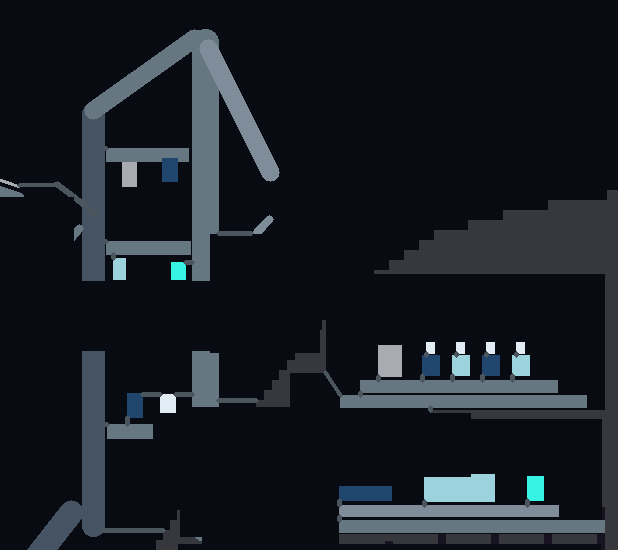

# Underroot Relay System — Windbreak Nursery / Isolation Gate

**New ORIGINAL world-group sibling 02 · complete 2048×1024 physical material-ID canvas · OPEN Draft/HOLD · creator source-static PASS · native NATIVE-UNTESTED · independent Art/Technical/Shepherd PENDING.**

## World-family placement

The Underroot Relay System now has an upstream seed-propagation and containment location feeding the existing [Assay Freight Annex (sibling 01)](https://github.com/techrote/sandmapsreference/pull/82). Primary stylistic donor: [wide-graftloom-slipway (R6)](https://github.com/techrote/sandmapsreference/pull/22) @ `b0d1e5216aabb9b5e009e599ffbffcec6fd8a657`. Current sibling-01 exact HEAD inspected: `ebc5cce0e18c73e316e5e4ff5f50bf30e051da3e`.

**Inherited design vocabulary only:** cold bio-industrial material palette; keyed turquoise optical assay marks; rooted structural supports; specimen custody process; breathable open flight voids.

**New independently authored topological thesis:** low, wide, staggered nursery banks on an open valley floor beneath a **distributed segmented windbreak canopy**, with the sealed clean/dirty cask transfer lifted onto a **tall asymmetric gate on the far eastern scarp**. Neither the donor's hanging Memory crown nor the Annex's central paired cassette mast, terraced geometry, named sites, route graph, pixels, rectangle stream or coordinates are copied. Reusable *builder/PNG/static-verification infrastructure* is adapted from the Annex; **all world geometry, route positions and functional workface arrangements are new**.

### Operational districts and player traversal

1. **West shelter and intake:** windbreak arrivals, physical firebreak/refuge, condensation receiver and keyed nursery ledger, entered by side portals.
2. **Propagated nursery banks:** three unequal-area populated specimen pans, grounded independent brace arrays, catenary inspection clamps and branching living racks; broad flight margins and recovery below.
3. **Distributed windbreak and control:** multi-span interrupted roof with independent signal heads and open aerial crossing; not a monolithic roof or single ring.
4. **Off-centre quarantine gate and cold freight:** tall asymmetric lock with a genuine 31×27-clear mid-level dirty/clean throat, separate overflight and below-grade bypasses, east autoclave and dispatch.
5. **Below-grade irrigation/service return:** four entered workfaces (pump/valve, screening sorter, ventilation, filter array), two excavated rescue openings, operational underworks crossing.

**World transaction:** source nursery propagation → inspection and assay screen → sealed cask transfer → quarantine/autoclave → cold dispatch to the sister freight annex. This story is expressed by actual material cells; stationary machines are *not* claimed to run as simulated actuators.

## Measured creator source-static qualification (same final cells)

| Invariant | Actual |
|---|---:|
| Material-ID plane | **2,097,152 cells (2048×1024)** |
| Losslessly re-playable canonical disjoint five-field Setup-v2 rectangles | **4091 / 32768** |
| Conservative hypothetical older installed-bridge rectangle fallback | **4091 / 4096** |
| Full Setup-v2 JSON | **75667 / 1048576 bytes** |
| Non-air inert-material cells | **380073** |
| Grounded / unrooted solid cells | **380073 / 0** |
| Literal fully enclosed 19×15 Midge routes | **22/22 sites** |
| Literal fully enclosed 23×19 Midge routes | **22/22 sites** |
| Literal fully enclosed 31×27 Midge routes | **22/22 sites** |
| Temporary real solid obstruction at `[1564,622,1601,643]` | **21/22**, only physically covered Sealed gate throat refused; all other exact sites recovered |
| SHA-256 final material plane | `aa75948169e8ad69655d48830b87837dba508c3c4fad4206707adfdda6cd93e8` |
| SHA-256 complete Setup | `5a418e9db47abc79ac721f0da7714263ab1291954563fe61df04463e2ce38d4b` |
| Authentic indexed-material image outputs | **2048×1024 overview + 5 exact unscaled 1:1 PNG crops** |
| Installed Godot/Workbench/CyberDemoBridge/Rapier gameplay/ticks/persistence | **NATIVE-UNTESTED** |

Inert material IDs follow accepted CyberSand main read-only authority at `7b03aa437561ec63e31fd09531171360ab60eeb4`. Map repository starting accepted main `99a166e7fcae45eb22be1740e9f33f62faccbcc7`. `setup.json` contains exactly the accepted fourteen root fields and a literal Midge actor. Source-rendered material IDs and true PNG indices are always one-to-one; no AI concept images or aesthetic screenshot substitutions are committed.

## Reproduce and independently verify

From this directory: run `node build.cjs --verify` to regenerate the exact material ID grid and compare its Setup, receipt and every PNG byte, while using Node SHA-256, zlib inflate, chunk CRC and image-pixel parity. Run `node verify-independent.cjs` for a separately written **Setup-to-grid** replay, byte/hash/histogram/grounding audit, literal multi-hull 4-neighbour route reconstruction, blocked-route proof and independent indexed-PNG zlib/CRC/pixel check. These are reproducible source-static checks, not native engine tests.

## Actual material-cell overview and one-pixel-per-cell districts

| Upwind nursery shelter | Three propagation banks |
|---|---|
|  |  |
|  |  |

## Exact gates

Source-static claims are **creator-generated**, not yet independent Art/Technical/Shepherd passes. A source rectangle count below 4096 does not prove compatibility with an actual installed bridge. No Godot, Workbench, Rapier collision/flight/ticks or fresh-process save/reopen has been run. Remain **OPEN Draft/HOLD**; no Ready, merge or owner acceptance.

**Next siblings should add distinct remote recovery habitat, deep xenobiome survey and emergency pollen diversion without duplicating this wide-nursery / east-gate topology.**
