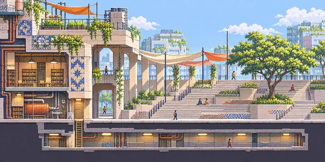

# Canvas rework R2 — COMMN-0012 Mosaic Viaduct Commons

**Draft / HOLD; branch only; do not merge, mark Ready or modify CyberSand engine or original artwork.**
Historical accepted-as-archive-only parent: [PR #8](https://github.com/techrote/sandmapsreference/pull/8), archived on main. This is a NEW artistic rework, not a replacement of the preserved historical snapshot.

## Visual authority (source INCLUDED in this PR)

- Original immutable PNG: [artwork/neighbourhoods_commons/batch2/mosaic_viaduct_commons.png](https://github.com/techrote/sandmapsreference/blob/198bf5bc793e59006b7ccc9e587971e3d9a857f9/artwork/neighbourhoods_commons/batch2/mosaic_viaduct_commons.png); Git blob `fb01ca96733623502e99e9734bf4fb7d5d28035e`.
- This committed `source-reference-preview.jpg` is an **actual repository gh-pages reference JPEG blob** (`8cf59bbba8c4a4037924490b7d158872be876abd`), copied without visual alteration; it is not a generated concept image. Preview is lower resolution than original PNG.
- Historical CyberSand output: [archived material-cell preview](preview.png); original source/preview and output are separate. Source dimensions and exact original-pixel parity must not be inferred from the JPEG.

## Priority repair brief — use actual source pixels, not catalogue prose

The source is a *horizontally distributed urban civic plaza*: asymmetric masonry/tiled left civic block, long stepped/public stair on the right, **dominant broad rooted tree at right-center**, orange shade sails, broad daylight sky, blue patterned glazed surfaces, planting and a **continuous buried tunnel underneath**. The historical conversion heavily substitutes repeated symmetrical arches + large mechanical circular roundel + black central void, losing the original spatial hierarchy.

1. **P0 macro composition**: restore stepped civic promenade/plaza and public stair as the dominant navigable feature. Place the right-side spreading tree with branches/canopy as primary landmark (model with stable CyberSand solids, not uncontrolled live growth); preserve the left asymmetrical tiled facade and accessible balcony. Subordinate/replace the giant central roundel and regular viaduct arches if they harm the reference.
2. **P0 orthographic geometry / routes**: preserve a continuous high-level promenade, clear primary and alternate Midge flight corridors, traversable terraced stair and rooftop/underpass transitions. Keep the long lower buried corridor legible and connected. No angled pseudo-isometric tops.
3. **P1 local architecture**: differentially sculpt blue-and-white tilework, glazed shopfront/library, colonnade, planters, under-stair retaining walls, functional street furnishing, and irregular upper balconies. Avoid cloned red brick blocks, equally spaced arch modules, evenly repeated circular greebles, clipped title signs.
4. **P1 colour/space**: reconcile source daylight/sky and warm terracotta vs blue glazed stone without inventing a backdrop that is not true authored terrain. Balance negative space; no vast unearned black gulf replacing civic space.
5. **P0 physics + evidence**: re-read CyberSand accepted main; use correct non-falling support and valid enum IDs, current Midge hull plus conservative operational margin, zero hidden waypoint proxying. Require exact target-airspace connectivity, original 2048×2048 extent and JSON/rectangle limits. Rebuild all cells independently and regenerate full-map PNG and >=3 native-cell district crops from the same authored grid.
6. **P0 integrity**: deterministic builder (fixed seed), real Setup-v2/generated-start, portable load instructions. If native Workbench/Rapier absent say NATIVE-UNTESTED; no fabricated run or save/reopen. Repair actual cells, not just this brief, before owner review.

## Handoff and role coordination

Initial PR commit only carries this rework brief and the embedded exact source preview. **No new material-state edit has yet been made.** The assigned Reworker C should implement and qualify subsequent commits *on this same PR branch*. Shepherd must review final HEAD, and owner acceptance controls merge.
