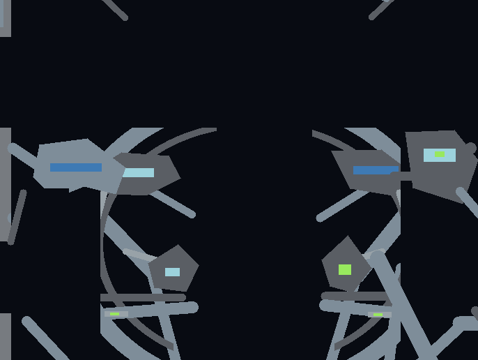

# The Hollow Sovereign — original 2048×2048 megastructure

**R5 creator repair · Draft/HOLD · original concept, no external reference image · NATIVE-UNTESTED · INDEPENDENT REVIEW REQUIRED**

This is an actual CyberSand Setup-v2 material-cell level in strict orthographic side elevation, not a scenic illustration or a native screenshot. It inherits the original architectural thesis: a machine-civic capital torn apart by removal of its gravity spindle. Freight and foundry arcologies occupy the western cliff; optical administration and a market bastion occupy the eastern cliff; an interrupted spindle, severed halo station and three interlocking travel arteries span an enormous navigable civic wound. Beneath is an asymmetric cutter-vessel drydock and waste-heat maintenance crypt.

## R5 actual material-cell repair

Starting from the prior review-flagged R4 head `b85f84a1abad520202173ec8c54adf135e93ba95`, an **80-operation deterministic original-material programme** in [r5-ops.json](r5-ops.json) changed **99,687 real material-cell identities** (63,455 newly occupied, 36,232 reclassified, zero excavated). It adds larger west freight process decks, crane fixtures and crucible controls; irregular east optical gallery and civic market floors; unequal market passenger/cargo transfer structures; a visually strengthened, interrupted gravity race; and a layered dock vessel with bridge/cargo access and supporting equipment. A true 49×51 Empty-cell operational port is cut through the new western transfer art around the existing exact (742,1159) Midge destination. The major central flight negative space, three horizontal arteries and all 18 exact sites remain open in the source-cell test.

**Material support is not yet resolved to owner standard.** Actual cardinal-solid analysis improves from 111,267 to 96,472 detached immovable material cells, but a **52,681-cell western composite structure at x479–978/y1047–1407** combines intended severed-halo debris with inhabited-looking transfer structure, and cannot honestly be called grounded. Other eastern gallery/dock-looking assemblies also remain partly ungrounded. No engine gravity collapse is implied: every placed nonempty material is physically immovable in the initial accepted material rules. This is still **P1 structural/artistic REWORK**, not a qualified finished map.

## Exact world and route graph

Extent 2048×2048; actor Midge 4×3 source hull, saved spawn **Magnet Customs (217,987)**, boost 1.8. Main west↔east routes are y≈490 (skyway), y≈980 (mid-civic trade artery), and y≈1485 (engineering tier), with x≈414, x≈1046, and x≈1687 vertical transfer, plus side bypasses.

18 declared functional actor-centre sites are verified **without any substitute coordinates**:

| Site | Exact (x,y) | Site | Exact (x,y) |
|---|---|---|---|
| Magnet customs | (217,987) | West skyline hatch | (291,497) |
| Nacre foundry chamber | (513,751) | Freight lift junction | (415,1197) |
| Western high slip | (745,496) | Loom aerial transfer | (1026,712) |
| Lost civic core | (1047,989) | Underloom service | (1046,1486) |
| Bastion signal loft | (1523,497) | Neon Meridian market | (1680,986) |
| Eastern descending lift | (1687,1390) | Dock west portal | (509,1487) |
| West keel interrogator | (837,1733) | Reactor berth | (1281,1733) |
| East salt gate | (1868,986) | Broken-spindle observation | (1210,729) |
| Western crucible transfer | (742,1159) | Bastion undercrypt | (1439,1261) |

High route: west hatch → western high slip → aerial loom / observation → east bastion. Mid route: Magnet Customs → Lost Civic Core → Neon Meridian Market → East Salt Gate. Lower alternate: freight and crucible transfers → underloom → descending lift / dock portal → keel interrogation / reactor berth. With centre region x961..1152,y931..1044 virtually blocked, **17/18** exact sites remain accessible at 31×27; only the intentionally blocked Civic Core is excluded.

## Physical and format qualification (R5 exact output)

| Gate | Result |
|---|---|
| Full physical-cell plane | 2048×2048, 4,194,304 material IDs |
| Setup-v2, ordered nonoverlapping five-field rectangles | 18,738 / 32,768 |
| Setup JSON | 362,370 / 1,048,576 bytes |
| Complete rectangle replay | 0 overlaps, 0 material mismatches |
| Exact spawn + sites, 19×15 | 18/18, 1,795,324 connected actor centres |
| Exact spawn + sites, 23×19 | 18/18, 1,643,356 connected actor centres |
| Exact spawn + sites, 31×27 | 18/18, 1,485,241 connected actor centres |
| 31×27 central core closure | 17/18, only core deliberately blocked |
| Solid topology | 35 components, 96,472 detached cells — **P1 OPEN** |
| Real indexed PNGs, chunk CRC32, zlib, Adler, IEND and exhaustive material-pixel parity | 6/6 PASS by independent artifact-generation code |
| Standalone Node builder `--verify` | **NOT RUN** on this host; deterministic source included |
| Installed native bridge rectangle/material admission | **UNVERIFIED** |
| Native Workbench install / Midge collision / simulation / save/reopen | **NATIVE-UNTESTED** |

All placed nonzero IDs are accepted `Solid / movable=false / RuleKernel::None` source laws: 49 Slate, 58 Reinforced Concrete, 62 Steel Plate, 100 Basalt Columns, 101 Obsidian, 113 Zinc Sheet, 117 Bare Iron, 120 Glass Block, 122 Quartz Crystal, 123 Uranium Glass, 128 Polymer Panel. No powder foundation, unknown pseudo-ID, liquid/growth/combustion simulation or AI-generated decorative image was used.

Accepted source authority revalidated **18 November 2026**: `techrote/cybersand main@018bd09503d7f079ddac52e225c2f7daf8d678bf`; Setup-v2 `godot/scripts/workbench_setup.gd` Git blob `70dd964bc2d5bff9ca030edd57d7fc7aa5068fc9`; production material laws `native/include/cybersand/material.hpp` blob `dcf05895da3015a2e999e3d1cbbae0fdc7fe32b3`; Midge source `godot/authoring/flyers/midge.json` blob `228399e38a0e0ab215b9f48698edce67a7a35799`, authored registry hash `c226d73ae56a426820d2ef842a4856bf79ac23efabe64e66569dff8de62a7a96`. Source 32,768 capacity does not guarantee installed native bridge capacity; older 4,096 fallback is insufficient.

## Genuine material-cell evidence

| Western freight | Broken loom and Sky Sacristy |
|---|---|
|  |  |
| East Meridian bastion | Split market and halo |
|  |  |
| Abyssal dock | |
|  | |

## Rebuild and remaining acceptance

Requires Node 22+, no packages. Run `node build.cjs` in this folder to regenerate final JSON and all six PNGs. Run `node build.cjs --verify` to byte-compare regenerated artifacts to committed outputs. The fixed seed is inherited from the original builder and the [R5 programme](r5-ops.json) is pure deterministic geometry, not an image input.

Before owner playtesting, the independent Shepherd/art/technical auditors must re-review the **R5 exact HEAD**, especially the large detached western civic/transfer group and other unanchored occupied-looking installations. A source-matched native bridge should then prove installed rectangle capacity ≥18,738, real Workbench install, Midge flight/collision, bounded progression and fresh-process save/reopen. **No merge, Ready, native PASS or owner acceptance claimed.**
