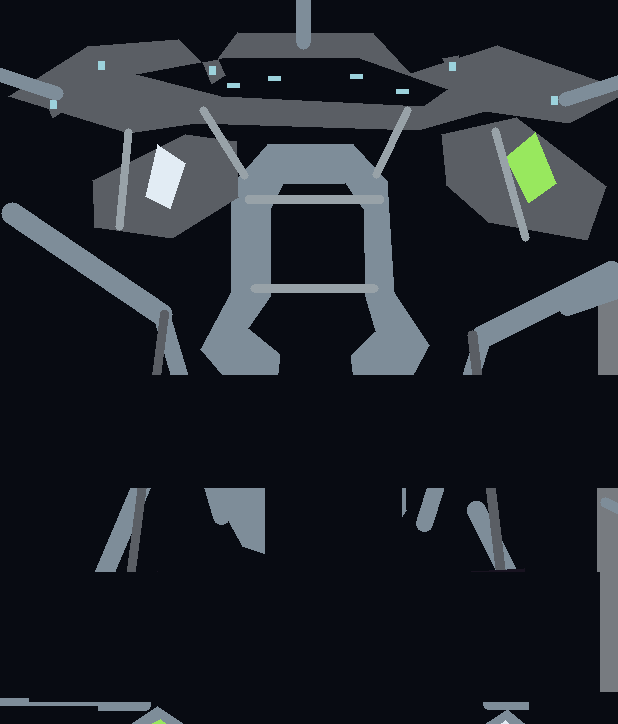
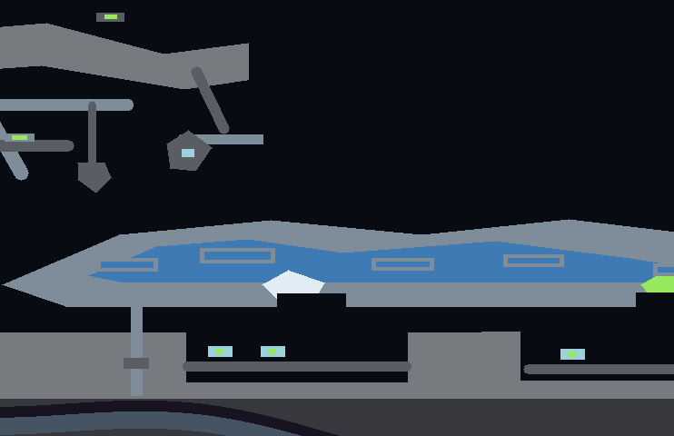

# The Hollow Sovereign — original 2048×2048 CyberSand megastructure canvas

**DRAFT / HOLD. Original authored material-cell geometry. No reference artwork was selected, imitated or traced. Native execution and owner acceptance remain UNTESTED.**

## Creative thesis

A ruined transit capital has been cut in two by the removal of its enormous central gravity spindle. The surviving west freight/foundry state, eastern mirror-bastion and hanging sky parliament fight over the missing civic core; a gigantic broken halo-station and a drydock vessel connect their infrastructure below. The **empty vertical civic wound is intentional**, offset by layered dense inhabited flanks, construction framing, irregular cliff silhouettes and a separate dock/keel scene. This is **exact orthographic side elevation**: no platform tops, perspective, image overlay or fake physics.

Six deliberately distinct architectural districts:

- **Nacre Freight Cliff (west):** stepped monolithic customs/foundry with a flame-green inert crucible, transected industrial atria, freight shafts and wall-mounted switch apparatus
- **Broken Gravity Loom (centre):** fractured sky instrument, wide passages through its severed core, giant lower crescent halo and missing-city central flight volume
- **Sky Sacristy (upper):** roof-anchored parliamentary antenna, hollow crown, severed optical plates and magnetic lift cables
- **Mirror Meridian Bastion (east):** angular inward-facing arcology, antenna spikes, unequal atria, night market reactors and shielded glass rooms
- **Abyssal Shipyard (below):** grounded drydock with two differently proportioned cranes and a docked static keel-vessel
- **Waste-Heat Crypt (deepest):** connected under-keel inspection galleries and protected inert signal prisms

Every visible architectural feature is an actual CyberSand material cell. The diagnostic PNG uses exact material-ID colours, not the native lighting/render pipeline. Inert crystal panels are not functioning reactors, and the cranes and ship are static, not simulated machines.

## Real physical travel, start and strict site coordinates

The **Midge** starts at **(217,987)** in western Magnet Customs. Its actual authored hull is 4×3, with 1.8× boost. Three generous parallel west-east arteries join the wings at approximately y490 (skyway), y980 (middle trade artery) and y1485 (engineering sublevel). Three principal vertical lifts are centred around x414 (west), x1046 (civic wound), and x1687 (east). Additional route loops near x742/x1305 join the lower crescent/void to the high and low arteries. The drydock and its inspection sites connect south of the engineering sublevel.

**18 exact actor-centre sites** (no nearest-point substitutions):

- Magnet customs: (217, 987)
- West skyline hatch: (291, 497)
- Nacre foundry chamber: (513, 751)
- Freight lift junction: (415, 1197)
- Western high slip: (745, 496)
- Loom aerial transfer: (1026, 712)
- Lost civic core: (1047, 989)
- Underloom service: (1046, 1486)
- Bastion signal loft: (1523, 497)
- Neon Meridian market: (1680, 986)
- Eastern descending lift: (1687, 1390)
- Dock west portal: (509, 1487)
- West keel interrogator: (837, 1733)
- Reactor berth: (1281, 1733)
- East salt gate: (1868, 986)
- Broken-spindle observation: (1210, 729)
- Western crucible transfer: (742, 1159)
- Bastion undercrypt: (1439, 1261)

**Primary:** Magnet Customs → Lost Civic Core → Neon Meridian Market → East Salt Gate.  
**High bypass:** West Skyline Hatch → Western High Slip → Loom Aerial Transfer / Broken-Spindle Observation → Bastion Signal Loft.  
**Lower return:** Freight Lift Junction / Western Crucible Transfer → Underloom Service → Eastern Descending Lift → Dock West Portal → West Keel Interrogator / Reactor Berth.  

For route stress, the rectangular central actor-centre region x961..1152, y931..1044 is virtually blocked. The lower/upper alternatives still reach every other named site at 31×27. This is a graph test, not an edited closure or functioning door.

## Accepted CyberSand authority and material laws

Read-only accepted `techrote/cybersand` main **018bd09503d7f079ddac52e225c2f7daf8d678bf** (18 Nov 2026 rechecked). Setup-v2: each side 512–2048 divisible by 64; no more than 32,768 edit stamps, 32,768 source rectangles and 1,048,576 JSON bytes. The installed native bridge's `workbench_start_rectangle_capacity` has NOT been queried; its legacy fallback is only 4096 rectangles.

The source material catalogue at `materials/catalogue/generated/catalogue.shadow.hpp` SHA `bdbac2c6861ec593634c897130e320741734c1c2` declares all used nonempty IDs state=1 (solid), movable=false, valid=true, current_rule_available=true and kernel=0: Slate (49), Reinforced Concrete (58), Steel Plate (62), Basalt Columns (100), Obsidian (101), Zinc Sheet (113), Bare Iron (117), Glass Block (120), Quartz Crystal (122), Uranium Glass (123) and Polymer Panel (128). Source is a generated **shadow candidate**, not proof of the particular installed native binary. No granular rock, autonomous growth, explosive chemistry or uncontained liquid exists.

Setup-v2 requires an installed bridge recognizing extended material IDs such as Slate (49) and Steel Plate (62); **a legacy bridge may refuse the map**. The construction is intentionally static, but runtime collision shape equivalence, camera installation, Rapier progression, input response and save/reopen are all **NATIVE-UNTESTED**.

## Qualification of final physical cells

| Gate | Verified outcome |
|---|---|
| Extent | **2048 × 2048**, exactly 4,194,304 cells |
| Serialized non-overlapping rectangles | **13715 / 32768** |
| JSON length | **266180 / 1048576 bytes** |
| Full-grid replay / overlap | **0 mismatches / 0 overlap cells** |
| Conservative 19×15 actor centres | **18/18 exact sites reachable** |
| Larger 23×19 centres | **18/18 exact sites reachable** |
| Stress 31×27 centres | **18/18 exact sites reachable** |
| Stress blocked-middle bypass | **17/18**: only deliberately blocked Lost Civic Core excluded |
| Deterministic source rebuild | **PASS**, repeated build produces identical JSON/PNG bytes |
| PNG integrity/parity | **6/6 PASS**, decoded 4-bit material indices, CRC32, stored-zlib Adler, IEND and pixel comparisons |
| Installed Workbench / Rapier / save-reopen | **NATIVE-UNTESTED** |

More detailed counts, per-site reachability, exact crop coordinates, material histogram and image validation are in [qualification.json](qualification.json).

## Actual material-cell PNG gallery

| Nacre Freight Cliff (1:1) | Sky Sacristy and broken spindle (1:1) |
|---|---|
|  |  |
| Mirror Meridian Bastion (1:1) | Split market artery and halo station (1:1) |
|  |  |
| Abyssal shipyard (1:1) | |
|  | |

## Build, owner evaluation and limitations

Run `node build.cjs` from this directory (Node 22+, no external packages) to regenerate the actual `setup-hollow-sovereign.json` and all six PNGs. Run `node build.cjs --verify` to compare their bytes to committed outputs. The builder computes strict full-grid replay, three envelope flood fills, a blocked-centre alternate-route test and every PNG chunk/pixel check. It has a fixed seed and uses only deterministic operations.

For native playtest, load the JSON through the current Workbench setup import in a CyberSand build with the expanded native rectangle capacity and staged material catalogue. Check selected Midge movement and collision at all three altitudes, visibility at full 2048² extent, save/reopen and bounded simulation. No installed native DLL/SO, executable Godot/Rapier session or actual user input was available to verify those gates here.

**Critical self-review:** the first diagnostic overview read as an excessively sparse geometric diagram. Before final serialization, two deliberate actual-cell rework passes added asymmetric civic interior glazing, rooted lift-gantries, broken halo-city arches, physically rooted skyline anchors, repair-yard framing and ship supports. All 18 site coordinates and three stress footprints were rechecked after final modifications. The dark central wound is still deliberately large; this map trades some pixel density for orthographic readability. Some suspended inert substructures rely on cable/superstructure framing rather than simulated active lifting dynamics. Independent art/technical Shepherd assessment is required. Do not mark Ready, merge or claim native acceptance.
