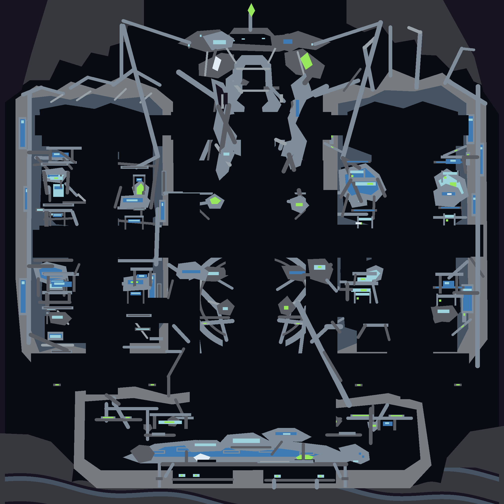
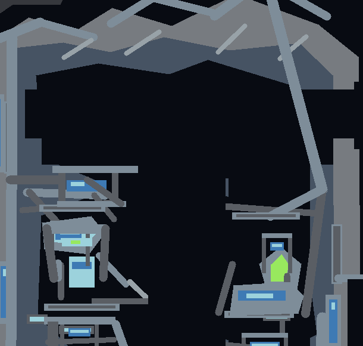
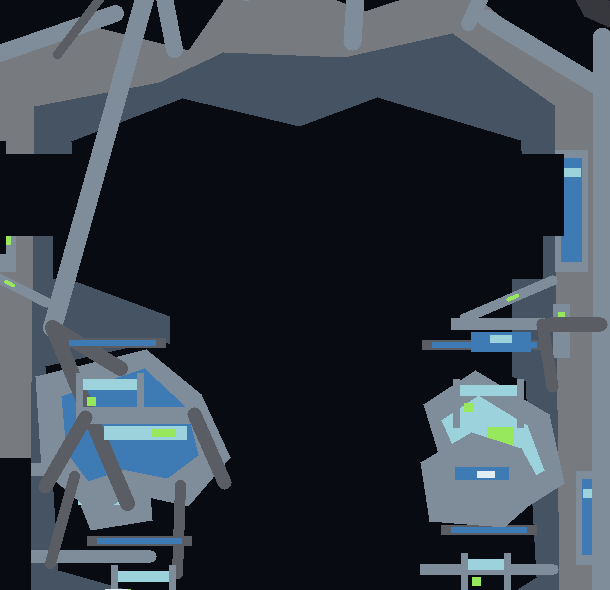

# The Hollow Sovereign — R6 original sci-fi megastructure (2048×2048)

**ORIGINAL FROM SCRATCH · real material-cell CyberSand Setup-v2 · Draft/HOLD · NATIVE-UNTESTED · independent review pending.** No source images, converted/borrowed art, AI-generated image-as-map, engine edits or historical reference conversion.

## Design and R6 architectural repair

A ruined machine-civic city frames the absence of a colossal gravity spindle. A broken parliamentary crown above, two industrial/market arcologies on opposing cliffs, a fractured civic gravity loom and an asymmetric cutter-vessel drydock below create large legible **true orthographic 2D side-elevation** silhouettes. Six functional districts: Nacre Freight Cliff, Broken Gravity Loom, Sky Sacristy, Mirror Meridian Bastion, Abyssal Shipyard and Waste-Heat Crypt. Preserve the three horizontal flight strata and large deliberately clean central void.

The **58 real-cell operations** in [r6-ops.json](r6-ops.json), applied after existing R5 operations, change **39,775 material cell identities** relative to the prior R5: **23,889 newly occupied, 646 excavated, 15,240 nonzero reclassified**. West freight workstations, foundry/hoist platforms, supported service levels, unequal east surveillance/market thresholds, gravity-race mechanical failure details and two drydock service installations are genuinely authored *physical material cells*, not image overlays.

The formerly unsupported **52,681-cell western freight/halo** complex now has a cardinal steel load path to the grounded main structure; the former large 9,956-cell lower-west and 7,701-cell eastern market structures are also joined to grounded solids. The main piers initially obstructed the bypass when the lost civic core was sealed. A **78×96-cell emergency port (x917–994, y1022–1117 inclusive)** was therefore excavated after the load-path repair; the 31×27 clearance re-audit proves a *real material-solid* civic-core obstruction at x961..1152/y931..1044 leaves **17/18** exact destinations accessible. The Lost Civic Core alone is intentionally excluded in that stress test; it is available in the normal map.

**P1 improvement is material but art acceptance is not automatic.** Detached immovable solids dropped from 96,472 to **24,452 cells in 31 detached components** (32 components overall). The largest 5,139/3,581-cell components are intentionally severed gravity-machine fragments, not occupied decks. A 2,315-cell drydock hoist rail and smaller structures may still look unsupported; require independent Shepherd, Fidelity and Technical review of final overview plus native-scale crops. Source-law immovability does **not** establish believable support, and no claim of native gravity collapse is made.

## Functional route graph and exact destinations

Current authored Midge 4×3 hull, saved start **Magnet Customs (217,987)**, boost 1.8. West/east traversals near y≈490 high, y≈980 central civic, y≈1485 lower engineering, with transition spines near x≈414, x≈1046, x≈1687 and secondary bypasses. All named required sites are exact functional actor-centre positions (no tolerance, relocation or nearest substitute):

| Destination | Exact centre |
|---|---|
| Magnet customs | (217, 987) |
| West skyline hatch | (291, 497) |
| Nacre foundry chamber | (513, 751) |
| Freight lift junction | (415, 1197) |
| Western high slip | (745, 496) |
| Loom aerial transfer | (1026, 712) |
| Lost civic core | (1047, 989) |
| Underloom service | (1046, 1486) |
| Bastion signal loft | (1523, 497) |
| Neon Meridian market | (1680, 986) |
| Eastern descending lift | (1687, 1390) |
| Dock west portal | (509, 1487) |
| West keel interrogator | (837, 1733) |
| Reactor berth | (1281, 1733) |
| East salt gate | (1868, 986) |
| Broken-spindle observation | (1210, 729) |
| Western crucible transfer | (742, 1159) |
| Bastion undercrypt | (1439, 1261) |

| Conservative fully contained Midge operational envelope | Reachable exact actor-centres | Required destinations |
|---|---:|---:|
| 19×15 | 1,760,583 | 18/18 |
| 23×19 | 1,605,572 | 18/18 |
| 31×27 | 1,457,048 | 18/18 |
| 31×27, central actor-centre region blocked | 1,435,554 | 17/18 |
| 31×27, physical Solid material added to core and full erosion recomputed | 1,427,398 | 17/18 |

The last two blocked-site tests are separate. The physical fill is qualification-only, not stored in the playable map.

## Exact CyberSand source identity / physical materials / limits

Read-only authority independently checked: `techrote/cybersand` accepted **main `018bd09503d7f079ddac52e225c2f7daf8d678bf`**. Loader `godot/scripts/workbench_setup.gd` Git blob `70dd964bc2d5bff9ca030edd57d7fc7aa5068fc9`; production material table `native/include/cybersand/material.hpp` Git blob `dcf05895da3015a2e999e3d1cbbae0fdc7fe32b3`; Midge authored source `godot/authoring/flyers/midge.json` Git blob `228399e38a0e0ab215b9f48698edce67a7a35799` and stored definition hash `c226d73ae56a426820d2ef842a4856bf79ac23efabe64e66569dff8de62a7a96`.

Placed nonzero material IDs **49, 58, 62, 100, 101, 113, 117, 120, 122, 123, 128** are all accepted **Solid / movable=false / RuleKernel::None** physical materials; no invented pseudo-ID, falling granular rock, uncontrolled liquid, growing material or combustion. Source Setup-v2 accepts the 2048² extent, up to **32,768 rectangles/edits and 1,048,576 bytes**. **Installed native CyberDemoBridge capacity is not proven**; a legacy 4,096-rectangle fallback would reject R6's 19,024 records. A matching installed bridge must be qualified.

## Static receipt and reproducibility

| Gate | R6 result |
|---|---:|
| Exact material plane | 2048×2048 = **4,194,304 cells** |
| Serialized ordered nonoverlapping five-field edits | **19,024 / 32,768** |
| Setup-v2 JSON | **367,776 / 1,048,576 UTF-8 bytes** |
| Exhaustive independent final material replay | **0 overlapping and 0 mismatched cells** |
| 19×15, 23×19, 31×27 exact destination reachability | **18/18 each** |
| Physical civic-core blockage and fresh 31×27 obstacle erosion | **17/18** |
| Solid support topology | **32 components, 24,452 detached immovable cells** |
| Genuine 2048² overview + 5 native-cell district PNGs | **6/6 PNG signature, chunk CRC, stored zlib, Adler, IEND and every material pixel parity PASS** |
| Separate Node 22 `build.cjs --verify` execution in current environment | **NOT RUN** |
| Native Workbench installed loader, Midge physical control/collision, progression, save/reopen | **NATIVE-UNTESTED** |

See [qualification.json](qualification.json) for material histogram, exact site coordinates, classification and evidence SHA/blobs. Run `node build.cjs --verify` from this directory in a Node 22+ clone to compare the deterministic fixed-seed builder against all committed output bytes, or `node build.cjs` to rebuild. Both [r5-ops.json](r5-ops.json) and [r6-ops.json](r6-ops.json) are needed. Independent R6 geometry and full-grid/PNG parity checks were performed, but a separate Node process was not available in this run, so byte-exact independently executed Node rebuild is not claimed.

## Genuine material-cell gallery

| Western freight and foundry | Gravity loom and Sky Sacristy |
|---|---|
|  |  |

| Meridian bastion | Split market |
|---|---|
|  |  |

**DRAFT / HOLD** — needs independent exact-HEAD Shepherd/art/technical review and real installed Godot/CyberDemoBridge/Rapier load/install, actor movement/collision, bounded simulation, save and fresh-process reopen. No merge, Ready promotion, native PASS or owner-playtest acceptance is claimed.
