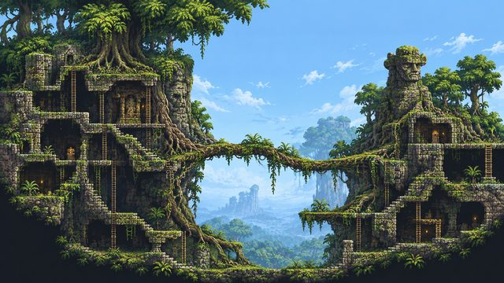

# Twin Ravine Temples - source-led R2 CyberSand canvas

**2048 x 2048 | DRAFT / HOLD | NOT native or owner accepted.** This R2 exists only on PR #14's branch. Archived R1 was merged into main for historical preservation, not acceptance.

## Reference provenance and composition

- Public catalogue ID: `ruins-0013`, source key `batch1/image-0212`.
- Genuine source: `artwork/ruins_monuments/batch1/rootbound_guardians-twin_ravine_temples-suspended_tension.png` (Git blob `0611d05df37b443a411c1ebf9dba663082e25975`).
- **Genuinely visually inspected** unaltered source JPEG derivative: `source-reference-preview.jpg` (Git blob `adfb56729b2c443a513892fbe803718dc8b71e52`). Direct visual comparison with the true-grid output; **full-resolution PNG pixel parity unverified**.

| Original source JPEG | Exact authored material-cell world (2048 x 2048 PNG) |
|---|---|
|  |  |

The source's big rooted west cliff, smaller east guardian shrine, one suspended root crossing and open central sky define the actual authored geometry. The R1 mirrored five-tier gallery format, floating masks, three viaducts and artificial boxed moonwater pool are gone. The west contains two unequal shrine rooms, deep root chambers and eccentric stepped terraces; the east contains one integral carved ridge guardian, distinct eroded rooms, a small crown tree and a lower rooted spur. Open sky and air routes occupy the asymmetric inter-cliff gap down to the genuine valley floor.

## Actual map evidence

**West canopy and roots** - native 512 x 512 material cells


**West shrine threshold** - native 512 x 512 material cells


**Living bridge** - native 512 x 512 material cells


**East integrated stone guardian** - native 512 x 512 material cells


**East lower sanctuaries** - native 512 x 512 material cells


**Lower root passages** - native 512 x 512 material cells


**Ravine floor and return** - native 512 x 512 material cells


A separate 1024 x 1024 diagnostic downsample is `twin-ravine-temples-preview.png`. All nine PNGs are reconstructed from **the same committed Setup-v2 material plane**, not AI-generated illustration or an original image pasted on top.

## Static admission - accepted CyberSand main `018bd09503d7f079ddac52e225c2f7daf8d678bf`

| Gate | Exact result |
|---|---|
| Setup-v2 extent | 2048 x 2048 = 4,194,304 cells |
| Rectangle records | 13387 / 32,768 |
| Serialized JSON | 256936 / 1,048,576 bytes |
| Final grid replay vs deterministic builder | 0 mismatches, no overlapping/out-of-bounds records |
| Stable material law | IDs 0, 38, 40, 41, 42, 49, 52, 100, 101; no reactive, powder, growing or Water cells |
| Midge actual hull | 4 x 3; unchanged spawn [1024,454] |
| Exact named R2 operational sites | 20/20 connected at 19x15, 23x19 and 31x27 clearance |
| Fully-in-bounds connected legal centres | 2,184,360 (19x15); 2,137,970 (23x19); 2,046,793 (31x27) |
| R1 exact positional regressions | 12/17 retained, 5 intentionally superseded by redesigned shrines; no waiver or nearest site substitution |
| PNG integrity and material parity | 9/9 CRC/zlib/IEND pass; zero displayed pixel mismatches |
| Native runtime / save-reopen | **NATIVE-UNTESTED** |

Meaningful operational centres and complete material histogram are in `evidence.json`. These clearance counts use only *fully-in-bounds* actor envelopes, four-neighbour BFS and every nonempty cell as an obstacle. Actual movement/thrust/rotational collision and native installed setup are **not** proven by these static checks.

## Rebuild and verify

Use Node 18+ in this folder:

```powershell
node -e "const fs=require('fs'),{generate,template}=require('./builder.cjs');const r=generate(template);fs.writeFileSync('setup-twin-ravine-temples.json',r.json);fs.writeFileSync('twin-ravine-temples-preview.png',r.png);for(const [name,png] of Object.entries(r.details))fs.writeFileSync(name,png)"
node verify-r2.cjs
```

The run is deterministic with seed 20261117. Existing PR #14 branch only; original source JPEG/PNG, CyberSand engine and archived main remain untouched. The JSON is a standalone Workbench Setup-v2 start with the preserved actor model/hash and spawn; install into a source-matched native Workbench to complete physical evaluation. No Godot, Rapier movement, long simulation or save/reopen was exercised.
