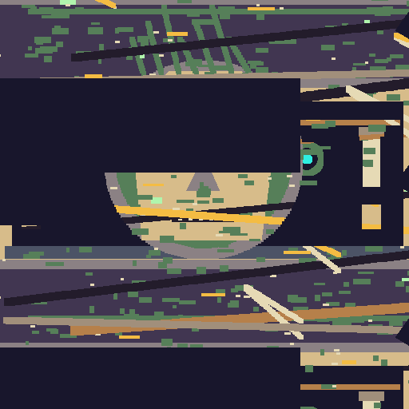

# Twin Ravine Temples — CyberSand 2048×2048

**DRAFT / HOLD · owner playtest required · never merge without approval.**

Original reference: [artwork/ruins_monuments/batch1/rootbound_guardians-twin_ravine_temples-suspended_tension.png](https://github.com/techrote/sandmapsreference/blob/main/artwork/ruins_monuments/batch1/rootbound_guardians-twin_ravine_temples-suspended_tension.png) · public ID **ruins-0013** · source key **batch1/image-0212** · Git blob **0611d05df37b443a411c1ebf9dba663082e25975** · original SHA-256 **47f4039fb0547f6799b0e3b445a12869e1a7dc5904c68e1725d2ba2d52aa5bdb**. Original image dimensions and direct pixel comparison could not be independently verified in this run because the binary source was unavailable to the generator; the title, catalogue identity and geometry are the sourced visual premise.

The 2048² level interprets the reference's twin ravine shrines as **two separate cliff-bound temple wings**, with guardian reliefs, root-bound mineral ledges, three masonry/root crossings, conservative flying bypass shafts, underground galleries and a contained turquoise moonwater basin. 2D orthographic geometry only. The original reference PNG is not used as scenery, engine background or actual material pixels.

## Loading

1. Copy `setup-twin-ravine-temples.json` into the Workbench setup location: `%APPDATA%\\Godot\\app_userdata\\Cyber Sand Reference Sandbox\\workbench\\` on Windows (verify the installed Workbench user-data path).
2. Open Workbench and select the start `twin-ravine-temples`. Install into the Workbench and play as the selected Midge.
3. Do not treat static material rendering as a native test: exercise Godot, Rapier, actor control and save/reopen on physical Windows 11.

## Static qualification

- CyberSand authority: [accepted main `018bd09503d7f079ddac52e225c2f7daf8d678bf`](https://github.com/techrote/cybersand/tree/018bd09503d7f079ddac52e225c2f7daf8d678bf).
- Real Workbench setup-v2 extent: **2048×2048**; the material plane is reconstructed losslessly from 5-field rectangle edits.
- 28,733 rectangles / 32,768; 545,894 UTF-8 JSON bytes / 1,048,576.
- Conservative **19×15** actor clearance: 17/17 **original exact centres** reached; spawn 1024, 454. Waypoint substitutions: **none**; any unreachable site makes the builder fail. Independent recheck: 1,620,906 connected legal Midge centres.
- Full material-equivalence check: 4,194,304 / 4,194,304 cells.
- Stable structural materials predominate; actual Water is retained inside a reinforced basin with solid liner. No spreading live Plant/Fungus components.

## Reproducibility

Run `node -e "const fs=require('fs'),{generate,template}=require('./builder.cjs');const r=generate(template);fs.writeFileSync('setup-twin-ravine-temples.json',r.json);fs.writeFileSync('twin-ravine-temples-preview.png',r.png);for(const [name,png] of Object.entries(r.details))fs.writeFileSync(name,png);fs.writeFileSync('evidence.json',JSON.stringify(r.stats,null,2)+'\\n');console.log(r.stats)"` from this directory with Node 18+.

The committed PNG is a **1024×1024, 4-bit indexed material-cell preview** sampled from the exact 2048² authored array; it is not a tracing or AI-generated image. See `evidence.json` for collision clearance, waypoints and budget evidence.

**Unqualified:** direct visual fidelity against the original PNG, physical Godot/native/Rapier launch, actor input/collision, simulation progression, and save/reopen. These require owner/independent validation and must not be described as passed.

## Reworker B substantive geometry repair — 17 November 2026

Original review [PR #4](https://github.com/techrote/sandmapsreference/pull/4#issuecomment-6938539932), starting HEAD `4290ae939e0792566ff753b05639c0b20bda2ea0`. This remains a **Draft / HOLD** research canvas. The deterministic builder was materially revised rather than painting a more attractive preview over unchanged terrain.

- Created **large, asymmetric chiseled guardian projections** after the original giant air-route punches (which previously erased much of the small guardian carvings). One is a rooted calcite elder with a broken jaw and moss crown; the other is a faceted sun oracle with bronze features. The original half-ruined gallery reliefs remain as older embedded fragments. Short roots and tendrils are kept out of the conservative service shaft clearance.
- Differentiated west/east cliff ornament language: west has irregular root/fossil seams and moss strata; east uses angular bronze, amber and obsidian tracery. Created eroded exterior alcoves and diverse native material props.
- Gave all three crossings distinguishable parapets, braces, intentionally broken segments and suspended tension roots; cut a **true open-air passage through the third bridge** to keep the Moonwater Basin lookout at its original exact location.
- Restored the two guardian portal envelopes and replaced the old ±80-cell *nearest destination substitution* with a hard assertion on all 17 named exact coordinates.
- Replaced unsupported/unverified material **1** (formerly used as the basin liner) with Workbench's documented **Hard Wall 58**; all **26,928 original Water cells** remain retained in the lower basin. This replacement is source-code-grounded, **not** a substitute for actual native material qualification.
- Fixed the overview sampler's second-pixel horizontal stride from +4 to +2 to represent the intended adjacent 2×-downsampled material cell. The PNG is a real authored-cell render, not a repaint.

### Repaired PNG review gallery

Static requalification used the current exact JSON plus an **independent second** 4,194,304-cell reconstruction/histogram and full 19×15 four-neighbour conservative reachability scan: 1,620,906 connected legal centres and **17/17 original declared exact sites**, no offsets. The repaired JSON is 545,894 bytes, 28,733 rectangles. The committed PNG and four native-cell crops all derive from the final authored cell array.

**Still not qualified:** pixel-accurate original source-art similarity (original binary not directly inspected), native Godot/CyberDemoBridge/Rapier input or progression, installed material-ID/actor-definition hashes, physical collision checks or Workbench save/reopen. Owner and independent Shepherd acceptance remain required.