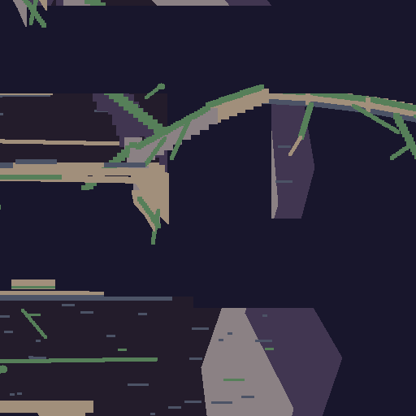
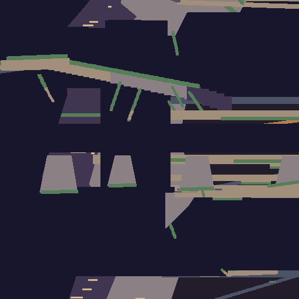
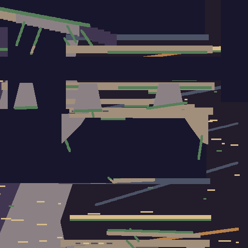
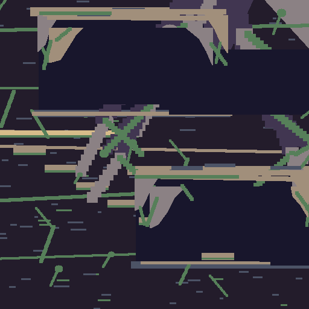
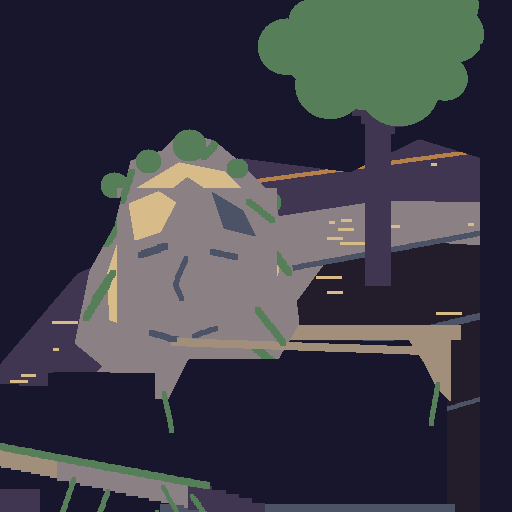
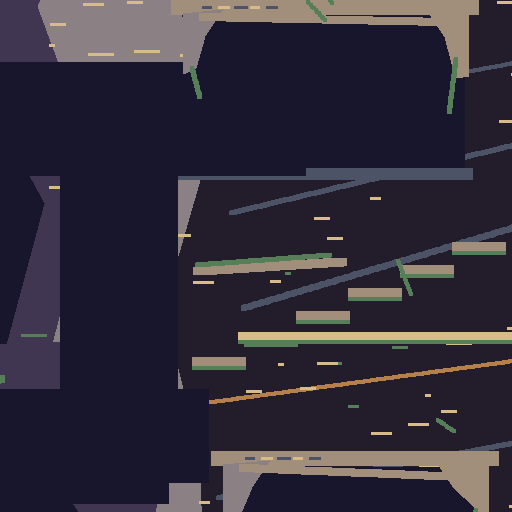
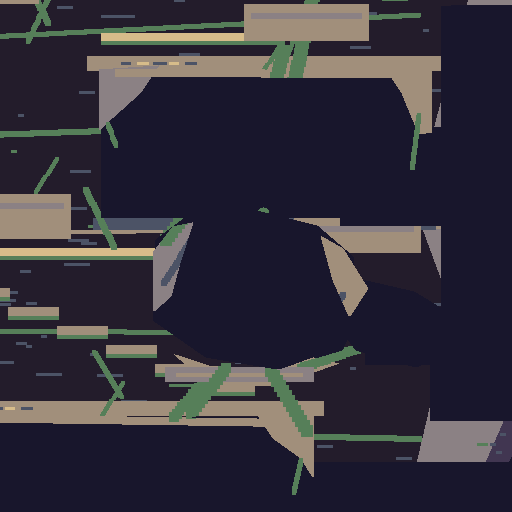

## R2B-P1 targeted source-art follow-on — 17 November 2026

**Assigned parent HEAD:** `85c3ef0166004cd9480d3b1b933d51045d2e19f2` on PR #14. The Shepherd's four-neighbour bridge repair acceptance remains valid: the **single continuous 1,726,673-cell solid structural component** still contains the west attachment, centre span, eastern seam and both rooted banks. This follow-on changed **128,145 actual material cells**, without altering source art, accepted CyberSand main, archived history, or source identity.

**Specific artistic changes:** Replaced eleven repeated radiating tree-root spokes with three thick asymmetrically forked west root buttresses and unequal branching tendrils. The first two west shrine entrances now have asymmetrical weathered stone voussoirs, broken lintels, differentiated chipped thresholds and rooted detail rather than identical flat black mouths. The east guardian is shorter, wider, ridge-embedded, chipped and moss-crowned rather than a pointed decorative mask. Unequal physically supported piers and vegetated courses articulate the visible lower east spandrel. The bridge's mechanically repeated hanging V roots are replaced with fewer variable forks; source-shaped western crown shadows and eastern terrace details are added. All compositions remain strict orthographic side elevation.

**Proven static gates:** Setup-v2 2048×2048 (4,194,304 cells), **14,400/32,768** coalesced nonoverlapping rectangles, **275,852/1,048,576** JSON bytes. Zero invalid/unsupported/reactive/powder/liquid material IDs: only 38, 40, 41, 42, 49, 52, 100 and 101 as accepted-main inert Solid / RuleKernel::None. 20/20 exact named sites connected at Midge-envelope 19×15, 23×19, 31×27, fully in-bounds; connected legal-centre counts **2,147,121 / 2,095,230 / 1,992,550**. No positional workaround. Every cell of the x1435..2047/y757..805 49-high undercroft and x1992..2047/y251..850 56-wide chimney remains Empty. The nine solid bridge probes' parent claim is superseded by actual four-neighbour five-probe verification: (1070,705), (586,745), (1455,655), (1580,680), (1770,730).

**Rebuilt grid evidence:** deterministic Setup-v2 and all **12 genuine cell-grid PNGs** regenerated. Independent binary CRC, stored-deflate, Adler32/IEND and exact material pixel readback validated **7,864,320 rendered cells**, zero mismatches. Double generation byte-identical. Directly compared unchanged repository source JPEG (blob `adfb56729b2c443a513892fbe803718dc8b71e52`) with actual-cell overview and affected district crops; original full-resolution PNG pixel parity remains **UNVERIFIED**.

**Outstanding:** True full-resolution original-PNG parity, independent final artistic review, native Godot/CyberDemoBridge/Rapier install/actor input/collision, bounded simulation and fresh-process save/reopen are **NOT TESTED**. The right-bank undercroft and exterior chimney deliberately weaken the reference's continuous cliff silhouette to preserve reachable lower flight with a solid-connected crossing; this tradeoff remains for owner and Shepherd review. The square lower valley is artistic interpretation of a landscape preview, not direct-pixel reconstruction. **DRAFT / HOLD — no owner acceptance.**

---

# Twin Ravine Temples - source-led R2 CyberSand canvas

**2048 x 2048 | DRAFT / HOLD | NOT native or owner accepted.** This R2 exists only on PR #14's branch. Archived R1 was merged into main for historical preservation, not acceptance.


## Shepherd P0/P1 rework — final actual-cell geometry

Following the exact-HEAD Shepherd finding at \`abb91db611255eaa914117805bb7126d3e664243\`, the **floating living-bridge island has been physically joined to both banks in the final 8-neighbour material-cell plane**. Its bridge seed (1070,705), west-root attachment (586,745), right-deck seam (1455,655) and eastern sanctuary attachment (1770,730) are in **one 1,726,790-cell component**, verified from packed JSON, not inferred from the builder's drawing order.

A solid spanning bridge between two floor-rooted cliffs would enclose the lower ravine in a strict 2D collision world. Therefore this pass makes the smaller eastern temple a **cantilevered cliff cap above a narrow open service undercroft (x1435..2047, y757..805)**, reached by an outboard **56-cell-wide flight chimney (x1992..2047, y251..850)**. Both features are real Empty cells. The six named bypass air checkpoints remain reachable with conservative fully-contained **19×15, 23×19 and 31×27** Midge envelopes; all **20 original R2 operational coordinates** remain reachable. This is an explicit source-composition tradeoff for independent artistic review, **not** a waypoint waiver.

The west/east shrine thresholds now use unequal arch spandrels and supported moss growth, and the guardian is chiseled into a weathered ridge relief rather than a pale cartoon face. The original full-resolution source PNG remains unmodified and pixel parity is UNVERIFIED. Godot/CyberDemoBridge/Rapier native installation, movement and save/reopen remain **NATIVE-UNTESTED**.

**Current exact-plane gates:** 2048×2048 = 4,194,304 cells; **15,734/32,768** nonoverlapping packed rectangles, **299,950/1,048,576** JSON bytes, **zero reconstruction/overlap mismatches**; accepted immutable Solid/None materials IDs **38, 40, 41, 42, 49, 52, 100, 101**, no hazards or active liquids. Fully-in-bounds connected Midge centres at 19×15 / 23×19 / 31×27: **2,147,401 / 2,095,406 / 1,992,845**. The historical R1 waypoints are retained at **12/17** at nominal 19×15; the five superseded original positions remain explicitly listed in \`evidence.json\`.

**New actual-grid evidence, native resolution 1:1:**

| West living-root landing | East living-root landing | East underside and chimney |
|:--:|:--:|:--:|
|  |  |  |

The original source JPEG, genuine full-map material-cell overview and the other seven previous district views below are regenerated/retained on this branch; **12/12 output PNGs** passed binary integrity and **7,864,320 actual material-pixel comparisons** with zero mismatches. Deterministic builder executed twice and produced byte-identical JSON and all PNGs.


## Reference provenance and composition

- Public catalogue ID: `ruins-0013`, source key `batch1/image-0212`.
- Genuine source: `artwork/ruins_monuments/batch1/rootbound_guardians-twin_ravine_temples-suspended_tension.png` (Git blob `0611d05df37b443a411c1ebf9dba663082e25975`).
- **Genuinely visually inspected** unaltered source JPEG derivative: `source-reference-preview.jpg` (Git blob `adfb56729b2c443a513892fbe803718dc8b71e52`). Direct visual comparison with the true-grid output; **full-resolution PNG pixel parity unverified**.

| Original source JPEG | Exact authored material-cell world (2048 x 2048 PNG) |
|---|---|
|  |  |

The source's big rooted west cliff, smaller east guardian shrine, one suspended root crossing and open central sky define the actual authored geometry. The R1 mirrored five-tier gallery format, floating masks, three viaducts and artificial boxed moonwater pool are gone. The west contains two unequal shrine rooms, deep root chambers and eccentric stepped terraces; the east contains one integral carved ridge guardian, distinct eroded rooms, a small crown tree and a lower rooted spur. Open sky and air routes occupy the asymmetric inter-cliff gap down to the genuine valley floor.

## Actual map evidence

**West canopy and roots** - native 512 x 512 material cells


**West shrine threshold** - native 512 x 512 material cells



**Living bridge** - native 512 x 512 material cells


**East integrated stone guardian** - native 512 x 512 material cells



**East lower sanctuaries** - native 512 x 512 material cells



**Lower root passages** - native 512 x 512 material cells



**Ravine floor and return** - native 512 x 512 material cells


A separate 1024 x 1024 diagnostic downsample is `twin-ravine-temples-preview.png`. All twelve PNGs are reconstructed from **the same committed Setup-v2 material plane**, not AI-generated illustration or an original image pasted on top.

## Static admission - accepted CyberSand main `018bd09503d7f079ddac52e225c2f7daf8d678bf`

| Gate | Exact result |
|---|---|
| Setup-v2 extent | 2048 x 2048 = 4,194,304 cells |
| Rectangle records | 15734 / 32,768 |
| Serialized JSON | 299950 / 1,048,576 bytes |
| Final grid replay vs deterministic builder | 0 mismatches, no overlapping/out-of-bounds records |
| Stable material law | IDs 0, 38, 40, 41, 42, 49, 52, 100, 101; no reactive, powder, growing or Water cells |
| Midge actual hull | 4 x 3; unchanged spawn [1024,454] |
| Exact named R2 operational sites | 20/20 connected at 19x15, 23x19 and 31x27 clearance |
| Fully-in-bounds connected legal centres | 2,147,401 (19x15); 2,095,406 (23x19); 1,992,845 (31x27) |
| R1 exact positional regressions | 12/17 retained, 5 intentionally superseded by redesigned shrines; no waiver or nearest site substitution |
| PNG integrity and material parity | 12/12 CRC/zlib/IEND pass; zero displayed pixel mismatches |
| Native runtime / save-reopen | **NATIVE-UNTESTED** |

Meaningful operational centres and complete material histogram are in `evidence.json`. These clearance counts use only *fully-in-bounds* actor envelopes, four-neighbour BFS and every nonempty cell as an obstacle. Actual movement/thrust/rotational collision and native installed setup are **not** proven by these static checks.

## Rebuild and verify

Use Node 18+ in this folder:

```powershell
node -e "const fs=require('fs'),{generate,template}=require('./builder.cjs');const r=generate(template);fs.writeFileSync('setup-twin-ravine-temples.json',r.json);fs.writeFileSync('twin-ravine-temples-preview.png',r.png);for(const [name,png] of Object.entries(r.details))fs.writeFileSync(name,png)"
node verify-r2.cjs
```

The run is deterministic with seed 20261117. Existing PR #14 branch only; original source JPEG/PNG, CyberSand engine and archived main remain untouched. The JSON is a standalone Workbench Setup-v2 start with the preserved actor model/hash and spawn; install into a source-matched native Workbench to complete physical evaluation. No Godot, Rapier movement, long simulation or save/reopen was exercised.
