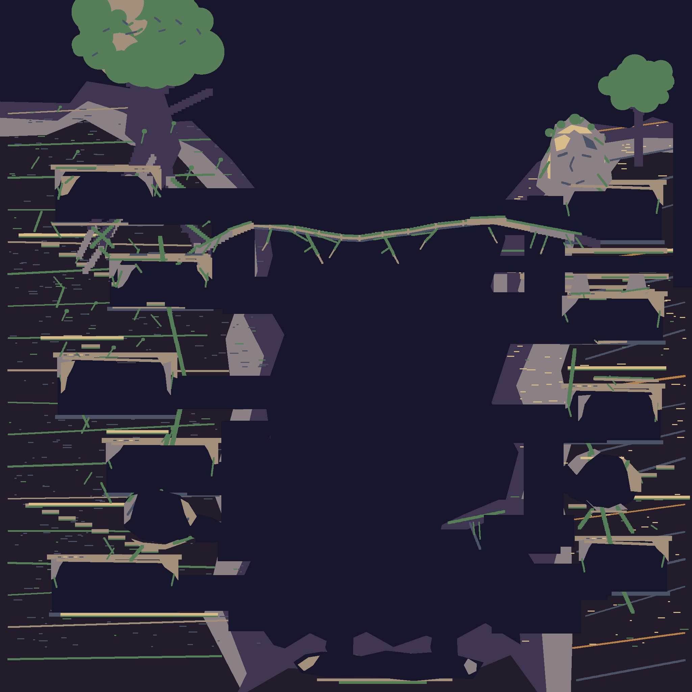
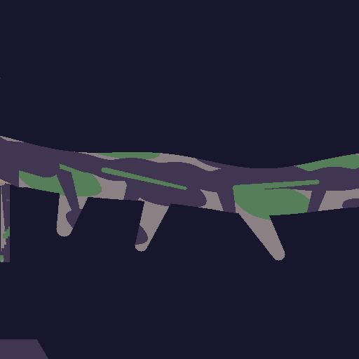

# R2A source-led lower-ravine finishing — current working artifact (18 November 2026)

**DRAFT / HOLD. Not merged, not Ready, not native qualified or owner accepted.**
This section supersedes numerical claims in the historical R2B summaries below.

**Source inspected:** actual committed `source-reference-preview.jpg` (Git blob `adfb56729b2c443a513892fbe803718dc8b71e52`) of the giant left tree, one living horizontal root bridge, unequal inhabited cliff sanctuaries and squat right guardian. Its full-resolution original PNG `artwork/ruins_monuments/batch1/rootbound_guardians-twin_ravine_temples-suspended_tension.png` is unchanged and **original-PNG pixel parity remains UNVERIFIED**. The 2048-square cell canvas is a stylised playable interpretation of this source, not an image-tracing claim.

**Actual authored-cell R2A repair (from assigned `dee3558aa17e0812228575c359a0ad1915b6a101`):**
- West root relay at x≈370–670, y≈1449–1627: carved asymmetric connected limestone/granite alcove, coupled to west terrace chamber and service shaft; root-moss trace over existing stone, with exact new flyable centre **(469,1515)**.
- East lantern archive at x≈1593–1897, y≈1328–1515: distinct eroded vaulted stone room and safe lateral corridor to established east shaft; exact centre **(1804,1433)**.
- Valley substrate return at x≈869–1430, y≈1843–2023: *ground-excavated* continuous hollow gallery, two separate skylight entries and stone/organic inlay. It is **not a second bridge** and leaves the original central flight gap open. New exact centre **(1145,1970)**.
- Selected west and east older shrine corners are recut into asymmetric supported voussoirs; root continuity is retinted on existing solid rather than painting unsupported floating lines. The only overhead root bridge retains both genuine bank joins and 4-neighbour physical structure.

**Exact static qualification after 132,587 changed material cells:** 2048×2048; **15,441 / 32,768** rectangles; **295,832 / 1,048,576** UTF-8 JSON bytes; independent exhaustive **4,194,304-cell** replay without overlap/invalid IDs; **1,663,020 occupied** cells. Only native accepted-main immovable Solid/RuleKernel::None IDs **38,40,41,42,49,52,100,101**. Original twenty and three new **exact** named sites: **23/23 at 19×15, 23×19 and 31×27**, from original Midge spawn (1024,454), in fully-in-bounds 4-neighbour air BFS, no nearest-point fallback. Free-centre components **2,218,488 / 2,161,862 / 2,049,896**. Four-neighbour physically joined bridge/bank component **1,615,209 cells**; established outside-air east bypass **6/6** at each envelope.

**Reproducibility/evidence:** two actual pure deterministic builder executions produced byte-identical Setup JSON and **all fifteen** indexed material-cell PNG files. Independent decode verified PNG chunk CRC, stored deflate block lengths, IEND, and **8,650,752 / 8,650,752** displayed material-palette pixels against final independent grid with **zero mismatches**. The committed `verify-r2.cjs` has corrected fixed output assertions and now requires strict four-neighbour solid joins and three new sites; the *Node CLI command itself has not been executed* in the isolated tool runtime, and should be run on a normal checkout (`node verify-r2.cjs`). Independent source-equivalent deterministic checks were actually performed. Genuine full-material overview, one 2× preview and **thirteen** native 512×512 district crops are committed, including:
[west root relay](temples-detail-west-root-relay.png), [east lantern archive](temples-detail-east-lantern-archive.png), [substrate return](temples-detail-valley-substrate.png), [complete original-resolution material cells](temples-material-2048.png), [overview](twin-ravine-temples-preview.png).
Exact machine-readable counts, image blob SHAs, CRCs, current sites and limitations: [evidence.json](evidence.json).

**Still HOLD:** genuine JPEG source visually inspected but full original PNG not decoded; stylised source-composition compromise including the eastern outside-air chimney remains for independent art review; installed native Godot/Workbench/CyberDemoBridge/Rapier capacity, Midge flight/physics, bounded simulation, and save/reopen **NATIVE-UNTESTED**. Historical twenty R2 sites are preserved; 17 R1 positional probes are not proxy acceptance destinations. No engine/art/historical-main mutations.

---

## Historical R2B notes retained below (not current numerical authority)

## R2B-P1 final validated source-art finishing (supersedes earlier counts)

**Start:** `85c3ef0166004cd9480d3b1b933d51045d2e19f2`, **new final revision** (see current PR HEAD). This branch preserves genuine committed source JPEG, historical R1, CyberSand main and draft status. Final full-grid source-inspired work changes **124,629 real material cells** from the Shepherd-assigned seed. The rebuilt west tree has three thick forked, connected buttresses rather than repeated comb roots; the first two shrine openings have unequal broken-stone arch shoulders and weathered thresholds; the ridge-embedded guardian is lower, broader, less regular and mossy; the living bridge hangs irregular forked rooted pendants; crown and east terraces use supported textured masonry.

**Structural correction:** The initial P1 preview revealed two isolated apparent spandrel piers; these were removed before the final owner-facing result, replacing their decorative material with recolouring of pre-existing stone. Only **two ground-connected east-bank spandrel piers** remain, with stone/moss courses to visually break the exposed undercroft. This explicitly avoids new decorative floating solids while preserving unobstructed **x1435..2047/y757..805** undercroft and **x1992..2047/y251..850** exterior air chimney. Source-versus-playability compromise remains visible and requires owner review.

**Requalification:** 2048×2048 / 4,194,304 material cells, **14,356/32,768** nonoverlapping integral rectangles, **275,012/1,048,576** JSON bytes; zero replay mismatches; accepted inert IDs only 38,40,41,42,49,52,100,101, no active/unstable materials. Four-neighbour bridge/bank connection **1,726,673** solid cells including both banks and east seam. Exact 20/20 Midge air destinations at 19×15, 23×19, 31×27, with legal-centre graph sizes **2,152,140 / 2,100,641 / 1,998,608**; no hidden fallback. Source JPEG `adfb56729b2c443a513892fbe803718dc8b71e52` visually inspected against committed grid PNGs, **original full PNG pixel parity UNVERIFIED**. All 12 genuine material-plane PNGs regenerated and integrity-checked, 7,864,320 displayed-pixel comparisons, no mismatch; two deterministic runs identical. **NATIVE-UNTESTED:** no actual Godot/CyberDemoBridge/Rapier input, collision, simulation or save/reopen. **Draft/HOLD** — independent Shepherd/owner judgment still required.

---

 Twin Ravine Temples - source-led R2 CyberSand canvas

**2048 x 2048 | DRAFT / HOLD | NOT native or owner accepted.** This R2 exists only on PR #14's branch. Archived R1 was merged into main for historical preservation, not acceptance.


## Shepherd P0/P1 rework — final actual-cell geometry

Following the exact-HEAD Shepherd finding at \`abb91db611255eaa914117805bb7126d3e664243\`, the **floating living-bridge island has been physically joined to both banks in the final 8-neighbour material-cell plane**. Its bridge seed (1070,705), west-root attachment (586,745), right-deck seam (1455,655) and eastern sanctuary attachment (1770,730) are in **one 1,726,790-cell component**, verified from packed JSON, not inferred from the builder's drawing order.

A solid spanning bridge between two floor-rooted cliffs would enclose the lower ravine in a strict 2D collision world. Therefore this pass makes the smaller eastern temple a **cantilevered cliff cap above a narrow open service undercroft (x1435..2047, y757..805)**, reached by an outboard **56-cell-wide flight chimney (x1992..2047, y251..850)**. Both features are real Empty cells. The six named bypass air checkpoints remain reachable with conservative fully-contained **19×15, 23×19 and 31×27** Midge envelopes; all **20 original R2 operational coordinates** remain reachable. This is an explicit source-composition tradeoff for independent artistic review, **not** a waypoint waiver.

The west/east shrine thresholds now use unequal arch spandrels and supported moss growth, and the guardian is chiseled into a weathered ridge relief rather than a pale cartoon face. The original full-resolution source PNG remains unmodified and pixel parity is UNVERIFIED. Godot/CyberDemoBridge/Rapier native installation, movement and save/reopen remain **NATIVE-UNTESTED**.

**Current exact-plane gates:** 2048×2048 = 4,194,304 cells; **15,734/32,768** nonoverlapping packed rectangles, **299,950/1,048,576** JSON bytes, **zero reconstruction/overlap mismatches**; accepted immutable Solid/None materials IDs **38, 40, 41, 42, 49, 52, 100, 101**, no hazards or active liquids. Fully-in-bounds connected Midge centres at 19×15 / 23×19 / 31×27: **2,147,401 / 2,095,406 / 1,992,845**. The historical R1 waypoints are retained at **12/17** at nominal 19×15; the five superseded original positions remain explicitly listed in \`evidence.json\`.

**New actual-grid evidence, native resolution 1:1:**

| West living-root landing | East living-root landing | East underside and chimney |
|:--:|:--:|:--:|
|  |  |  |

The original source JPEG, genuine full-map material-cell overview and the other seven previous district views below are regenerated/retained on this branch; **12/12 output PNGs** passed binary integrity and **7,864,320 actual material-pixel comparisons** with zero mismatches. Deterministic builder executed twice and produced byte-identical JSON and all PNGs.


## Reference provenance and composition

- Public catalogue ID: `ruins-0013`, source key `batch1/image-0212`.
- Genuine source: `artwork/ruins_monuments/batch1/rootbound_guardians-twin_ravine_temples-suspended_tension.png` (Git blob `0611d05df37b443a411c1ebf9dba663082e25975`).
- **Genuinely visually inspected** unaltered source JPEG derivative: `source-reference-preview.jpg` (Git blob `adfb56729b2c443a513892fbe803718dc8b71e52`). Direct visual comparison with the true-grid output; **full-resolution PNG pixel parity unverified**.

| Original source JPEG | Exact authored material-cell world (2048 x 2048 PNG) |
|---|---|
|  |  |

The source's big rooted west cliff, smaller east guardian shrine, one suspended root crossing and open central sky define the actual authored geometry. The R1 mirrored five-tier gallery format, floating masks, three viaducts and artificial boxed moonwater pool are gone. The west contains two unequal shrine rooms, deep root chambers and eccentric stepped terraces; the east contains one integral carved ridge guardian, distinct eroded rooms, a small crown tree and a lower rooted spur. Open sky and air routes occupy the asymmetric inter-cliff gap down to the genuine valley floor.

## Actual map evidence

**West canopy and roots** - native 512 x 512 material cells


**West shrine threshold** - native 512 x 512 material cells


**Living bridge** - native 512 x 512 material cells



**East integrated stone guardian** - native 512 x 512 material cells


**East lower sanctuaries** - native 512 x 512 material cells


**Lower root passages** - native 512 x 512 material cells


**Ravine floor and return** - native 512 x 512 material cells


A separate 1024 x 1024 diagnostic downsample is `twin-ravine-temples-preview.png`. All twelve PNGs are reconstructed from **the same committed Setup-v2 material plane**, not AI-generated illustration or an original image pasted on top.

## Static admission - accepted CyberSand main `018bd09503d7f079ddac52e225c2f7daf8d678bf`

| Gate | Exact result |
|---|---|
| Setup-v2 extent | 2048 x 2048 = 4,194,304 cells |
| Rectangle records | 15734 / 32,768 |
| Serialized JSON | 299950 / 1,048,576 bytes |
| Final grid replay vs deterministic builder | 0 mismatches, no overlapping/out-of-bounds records |
| Stable material law | IDs 0, 38, 40, 41, 42, 49, 52, 100, 101; no reactive, powder, growing or Water cells |
| Midge actual hull | 4 x 3; unchanged spawn [1024,454] |
| Exact named R2 operational sites | 20/20 connected at 19x15, 23x19 and 31x27 clearance |
| Fully-in-bounds connected legal centres | 2,147,401 (19x15); 2,095,406 (23x19); 1,992,845 (31x27) |
| R1 exact positional regressions | 12/17 retained, 5 intentionally superseded by redesigned shrines; no waiver or nearest site substitution |
| PNG integrity and material parity | 12/12 CRC/zlib/IEND pass; zero displayed pixel mismatches |
| Native runtime / save-reopen | **NATIVE-UNTESTED** |

Meaningful operational centres and complete material histogram are in `evidence.json`. These clearance counts use only *fully-in-bounds* actor envelopes, four-neighbour BFS and every nonempty cell as an obstacle. Actual movement/thrust/rotational collision and native installed setup are **not** proven by these static checks.

## Rebuild and verify

Use Node 18+ in this folder:

```powershell
node -e "const fs=require('fs'),{generate,template}=require('./builder.cjs');const r=generate(template);fs.writeFileSync('setup-twin-ravine-temples.json',r.json);fs.writeFileSync('twin-ravine-temples-preview.png',r.png);for(const [name,png] of Object.entries(r.details))fs.writeFileSync(name,png)"
node verify-r2.cjs
```

The run is deterministic with seed 20261117. Existing PR #14 branch only; original source JPEG/PNG, CyberSand engine and archived main remain untouched. The JSON is a standalone Workbench Setup-v2 start with the preserved actor model/hash and spawn; install into a source-matched native Workbench to complete physical evaluation. No Godot, Rapier movement, long simulation or save/reopen was exercised.
