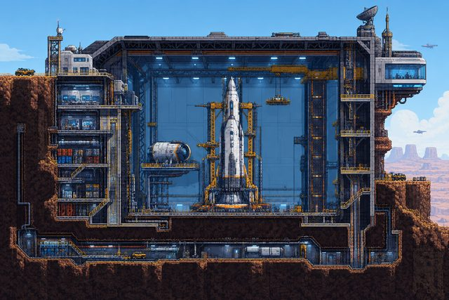

# Canvas rework R2 — WORKS-0023 Cliff-Cut Rocket Assembly Hall

**Draft / HOLD, fresh PR branch only; source and archived R1 kept untouched.** Historical owner-archived [PR #10](https://github.com/techrote/sandmapsreference/pull/10) is immutable prior work, not native accepted.

## Source image, committed directly beside this brief

Original unmodified source: [artwork/works_yards/batch1/orbital_assembly_hangars-rocket_assembly_hall-cool_precision.png](https://github.com/techrote/sandmapsreference/blob/198bf5bc793e59006b7ccc9e587971e3d9a857f9/artwork/works_yards/batch1/orbital_assembly_hangars-rocket_assembly_hall-cool_precision.png), Git blob `167c7873e9637cb3930fe7504a0e463cbfe8983e`. Included small JPEG blob `0b7872f4869c70dd2463f58dda48bfeda0d1e315` copied byte-for-byte from gh-pages preview, not newly drawn artwork. Historical R1 authored-cell [preview](preview.png).

## Exact reference-specific repair targets

Original shows a single huge **cliff-cut industrial blue rocket assembly hangar** with a *continuous wide overhead truss/gantry roof*, strong left-side cliff-bank infrastructure, tall central silver rocket on service cradle, differentiated supporting crossbeam cranes and yellow hoists, a **cantilevered glazed control deck/projecting pod on the top-right rock face**, subtly terraced west assembly shops, right-side tower/service elevators, and a **long lower below-floor access tunnel** in dark excavated rock. Current map retains rocket and galleries, but shifts toward a very regular set of dark left/right room tiers and under-emphasizes overhanging right-glass pod, roof span and massive rock silhouette.

- **P0 macro silhouette**: establish one continuous dominating overhead truss roof with convincingly engineered cross-members and access gantries; preserve central rocket, cradle and dual boosters. Restore asymmetric side banks: left workshops as excavated rock mass, right cantilevered observation room and vertical service tower.
- **P0 flight/gameplay**: preserve valid central high-bay, actual access to service arms/roof, multiple control-room stations and a continuous lower cargo/personnel route, with alternatives/recovery for Midge; no decorative collision snags or blocked doors.
- **P1 distinct industrial function**: cranes, yellow hoists, supporting traverse rails, platforms at different heights, a readable engine/booster build station on left and a glazed mission/telemetry control pod on right. Avoid rows of identically sized tool closets.
- **P1 visual texture**: more cool blue-metal hangar wall hierarchy, grounded ochre cliff rock and selective warm amber machinery. Maintain proper 2D orthographic side elevation, not fake platform tops/perspective.
- **P0 material/format**: strict original 2048×2048; accepted engine main Setup-v2/generated start, valid native material enum and stable physical laws, true Midge hull clearance at exact declared operational sites, correct byte/rectangle/material-cell budgets.
- **P0 evidence**: deterministic builder with final full-plane replay, authored-grid full-map PNG and >=3 1:1 crops of roof/truss, rocket/hoist, cantilevered deck, tunnel; exact-HEAD correctness report. Native test only if actually executed, otherwise NATIVE-UNTESTED.

This initial PR commit adds **the actual source JPEG and brief only**. Reworker B must implement subsequent material-cell edits on this exact PR, without changing engine, source PNG or historical PR. Shepherd/owner gate acceptance.
