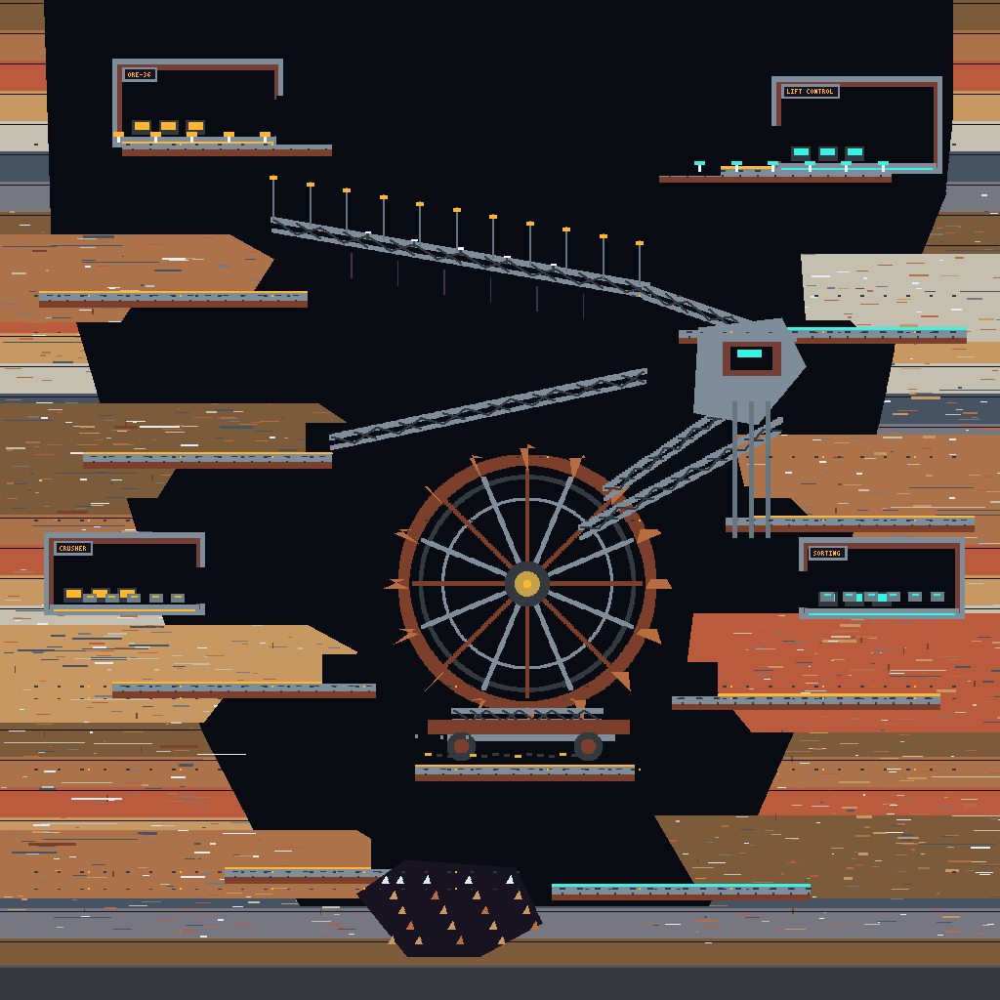

# WORKS-0036 · Dry-Magnitude Bucketwheel Quarry — CyberSand 2048×2048

**Draft / HOLD. Do not merge or promote to Ready before owner playtest.**

## Provenance
- Source reference: [`artwork/works_yards/batch1/terraced_orefields-bucketwheel_quarry-dry_magnitude.png`](https://github.com/techrote/sandmapsreference/blob/main/artwork/works_yards/batch1/terraced_orefields-bucketwheel_quarry-dry_magnitude.png)
- Public ID: **works-0036**; source key: `batch1/image-0081`.
- Git object SHA: `a96b91af219962dd219ffe3b8ea48f2d0668eda9`; catalogue/source-map SHA-256: `9307625500b4026ad09e24c3fc953da2a37a855ad4eea76869863900931ccc59`.
- Reference image dimensions: **not independently available** in the current tool runtime (image asset is binary and inaccessible to the canvas builder); original image must be visually compared during owner/shepherd review.
- Engine schema authority: [CyberSand `main` at `018bd09503d7f079ddac52e225c2f7daf8d678bf`](https://github.com/techrote/cybersand/tree/018bd09503d7f079ddac52e225c2f7daf8d678bf).

## Design translation
Instead of rasterising the source, the builder creates a side-elevation open-cut quarry with terraced iron-rich geology, elevated ore-yard shacks and crusher galleries, steel conveyors and hanging sensors, an overscale bucket wheel and wheel-support gantry, a hoist/control wing, ore veins and a deep extraction seam. Routes link upper service terraces with the excavator, side benches and deep transit using broad flight volume. The dry-quarry theme is intentional: no live sand or uncontrolled liquid is spawned.

The raw material plane, not this illustration, is the playable CyberSand terrain. The PNG is a **1024×1024 full-area overview** sampled directly from the exact 2048×2048 authoritative material cells.



## Install and playtest
Copy `setup-bucketwheel-quarry.json` to the running CyberSand project's `user://workbench/setup-bucketwheel-quarry.json`, use its ordinary Workbench setup loader and select **bucketwheel-quarry**. Confirm that the native bridge advertises at least 13,658 start rectangles (current source permits 32,768; an older native library can cap at 4,096). Spawn is the current Midge, with a 1.5× boost multiplier. This is a regular Workbench setup **version 2**, not a generated-start wrapper.

## Static qualification (builder's in-memory reconstruction)
| Check | Result |
|---|---:|
| Exact terrain extent | 2048×2048 |
| 5-field material rectangles | 13,658 / 32,768 |
| JSON UTF-8 bytes | 262,013 / 1,048,576 |
| Reconstructed material cells equal authored plane | 4,194,304 / 4,194,304 |
| Conservative clearance envelope | 19×15 cells |
| Reachable named destinations from Midge spawn | 14 / 14 |
| Largest destination waypoint adjustment | 50 cells |
| Native Workbench / Rapier exercise | **Not run** |
| Direct source PNG visual comparison | **Not run** |

Static clearance uses a summed-area blocked-cell mask for the entire 19×15 envelope, then a flood-fill over the legal center positions. The preview is reconstructed only from the authored material plane. See `evidence.json` for all waypoints and counts.

## Reproducible builder
Run from this directory with Node.js:
```powershell
node -e "const fs=require('fs'),{generate}=require('./builder.cjs');const a=generate();fs.writeFileSync('setup-bucketwheel-quarry.json',a.json);fs.writeFileSync('bucketwheel-quarry-preview.png',a.png);fs.writeFileSync('evidence.json',JSON.stringify(a.stats,null,2)+'\n');console.log(a.stats)"
```

No bitmap is imported as level geometry. Geology, platforms, wheel, truss, rooms and detail are computed from a fixed seed; rectangle vertical coalescing is lossless. **Open questions for owner/shepherd:** physical Windows/Godot/Native load, exact material catalogue admission in the installed native bridge, real flight/input/collision and save/reopen; independent comparison against the original source image. These are not claimed as passes.
